# Air fryer: open the drawer, put the banana in, close it

Imported from session `20261004T131834Z_air_fry_pan_dbb6a4` (2026-10-04, 09:18-12:05 local time). The operator
asked (TASK.md): "You should open the air fry pan, put the banana inside, and close it. Reminder: the plate is
really heavy and you should figure out where to grasp and the force applied. Also if the position of the air fry
pan is out of range you may ask for operator reset. Be careful about the forces and maybe not pull out the plate
entirely so we do not have to lift it in everytime." The agent did the task once by hand (run 1). Then it wrote the
controller (10 versions in the session) and ran it in nine more episodes. Runs 6, 7, 9 and 10 were clean unattended
successes. For the last episode the operator added an orange ball. This skill combines the session's three memory
notes (drawer open/close, tilted banana drop, re-registering a bumped camera), its TIPS/PROGRESS/RUNS and the
code README.

## When to use
- A white basket air fryer with a pull-out drawer and a black Γ-shaped handle stands on the table, with the handle
  facing the robot side. The handle has a horizontal bar on top of the drawer front and a grip hanging from the
  bar's outer end. The drawer is closed. A banana lies flat on the table (and optionally a small orange ball).
- Tested scene (all on one rig, one day):
  - table top z ≈ 0.09 m in the base frame;
  - fryer about 0.32 m tall (lid top z ≈ 0.415), upper body radius ≈ 0.115 m, dark lid circle radius ≈ 0.062 m,
    body seam z ≈ 0.245;
  - handle bar top z 0.256-0.265 (measured), grip about 3.4 cm wide and z 0.13-0.24;
  - basket rim radius 0.103-0.105 m (measured), rim z ≈ 0.235-0.245, grill plate z ≈ 0.135.
- Fryer placements run on the robot (axis xy, pull direction d = axis → handle, measured from +x):
  - (0.608-0.617, -0.209..-0.216), d 140.6-142.2 deg: runs 2-6;
  - (0.672, -0.172), d 143.5 deg: run 7;
  - (0.637-0.639, -0.217..-0.218), d 158.4-158.7 deg, handle toward the robot base: runs 8-9;
  - (0.634, -0.204), d 144.5 deg: run 10.
  An offline reachability map, not run on the robot, was feasible for axis x 0.56-0.71, y -0.29..-0.13 and
  d 122-162 deg, except the corner where the fryer is near the robot and turned toward it.
- Banana: chord 0.168-0.181 m, sagitta ≈ 2.8 cm, ≈ 3.5 cm thick, lying flat to the robot's left of the fryer. Tested
  middles: x 0.48-0.64, y 0.27-0.32, in several orientations. Ball: orange, r ≈ 2.7 cm, at (0.563, 0.089), run once.
- Cameras:
  - left exterior RGB-D camera at ≈ (0.25, 0.38, 0.51), looking toward +x / -y over the table (1280x720);
  - wrist camera on the hand.
  The right exterior camera was not used after run 2 (see Failure modes).
- Not for:
  - a drawer that is already open: the code refuses when the grip protrudes more than 6.5 cm; use `resume` with an
    earlier run of the same scene;
  - a handle facing away from the robot, or a fryer of a different height: the code searches fixed height windows
    for the lid (z 0.37-0.43), body (0.30-0.40) and handle bar top (0.24-0.29);
  - other colours: the HSV thresholds are dark lid/handle, white body, yellow banana, orange ball;
  - a banana within ~15 cm of the left camera mount: at (0.50, 0.43) the pick brought the forearm within 8 mm of
    the camera keep-out, so the operator moved it;
  - taking the banana back out: the hand does not fit into the 12.5 cm opening, so the operator emptied the
    basket between episodes.

## Preconditions
Checked by the code before it touches the fryer (only the prepare and viewing moves come first); on a failed check it
stops with `ok: False` and the reason in `why`:
- Motion is armed (`franka_status`), and the gripper holds nothing (`is_grasped` false at start).
- The left camera at the home pose sees the fryer:
  - lid: >= 300 dark points at z 0.37-0.43;
  - body: >= 500 white points at z 0.30-0.40, fitted radius 0.08-0.16 m;
  - handle grip: >= 200 dark points 2-12 cm outside the body;
  - grip outer face measured at z 0.14 and 0.22.
- Wrist top view over the lid, from one of three fallback poses: >= 2000 lid points with circle radius 0.045-0.08,
  and >= 300 handle-bar points. Its pull direction must agree with the side view within 12 deg.
- Drawer closed: grip face minus body front <= 0.065 m (closed reads 0.047-0.059). Handle bar top in 0.24-0.29.
- Banana found (>= 300 yellow points, chord 0.13-0.21 m), from the left camera or else a wrist view of the table.
  This holds for every `steps`, including `none`. Ball (only if requested): >= 150 orange points.
- Every planned configuration passes two checks:
  - local FR3 IK in a "natural" posture: elbow within 10 cm of the vertical plane through the base and the target,
    and |j3| < 1;
  - joint margin >= 0.15 rad from the Panda/FR3 limit intersection, and >= 8 mm clearance from a capsule model of
    the fryer (open or closed), table, held object and exterior-camera keep-outs.
  Joint paths to the main poses are sampled for clearance before the move.

## Procedure
Frame of the fryer: c = vertical axis from the lid circle, d = horizontal unit vector from the axis to the handle (the
pull direction), t = z x d. Run 1 learned the handle offsets, which are kept relative to the measured grip face at
z 0.22.
1. **prepare**: open the gripper; if the TCP is below z 0.30, lift it 12 cm; go home. Long joint moves are split
   because the service allows at most 1.5 rad per call.
2. **perceive**:
   - Left frame at home: fryer, faces, protrusion, banana (+ ball). The camera keep-outs are built from this frame.
   - Wrist top view, TCP = lid + (-0.07, 0.06, 0.20) with quaternion [1, 0, 0, 0]; fallbacks (-0.09, 0.05, 0.18)
     and (-0.11, 0.04, 0.16). The lid circle gives the axis, the handle bar gives d, its top height and lateral
     offset. One side view alone biased d by ~4 deg and the bar top by 1.5 cm.
3. **open**:
   - Grasp TCP = c + (face22 - 0.0116) d + grip_t t, at z = bar top - 0.009. The hand's z axis is tilted 5 deg from
     vertical toward the fryer, the fingers close along t, and the wrist camera is on the robot side.
   - Joint move to a pre-grasp 10 cm back along the approach axis, then a straight move to 4 cm. Final descent
     with 3 mm tolerance; a residual is accepted if it is < 6 mm vertical, < 8 mm lateral and < 15 mm along d (the
     pads still sit on the 5 cm bar); otherwise lift 8 cm and stop.
   - `grasp` width 0.025, 50 N, speed 0.04. The code polls the status until the fingers stop; it needs
     `is_grasped` and a width of 0.026-0.045 (measured 0.0340-0.0345).
   - Pull along d in 3 cm steps to absolute targets at a fixed z (grasp z - 6 mm), 5 mm tolerance. Relative moves
     sagged ~1 cm under the heavy drawer. Stop at 0.125 m, never all the way out. Open the gripper, lift 12 cm.
4. **verify open**:
   - Wrist + left view from the drawer pose, TCP = c + 0.215 d at z 0.50, looking down. The handle face must have
     moved >= 9.5 cm.
   - The basket rim circle (dark points z 0.20-0.25) is fitted. The basket centre is
     c + (face22 - 0.1474 + opened) d, or the fitted rim if it is within 2.5 cm and its radius is 0.085-0.12.
5. **banana**:
   - Pick top-down at the middle of the arc, z = max(0.105, top - 0.02), with the finger axis y = s · (convex-side
     normal).
   - Release pose: the banana middle at basket centre + 0.015 d, TCP z 0.36, hand tilted 60 deg about the banana
     axis: z_hand = -cos60 z - sin60 d, y_hand = s (cos60 d - sin60 z). The concave side faces the fryer, so the
     banana falls flat into the basket. A flat hand hit the fryer top in run 1.
   - Both signs s = ±1 are planned in full: pick, lift to z 0.42, straight carry to a rotation spot
     c + 0.26 d - 0.05 t at z 0.50, joint moves to the tilted drop-above and drop poses, retreat. Clearance includes
     the held banana. The sign with the larger minimum joint margin wins (s = -1 in every logged run).
   - `grasp` 0.02 at 20 N (measured 0.0357-0.0364). Check the banana is still held after the lift and at the drop
     pose (within 15 mm). Open at speed 0.1, retreat by joint moves, go home.
6. **ball** (optional; `steps` contains `ball`):
   - Top-down grasp at the equator at 10 N, with the hand's long axis along t. One sign was rejected in run 10:
     wrist-camera clearance -17 mm.
   - Release at TCP z 0.30 over basket centre + 0.045 d, then go home.
7. **close**:
   - Re-measure the handle from the drawer view: on release the drawer front tips 2-3 cm and shifts up to 1.5 cm
     sideways.
   - Grasp it as in step 3. Push along -d, raising z back to the closed grasp height, in 3 cm steps (6 mm
     tolerance), and stop 2 cm short. Friction alone slipped in the last ~2 cm in run 1.
   - Open, lift 10 cm, close the fingers, go home, take a left frame.
   - Fingertip push: closed fingers at z = bar top - 0.0205, starting 7 mm + half a finger outside the grip face.
     Push to the closed face - 4 mm with a 6 s timeout; the timeout is expected when the drawer bottoms out. Back
     off 2 cm, lift 15 cm, open, go home.
8. **verify close**: left frame at home. |grip face at z 0.22 - closed face| < 6 mm; if that face is not measured,
   protrusion < 0.065 m instead.

Typical times (runs 9, 10): perceive + open ~42 s, banana ~60-66 s, close ~65 s. Whole episodes took 168-210 s.

## Code
Entry `code/run.py`, run from the workspace root:

```python
import importlib.util, json
from api.runtime import Context
spec = importlib.util.spec_from_file_location("skill", "skill-library/skills/air-fry-pan/code/run.py")
skill = importlib.util.module_from_spec(spec); spec.loader.exec_module(skill)
with Context() as ctx:
    print(json.dumps(skill.main(ctx, steps="open,banana,close"), indent=1, default=str))
```

`main(ctx, steps=('open', 'banana', 'close'), resume=None, run_dir=None)` returns `{ok, measured, why}`.
- `steps` is a subset of `open,banana,ball,close`. `none` only perceives: it moves to the top view and back home.
  `ball` was run once, in run 10.
- `resume` is the name of an earlier run directory under `output/runs/` with the fryer not moved since. It reuses
  that run's fryer frames (they must still be in `runtime/frames/`) and drawer opening, and re-locates the banana
  in a fresh frame when `banana` is in `steps`. Tested in runs 4, 5 and 8 to finish the
  close or the banana step.
- `measured` is the controller's whole report:
  - `run_dir`;
  - `steps.perceive`: frame, fryer_c, d_deg, protrusion, arm_top, banana_mid, banana_chord;
  - `steps.open`: pulled_tcp, opened, grasp_tcp, release_tcp, rim, frame;
  - `steps.banana`: s, inside {n, inside, frac, zmax}, basket, frame;
  - `steps.ball`: ball_center, ball_top, banana_still_inside, frame;
  - `steps.close`: face_shift, protrusion, frame;
  - `error` and `final_state` on failure, and `seconds`.
- `why` is the controller's error (`StepFailure`, `MotionError` with the tool's full message, or `ValueError` from
  perception), or empty on success.
- Logs: `output/runs/<YYYYmmddTHHMMSS>/report.json` and `calls.jsonl`, relative to the working directory.
  `calls.jsonl` holds every tool call and reply, the frame id of each tag (initial, top_view, after_open,
  after_drop, after_ball, before_close, before_fingertip_push, after_close) and plan decisions (banana_plan,
  descent_residual, fingertip_push). The CLI equivalent is
  `python <skill>/code/controller.py --steps ... [--resume <run>]`.

Modules (sibling imports; `run.py` and `controller.py` put `code/` on `sys.path`):
- `controller.py`: the steps and their planning (`plan_ik`, `check_joint_path`, `cart_path_ok`, `descend_to_grasp`,
  `view_from`, `Scene`).
- `perception.py`: frame in, data out, no motion. `locate_fryer`, `locate_fryer_top`, `handle_state`,
  `locate_banana`, `locate_ball`, `locate_rim`, `banana_inside`.
- `collide.py`: capsule model of the FR3, hand, wrist camera, held banana or ball, the fryer with the drawer out by
  a given amount, and the camera keep-outs.
- `kin.py`: FR3 modified-DH FK and damped least-squares IK, with the service's Panda-like joint-limit intersection.
- `motion.py`: `Robot`, logged wrappers around the `franka_*` tools that split long moves (<= 0.35 m Cartesian,
  <= 1.4 rad joint) and poll the gripper.
- `geom.py`: frame loading from `runtime/frames/<id>/`, back-projection.

The modules have generic names (`geom`, `kin`, `motion`, ...). Load this skill in its own process, or clear
those names from `sys.modules`, if another skill ships modules with the same names.

Tunables are the named constants at the top of `controller.py`. Tested values:
- `PULL` 0.125: TCP pulled 0.121-0.124 m, face moved 0.119-0.132 m.
- `PULL_STEP` 0.03.
- `GRASP_FORCE_HANDLE` 50 N, `BANANA_FORCE` 20 N, `BALL_FORCE` 10 N: one value each.
- `DROP_BETA` 60 deg, `DROP_Z` 0.36, `DROP_MID_FROM_BASKET` 0.015, `ROT_SPOT` (0.26, -0.05, 0.50).
- `BALL_DROP_Z` 0.30, `BALL_DROP_FROM_BASKET` 0.045.
- `VIEW_DRAWER` (0.215, 0, 0.50), `TOP_VIEW_OFFSETS`.
- `MIN_MARGIN` 0.15 rad, `MIN_CLEAR` 0.008 m.
- `PROTRUSION_CLOSED` 0.065.
- Handle offsets from run 1: `FACE22_MODEL` 0.1674, `GRASP_FROM_FACE` -0.0116, `GRASP_BELOW_ARM_TOP` 0.009,
  `BASKET_FROM_FACE` -0.1474, `PUSH_Z_BELOW_ARM_TOP` 0.0205.

`TABLE_VIEW` (0.42, 0.26, 0.55) is the fallback when the left camera misses the banana. It was never used in a
controller run; the session's separate helper used the same pose once.

Scene- and rig-specific settings:
- `PERC_CAMS = ('left',)`: the right camera was moved in run 2.
- `collide.set_camera_obstacles` keeps out a 0.20 m sphere and a 0.12 m mount capsule around the right camera's
  reported pose, and a capsule around the left camera.
- `perception.TABLE_Z` 0.09 and `FRYER_REGION` x 0.35-0.95, y -0.45..0.30.
- `geom.py` applies an optional `left_cam_correction.json` next to it, and only while the service reports exactly
  the stale pose the file was made for. The session's file was the left camera's pose after the bump, re-estimated
  by registration: 1.4 deg yaw, ~1 cm. That file is rig-specific and not shipped. Runs 3-10 perceived with it.

Changes from the session's final code (`code/airfry/`, commit cbd047d = v10 5630cc5 + README):
- `controller.ROOT` and `geom.FRAMES` were relative to the file (`parents[2]`, the workspace layout `code/airfry/`).
  They are now relative to the working directory (`output/runs/`, `runtime/frames/`).
- The CLI adds the working directory to `sys.path` before `from api.runtime import Context`.
- `run.py` was added: `controller.main` returns a report dict, not `{ok, measured, why}`.
- Docstring and comment edits. No motion, perception or threshold changed.

Left out:
- `run_close_only.py`: one-off close of the drawer left open by run 2, superseded by `resume`.
- `check_banana.py`: one-off check used in the run 8 recovery.
- `table_view.py`: one-off wrist view of the table; the same view is built into `locate_objects`.
- `perceive_handle.py`: an early helper that the controller never imports.
- `README.md`: folded into this file.
- `left_cam_correction.json`: see above.
- The session's offline analysis scripts.

**Changed since the session's runs:** `code/run.py` is new: it wraps the session's `controller.main` to return `{ok, measured, why}`. `controller.ROOT` and `geom.FRAMES` now resolve against the working directory instead of the session's `code/airfry/` layout. These changes were checked offline only (every module imports with a stubbed `api.runtime`); they have not run on the robot. No motion, perception or threshold changed. The hyper-parameters later moved unchanged into `code/air_fry_pan_params.py` (2026-10-15).

**Hyper-parameters** are in one list, `code/air_fry_pan_params.py`; the modules import them from there. They moved there unchanged on 2026-10-15: every value was compared before and after with each module imported offline, and no behaviour changed. In a setup this skill was not tested in, calibrate the values marked CALIBRATE (`DROP_Z`, `PERC_CAMS`, `VIEW_CAMS`, `BALL_DROP_Z`, `TABLE_VIEW`, `USABLE_CAMERAS`, `HOME`, `MAX_JOINT_STEP`, `JOINT_TARGET_MARGIN`, `TABLE_Z`, `FRYER_REGION`); each comment says how to measure it.

## Checks
- perceive: the preconditions above. Reported values: protrusion 0.047-0.059 closed, arm top 0.256-0.265, banana
  chord 0.168-0.181.
- open: handle grasp `is_grasped` and width 0.026-0.045; each pull step reached within 5 mm with the grasp held;
  handle face moved >= PULL - 3 cm (measured 0.119-0.132).
- banana:
  - grasp width >= 0.015 and still `is_grasped` after the lift and at the drop pose; drop pose within 15 mm;
  - after the drop, from the drawer view: >= 150 yellow points within the rim circle + 1 cm, a fraction >= 0.6 of
    all yellow points, and the 98th-percentile height <= 0.235 (below the rim). The height comes from the wrist
    camera when it sees >= 200 yellow points.
  - Measured: 4892-10875 points, fraction 1.0, zmax 0.163-0.179.
- ball: ball grasp width >= 1.2 r (0.0425 at r ≈ 2.7 cm); after release the orange centre is within 0.10 m of the
  basket centre with top < 0.235 (0.199); the banana is still inside.
- close: grasp `is_grasped`; final |face shift| < 6 mm (measured -1.3..3.5 mm in runs 3-5 and 7-10; run 6's 9.9 mm
  passed by an older rule); protrusion 0.056-0.0615.
- Success: drawer closed, banana (and ball) inside, table clear (left image), robot home.

### Perception checkpoints
None in the code: it decides from depth/colour thresholds alone. After a run, the agent should look at the frames
the report names. The table lists the checks recommended from this session's anomalies; the code does not enforce
them.

| Step | Subagent model | Frames | Question | Expected answer | Pass if | On fail |
|---|---|---|---|---|---|---|
| after open | haiku | `steps.open.frame` (wrist.jpg, left.jpg) | Is the fryer drawer pulled out partway with the basket visible and still attached to the fryer, not pulled out completely? | yes / no | yes | do not continue to banana; close with `steps='close', resume=<run>` or ask the operator |
| after drop | haiku | `steps.banana.frame` (wrist.jpg) and its meta.json `tcp_position` | Is the whole banana lying inside the basket below the rim, with nothing hanging over the edge? | yes / no + where | yes, and the meta TCP is near c + 0.215 d at z ~0.49 (not home ~(0.31, 0, 0.48)) | if the view was taken from home (run 7), re-view from the drawer pose before closing; if the banana is out, stop and ask the operator |
| after close | haiku | `steps.close.frame` (left.jpg) vs `steps.perceive.frame` | Is the drawer front flush with the fryer body as at the start, and is the table empty where the banana (ball) was? | yes / no | yes | run `steps='close'` with `resume`, or ask the operator |

## Failure modes
- **Flipped-elbow IK hit the left camera** (run 2, v1). The banana pick-above IK picked j1 -1.31, j3 +1.73. The
  elbow swung into the left exterior camera, the move timed out 69.7 mm short and the operator e-stopped. The
  operator reported that the right camera was also hit during the homing afterwards, and its pose changed
  completely. The robot service then failed every call (arm bridge unavailable) until the operator recovered the
  arm. The gripper stayed "stale / is_moving" with control_uncertain until the operator reset it.
  Fix (v2): `plan_ik` accepts only natural postures and keeps clearance to camera keep-outs. A failure now shows as
  `StepFailure ... no acceptable IK (only non-natural postures | clearance N mm (link))` before any motion. Keep
  objects > ~15 cm from the camera mounts.
- **Bumped exterior camera, stale extrinsics.**
  - Signs: fixed landmarks (lid, groove insert) move 1-3 cm in that camera while the FK-based wrist camera says
    nothing moved, and the service's `T_base_cam` is unchanged.
  - Session recovery: SIFT matches (contrastThreshold 0.01) between pre- and post-bump images of the static scene,
    3-D points from both depth maps (< 1.2 m), RANSAC Kabsch with 8 mm inliers. Result: 136 inliers, 3.5 mm median
    residual; validated against the groove insert within 2 mm, the lid within ~9 mm and the banana within ~7 mm.
  - What failed: PnP on far features and point-to-plane ICP on table-dominated clouds.
  - A camera that moved a lot (the right one) is dropped instead. One side view alone biases d by ~4 deg, the bar
    top 1.5 cm low and the grip 4 mm sideways; hence the wrist top view.
- **Banana check false negative** (run 4, v2). Left-camera edge pixels of the banana tip took the rim's depth:
  zmax 0.2357 > 0.235 while the banana lay on the grill. Since v3 heights come from the wrist camera.
- **Handle descent stalls a few mm short** (light contact, slow settling).
  - Run 5: the default 1.5 mm tolerance timed out 3.7 mm short. Since v4 a residual is accepted.
  - Run 8: the descent stopped 10 mm short, horizontally. Since v8 the rule is directional. Logged as
    `descent_residual`. Accepted later: 7.6-8.1 mm along d.
- **Close check used the wrong reference** (run 6, v4): the face was measured with the arm in the left view, and the
  check passed through a loose branch with 9.9 mm. Since v5 the faces come from the home-pose frame and the check is
  strict.
- **Service per-call limits.**
  - A preset home after the stretched top view was refused: 1.70 rad > 1.5 rad per call (11:33). Since v6 home moves
    are split.
  - The carry to the rotation spot was refused: 0.432 m > 0.4 m per call (run 8; the robot kept holding the banana).
    Since v7 Cartesian moves are split at <= 0.35 m.
  - Both are validation refusals with `no_action_executed: true`, so the arm stays put.
- **Service Cartesian IK refused a near-singular step** with the tilted hand between the rotation spot and the
  drop-above pose: "maximum joint step 0.201 rad exceeds 0.200 rad" (run 8). Since v9 that approach and the retreat
  run as joint moves through planned configurations. Do not Cartesian-move the tilted hand near the drop.
- **Default top view unreachable** for a fryer 6 cm farther away (run 7): the code logs `top_view_unreachable` and
  uses the next offset. If all three fail it stops with "fryer too far?"; ask the operator to move the fryer.
- **The drawer front tips 2-3 cm and shifts ~1.5 cm sideways** when released 12.6 cm out under the basket's weight.
  The close step re-measures the handle. The grasp then sits ~3 cm lower: TCP z 0.221 in run 1.
- **The fingertip push ends in a `franka_move_pose` TimeoutError** (7.5-19.6 mm short) because the drawer bottoms
  out. This is expected and logged as `error` + `fingertip_push ok: false` in `calls.jsonl`. Judge the close by the
  final face check, not by that event.
- **`franka_move_joints` returned without moving.** This was seen twice and is not handled by the code:
  - Run 7: reply after 0.92 s with `max_joint_error_rad` 0.587, arm still at home. The banana check then used a
    wrist frame taken from home (it passed; the banana was in).
  - Run 8, close resume #1: 0.72 s, 0.675 rad. The following straight move to the 4 cm approach pose then ran from
    the viewing pose rather than through the checked joint path.
  - `Robot.move_joints` does not read `max_joint_error_rad`. Check the frame's `tcp_position` (see the checkpoints);
    a later version should compare the reply with the target.
- **Banana planning per side**: one sign s is often infeasible. Run 5: pick-above margin -0.09. Runs 8 and 9: drop
  approach clearance 0.021, margin -0.07/-0.08. The other sign was used each time. With both infeasible the code
  stops with "no feasible banana plan" and both reasons.
- **Found by hand in run 1, avoided by design**:
  - A front horizontal handle grasp leaves poor FR3 joint margins near the base.
  - A flat (untilted) hand with the convex side toward the fryer touched the fryer top (z bias -10 mm), and the
    opening finger would hit the body.
  - Friction push alone stopped 1.75 cm short.
  - `franka_gripper grasp/open` return before the fingers finish, so the code polls `is_moving`.
  - `move_joints` targets within 0.2 rad of the (Panda-like) limits are refused.
  - A negative z `final_bias_mm` while holding means something is pushing up; back off.
- **Operator note**: wrist-camera depth is not accurate closer than ~0.25-0.3 m. Use the exterior camera for metric
  targets and the wrist views from >= 0.3 m. The code's top and drawer views keep that distance.

## Evidence
All runs were on 2026-10-04, session `20261004T131834Z_air_fry_pan_dbb6a4`, and are listed in `evidence/runs.jsonl`
(commit `pre-library`). The session code versions are named after the session's local commits.

| Run | Code | Outcome | Unattended | Conditions |
|---|---|---|---|---|
| 1 | by hand | success (not a code run) | - | fryer (0.608, -0.21) d 141 deg, banana (0.523, 0.24); opened 12.6 cm, closed within 1.5 mm |
| 2 | v1 | failure | no | open OK (12.6 cm), then the elbow hit the left camera on the banana pick; e-stop |
| 3 | v2, close only | failure (partial) | yes | closed the drawer left open by run 2, face shift -1.3 mm |
| 4 | v2 + v3 resume | success | no | stopped by the false-negative banana check, resumed close (2.7 mm) |
| 5 | v3 + v4 resume | success | no | close descent 3.7 mm short, resumed with the tolerant descent (1.5 mm) |
| 6 | v4 | success | yes | same fryer, new banana pose; 170.6 s, opened 13.2 cm |
| - | v5, perceive only | failure | yes | unsplit home after the top view refused (1.70 rad) |
| 7 | v6 | success | yes | fryer moved +6 cm x / +4 cm y; 167.6 s, face shift -0.4 mm |
| 8 | v6 + v7.1/v8 resumes + manual drop | success | no | fryer rotated to d 158 deg; per-call limit, singular-step refusal |
| 9 | v9 | success | yes | rotated fryer again; 177.6 s, face shift 1.3 mm |
| 10 | v10 (= committed code) | success | yes | fryer d 144.5 deg, banana + orange ball; 210 s, face shift 3.5 mm |

Status `draft`: only run 10 ran the committed code unattended. Runs 6, 7 and 9 were unattended successes of earlier
versions. v10 changed the banana colour mask (hue > 15 → > 18, in `locate_banana` and `banana_inside`) and the
perception flow (table-view fallback), so under the protocol those runs do not count. Two more unattended runs of
this code (ideally the default `open,banana,close` on a new fryer placement) would make it `verified`.

Start state (run 9) and its result: drawer opened, banana in the basket (wrist view), drawer closed:

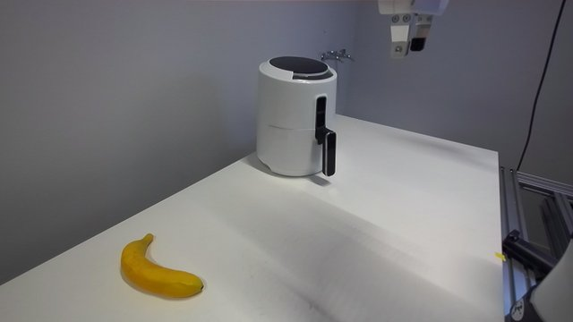
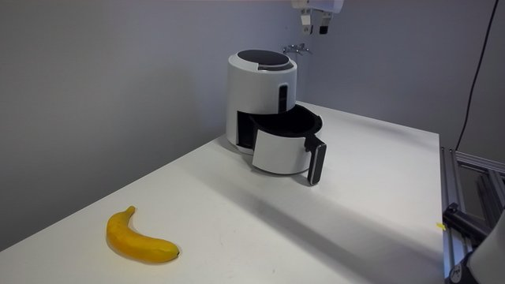
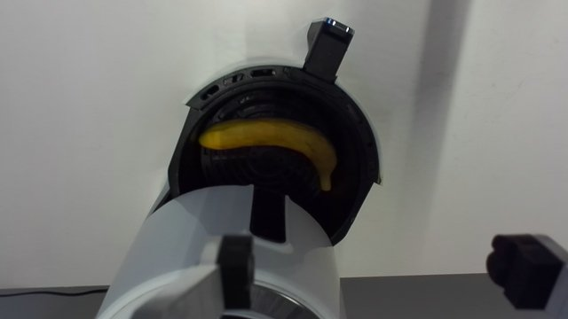
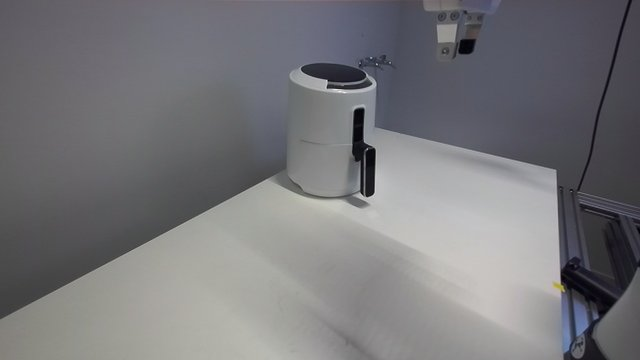

Run 10 (committed code, banana + ball):

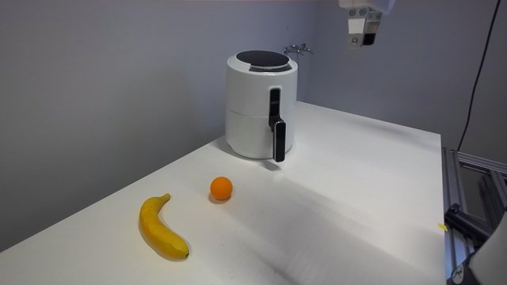
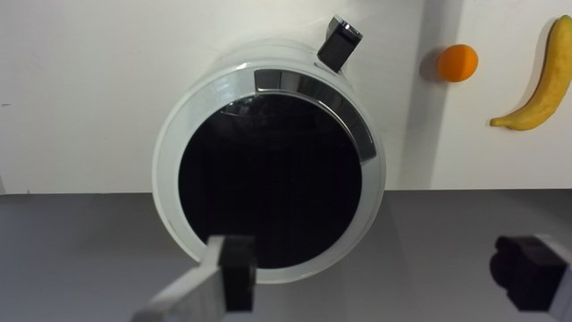
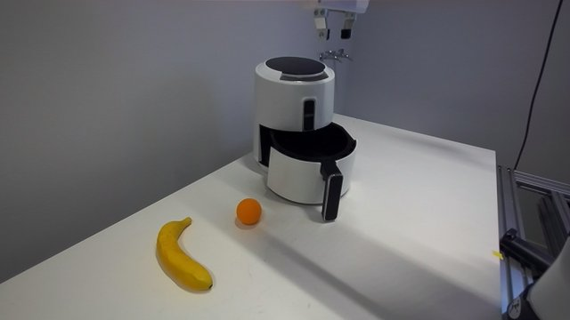
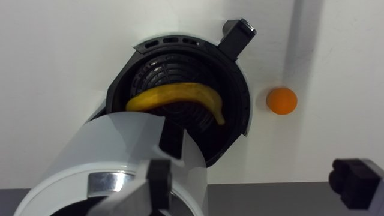
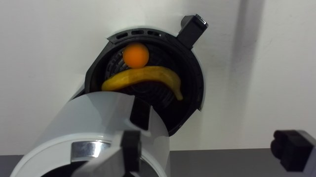
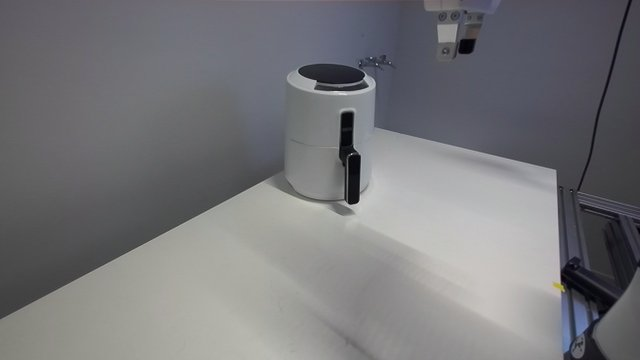

The handle grasp and the pull, seen by the right camera in run 1 before that camera was moved:

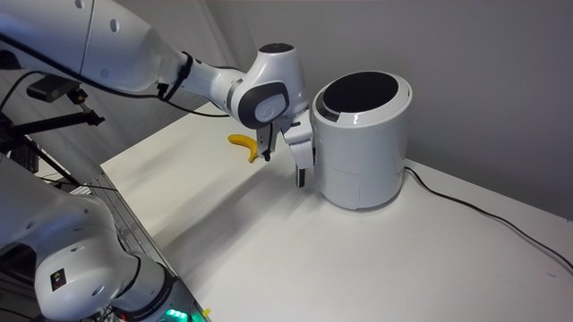
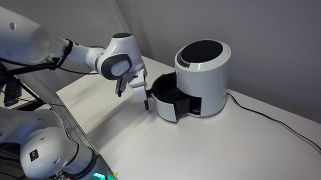

The anomaly in run 7: an after-drop "drawer view" that was actually taken from home:

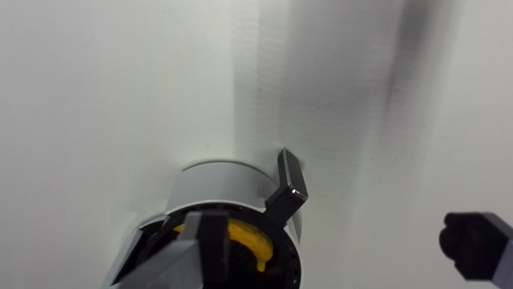

The images of the other runs are listed in `evidence/runs.jsonl`.
