# Bandu tower: assemble and disassemble

From session `20261010T151340Z_bandu_ff0fa2` (2026-10-10, about 11:13-17:20 local time, operator at the robot).
TASK.md: "Stack the bandu blocks as the demonstrated tower". The demonstration was a tower already standing on the
table; the operator said "you may try take them apart and then assembling them", later added a seventh piece ("I
have placed a new tilted cylinder on the table, put it on the barrel next time"), asked for the knob insertion to
"align yourself with at most 1 mm opening error", and after the first visual insertion: "learn this adaptive
correction process and run it yourself for two more times". The agent built the tower by hand first, wrote the
controller, and ran it 25 times (evidence/runs.jsonl); the last full assembly (run 15) ran with no help.

## When to use

- The bandu set of this session, standing upright on a flat table, with the base already in place:
  - base: 4 wooden blocks 7.8 x 2.8 x 1.65 cm in a 2x2 layout (15.4 x 5.6 cm), centre (0.5245, 0.032) m, long
    axis along base +y, top z 0.110 (touch 0.1095). The controller never moves or measures the base.
  - pieces (grasp width / height): ring 37.6 mm OD (~29 ID) / 16 mm; barrel 27.1 / 40 mm; goblet (egg cup, cup
    37 mm, wide foot) / 55-62 mm in depth; urn (vase, body 31.4 mm, opening r ~10 mm, lip r 13 mm) / 41 mm; knob
    (ball 24.3 mm on a neck over a small foot) / 56.6 mm; dowel 15.6 / 112.7 mm; slant (plain cylinder 24.9 mm,
    ~69 mm tall, body leaning ~14 deg). Light wood, weights not measured.
- Target (tower.py `SLOTS`, measured from the demonstration): on the base centreline, goblet at -36 mm with the
  urn seated in its cup (urn bottom 47.5 mm above the base top) and the knob in the urn (74.9 mm); ring at +11 mm
  with the dowel standing in it; barrel at +54 mm with the slant standing on it, leaning toward +y.
- Scene tested: white table, top z 0.093 for x <= 0.50 rising ~4.6 mm per 10 cm to ~0.100 at x 0.66 (9 fingertip
  touches, residuals <= 1.6 mm; `motion.table_z_at`). Two fixed exterior RGB-D cameras (1280x720): left at
  (0.23, 0.38, 0.50), right at (0.15, -0.45, 0.68); wrist camera on the hand. Indoor light, nothing else on the table.
- Start layouts tested: pieces standing on the controller's own table spots (`tower.SPOTS`, x 0.39-0.66,
  y -0.25..+0.30, runs 4, 13-15) and an operator layout (runs 7-11, x 0.33-0.66). Pieces must stand upright,
  ~10 cm apart, at x 0.40-0.68 and |y| <= 0.30, visible to both exterior cameras.
- Disassembly (`mode='disassemble'`) is the practice reset: it puts every tower piece on a free table spot.
- Not for: another tower (the layout is code: `tower.SLOTS`), a moved base (`base_center`/`base_top_z` are
  parameters but untested; nothing localizes the base), laying the base blocks, lying pieces (reported as
  unidentified, run stops), pieces nearer than x ~0.40 (J4 refusal at grasp height; the operator moved one).
- Reusable pieces for other tasks: `pieces.pick/place/insert` (guarded pick, place, tactile peg-in-hole),
  `align.insert_visual / straighten / upright` (two-camera peg alignment and tilt measurement), `holes.locate_opening`
  (wrist matched filter for a dark opening or ball), `perceive` (exterior survey), `clearance.check_path` (arm and
  hand volumes vs pieces). They are keyed by piece name (`pieces.PIECES`, `align.PROFILES`): add an entry for a
  new object.

## Preconditions

Checked by the code before moving (`controller.main`):
- the piece record `output/bandu/state.json` has no piece `held` (the gripper's `is_grasped` reads False for its
  width-0 grasps, so the record is trusted) -> stop "put it down first";
- gripper `max_width` >= 0.075 m (0.080 when homed empty; 0.055 after it was homed with the knob ball between the
  fingers, every width then read 25 mm low) -> stop "ask the operator to re-home it"; fingers opened to 60 mm if
  closed below 30 mm;
- survey: each piece still needed is found once, on the table or on the tower -> otherwise stop
  "X is neither on the table nor on the tower" (assemble) or "no free conflict-free table spot" (disassemble);
- before every pick and set-down: hand footprint vs every known piece (`tower.grasp_conflicts`, housing 7 x 21 cm
  from 3.5 cm above the TCP, camera bracket, open fingers to the fingertips, 15 mm margin) -> stop naming the
  pieces in the way, or move a table piece not needed yet (`clear_blocker`).

Not checked, make sure yourself: motion armed; base at the default pose (or pass the measured one); the arm can go
to the home joints `[0, -pi/4, 0, -3pi/4, 0, pi/2, pi/4]` (used to park for every observation); fingers empty.

## Procedure

1. **Survey** (`survey`): park at home (exterior cameras see the whole table), observe left+right. Wood pixels
   (HSV hue 5-30, saturation > 45) with depth -> base-frame points; clusters on 6 mm cells that BOTH cameras
   confirm (stereo depth bridged two pieces standing in line from one camera); drop clusters on the base; height
   above the table model (p97) gives a class (ring 8-28 mm, barrel|urn 30-44.5, knob|slant 44.5-54,
   goblet|slant 54-66, dowel 66-140); one Gemini call (`gemini_generate`, tile sheet of left|right crops, low effort,
   temperature 0) names the pieces; a piece the robot itself set down is matched to its record within 3 cm and keeps
   the recorded xy and table height. The slant's lean direction comes from depth slices. Tower occupancy = wood
   points above a per-slot level near each slot axis (present >= 60; calibrated present 246-3391, absent 0-4).
2. **Assemble**, order ring, barrel, slant, goblet, urn, dowel, knob (low pieces first so the hand never sweeps over
   a tall stack; a piece only after its support); pieces already on the tower are skipped, so a run resumes.
   - knob only: first measure the urn opening with the wrist camera from two opposite views (`holes.locate_opening`,
     yaw +90 and -90, camera 15 cm above the rim: wrist positions carry a view-dependent error up to ~1 cm that
     flips sign between the views); used as the target only if the views agree within 6 mm, else the urn's xy.
   - pick (`pick_from_table` -> `pieces.pick`): table height found by touching it with the open fingertips beside
     the piece (3 N guarded, 10-15 mm/s) unless the record knows it or the piece is taller than ~4.3 cm (the palm
     would land on its top: table model instead). Double grasp: yaw 0 first (closes along y, where the exterior
     estimate errs up to ~7 mm), then yaw 90, so the piece ends centred under the TCP (pads are narrow: a round
     piece must be centred within 3-4 mm). Knob: ball located from two wrist views (dark disc r 12.15 mm), ONE grasp
     there (an off-centre grasp tilts the knob ~1.3 deg per mm). Slant: one grasp with TCP x along the lean (keeps
     the lean). 20 N, 40 N for urn/knob/dowel; width within 6 mm of the piece's; one retry after a fresh survey.
   - put on the tower (`put_on_tower`): lift so the piece bottom is >= 0.28 (level moves sag up to 2.3 cm), travel
     level (<= 0.35 m per move), descend in move_pose legs of <= 12 cm stopping 4 cm above (move_pose overshoots
     ~20 % of a descent), then guarded at 10 mm/s.
     - ring, barrel, goblet, slant: guarded place-down (3 N), contact within 6 mm of the seat, open to width + 20 mm.
     - urn, dowel: tactile peg-in-hole (`pieces.insert`): hover 12 mm above the rim, 1.5 N probes at 5 mm/s, walk
       downhill on contact height (2.5 mm circle, then neighbours at 1.5 / 0.75 / 0.4 mm, then a 5 mm circle), lift
       above the highest contact before each lateral move, 4 N press when well inside, at most 30 probes; seated
       when within 4.5 mm (urn) / 6 mm of the seat.
     - knob: `align.insert_visual`: hold the foot 20 mm above the urn rim; in each exterior image measure the foot
       centre (saturation crossings 3-7 mm above its bottom) against the lip outline centre (brightness crossings)
       and solve the base-xy offset from both cameras; fit the knob's tilt from silhouette centres 3-23 mm above the
       foot; rotate the hand about the TCP (the ball) by the opposite tilt and shift the TCP; repeat until offset
       <= 0.8 mm and tilt <= 2.5 deg (after 6 corrections accept <= 1.0 mm and <= 3.0 deg); guarded descent 5 mm/s,
       3 N; seated within 6 mm. A centred knob tilted 8 deg stops at the mouth even at 6 N.
   - urn: upright check from both cameras (silhouette centres 16-36 mm above its bottom): above 12 deg it is caught
     on the goblet rim -> take it out, set it on the table, pick and insert again once.
   - verify: park, observe, the occupancy of every slot equals the set placed so far.
   - on a failed placement the held piece goes back where it was picked (straightened first if knob/urn) and the
     run stops with `step` and `why`; the record is rewritten after every step.
3. **Disassemble**, reverse order: the urn is re-located by its opening first (moves the goblet with it in the
   record; a knock had shifted them 10 mm and a grasp at the stale xy closed on air); single grasp at yaw 90 at
   the recorded xy; knob/urn straightened before set-down (held tilt from both cameras rotated out, <= 3 steps; a
   tilted piece lands on an edge and can fall over); set down on its spot or the first free alternative (7 cm from
   any cluster, conflict-free for the later double grasp); verify the tower empty.
4. Park at home and return the report.

## Code

Entry `code/run.py`, run from the workspace root (frames and outputs are relative to the working directory):

```python
import importlib.util, json
from api.runtime import Context
spec = importlib.util.spec_from_file_location("bandu", "skill-library/skills/bandu/code/run.py")
bandu = importlib.util.module_from_spec(spec); spec.loader.exec_module(bandu)
with Context() as ctx:
    print(json.dumps(bandu.main(ctx, mode="assemble"), indent=1, default=str))
```

| Parameter | Default | Tested | Meaning |
|---|---|---|---|
| `mode` | `assemble` | assemble, disassemble, survey | build, take apart, or only observe and report |
| `fresh` | False | False | ignore the piece record, label pieces from images only |
| `only` | None | 1, 2, 6 | stop after N pieces (returns `partial: true`) |
| `base_center` | (0.5245, 0.032) | default only | base centre in m; all slots move with it |
| `base_top_z` | 0.110 | default only | base top in m |
| `spots` | `tower.SPOTS` | default only | `{piece: (x, y)}` table spots for disassembly |
| `log` | print | - | extra log sink; the log file is always written |

Returns `{ok, measured, why}`; `measured` holds the controller's report: `done` (pieces moved, in order),
`seconds`, `run_dir`; on a stop `step` (e.g. `pick slant`, `put knob`, `verify urn`), `put_back`, `blockers`,
`frame`, `lost`; disassembly `verify` (points per slot); survey `table`, `on_tower`, `unknown`, `frame`. Every
call writes `output/runs/<timestamp>/log.txt` (one line per grasp width, contact error, probe, alignment step,
frame id) and `report.json`; the piece record is `output/bandu/state.json`; the Gemini tile sheet is
`output/runs/last_labels.png`. `PYTHONPATH=<skill>/code python3 -m bandu.controller assemble|disassemble|survey [--fresh] [--only N]`
does the same from a shell.

Modules (the robot only through `ctx`):
- `controller.py`: the steps above (`survey`, `pick_from_table`, `put_on_tower`, `check_upright`, `take_from_tower`,
  `put_on_table`, `clear_blocker`, `measure_opening`, `locate_ball`, `relocate_by_opening`, `verify_tower`, `main`).
- `pieces.py`: `PIECES` (grasp height, width, approach opening, grip force, seat tolerance per piece),
  `pick(m, name, x, y, yaw, center, table_z)` -> {table_z, grasp_z}, `place(m, name, x, y, bottom_z, ...,
  straighten)` -> {contact_z, seat_err, tcp_xy, yaw}, `insert(m, name, x, y, seat_bottom_z, fine, rim)` ->
  {xy, seat_err, probes}, `hand_conflicts`. They raise `RuntimeError` (pick: fingers opened and lifted; place and
  insert: still holding, lifted), `PieceLost`, `NotSeated`; they predate the `{ok, measured, why}` format.
- `align.py`: `insert_visual(ctx, m, name, lip_xy, z_rim, seat_bottom_z)` -> {xy, seat_err, iterations},
  `measure` (offset and tilt from one frame, no motion), `straighten`, `held_tilt`, `upright(fid, xy, z_bottom,
  heights)` -> (deg, rms px); `MAX_OFFSET` 0.8 mm, `MAX_TILT` 2.5 deg, `ACCEPT_*` 1.0 mm / 3.0 deg,
  `MAX_SEATED_TILT` 12 deg, `FOOT_GAP` 20 mm.
- `motion.py`: `Motion` (move, transit, descend, lift, gripper, place_down), `table_z_at`, `wrap_grasp_yaw`; constants
  `APPROACH_DZ` 0.04, `MAX_DESCENT` 0.12, `GUARD_SPEED` 0.01, `TRANSIT_Z` 0.27 (pieces uses 0.30), fingertips
  12.4 mm below the TCP, TCP floor 0.1005. Also `push`, `regrasp_move`, `touch_down_open` from the manual phase.
- `perceive.py` (park, snapshot, consensus clusters, `table_objects`, `slot_presence`, `lean_pose`,
  `gemini_labels`), `exterior.py` (wood points from exterior depth), `perception.py` (`Frame`: projection, rays,
  wrist view poses), `holes.py` (`locate_opening`), `tower.py` (`BASE`, `SLOTS`, `SPOTS`, `SHAPE`, `OPENINGS`,
  `grasp_conflicts`, `check_plan()`: offline footprint check of the whole plan, prints nothing when clean).
- `clearance.py`: FR3 forward kinematics with link capsules, hand/finger boxes and a held piece, checked against
  pieces and the table (`check_path`). Not called by the entry; the session used it to plan tilted-gripper moves.

Changes since the runs (format only, no behaviour change): `controller.py`, `exterior.py`, `perception.py` take
`output/` and `runtime/frames/` relative to the working directory instead of two folders above the file (the
session layout `code/bandu/`); the helper modules put their own folder on `sys.path` so they load from the skill
folder (since 2026-10-15 they are the package `code/bandu/` and import each other relatively); `run.py` is
new: the smallest wrapper that returns `{ok, measured, why}`, writes the log and report like the
session's command line, and applies (then restores) the optional base and spot overrides. Left out: `geom.py`,
`look.py`, `triangulate.py` (manual-phase camera helpers the entry never imports), the code README (folded in
here) and the one-off scripts in the session's `output/scratch/` (for example `reseat_urn.py`,
`insert_held_knob.py`). Module names are generic (`motion`, `pieces`, `tower`, `perception`): do not load another
skill with the same module names in the same Python process.

**Changed since the session's runs:** `code/run.py` is new: it wraps the session's `controller.main` to return `{ok, measured, why}` and applies the optional base / spot overrides. Output and frame paths now resolve against the working directory and sibling imports against the skill's `code/` folder. These changes were checked offline only (every module imports with a stubbed `api.runtime`); they have not run on the robot. No motion, perception or threshold changed. The hyper-parameters later moved unchanged into `code/bandu/params.py` (2026-10-15).

**Hyper-parameters** are in one list, `code/bandu/params.py`; the modules import them from there. They moved there unchanged on 2026-10-15: every value was compared before and after with each module imported offline, and no behaviour changed. In a setup this skill was not tested in, calibrate the values marked CALIBRATE (`TABLE_FROM_BASE`, `ALT_SPOTS`, `TABLE_Z`, `REGION`, `TCP_Z_MIN`, `TRANSIT_Z`, `MAX_STEP`, `HOME`, `MAX_JOINT_STEP`, `CAM_IN_TCP`, `PIECES_TRANSIT_Z`, `CARRY_BOTTOM_Z`, `BASE`, `SPOTS`); each comment says how to measure it. Object models (the pieces, the tower slots) stay in `pieces.py` and `tower.py`. The modules are the package `code/bandu/` (moved there on 2026-10-15; only the imports changed: the modules import each other relatively): import it as `bandu` with `code/` on `sys.path`, or run a module from the workspace root with `PYTHONPATH=<skill>/code python -m bandu.<module>`.

## Checks

- survey: every needed piece labelled once, standing (cluster extent < 70 mm), within its height band (+-6 mm
  slack for the Gemini label).
- pick: grasp width within 6 mm of the piece (measured: ring 36.8-37.3, barrel 26.1-26.5, goblet 36.4-37.8,
  urn 29.7-30.7, knob 23.3-24.6, dowel 14.9-15.6, slant 24.7-25.0 mm); `is_grasped` after lifting (`PieceLost`).
- place: guarded contact within 6 mm of the expected seat (10 mm on the table); seen -3.4..+3.5 mm.
- insert: probe or press within the seat tolerance (urn 4.5 mm, dowel 6 mm); seen urn +1.8..+4.5, dowel -0.7..+0.3.
- knob: offset <= 0.8 mm and tilt <= 2.5 deg before descending (or <= 1.0 / 3.0 after 6 corrections), seated within
  6 mm; seen -0.2 and -0.4 mm in 2 corrections.
- urn upright <= 12 deg (seated 2.8 deg in run 15, 7.6 deg in cycle 1; caught on the rim 22-24 deg).
- after every piece: slot occupancy equals the pieces placed so far; final success = all 7 slots present and the
  agent's look at both exterior views (perception checkpoints).
- disassembly: set-down contact within 10 mm of the table model, tower empty at the end (0 points at every slot).

### Perception checkpoints

The code returns no checkpoint brief and asks no subagent except the Gemini labelling; its log names every frame.
These are the looks that caught what the numbers missed in the session (the user saw the tilted urn, the dropped urn
and the base collisions before the code did):

| Step | Subagent model | Frames | Question | Expected answer | Pass if | On fail |
|---|---|---|---|---|---|---|
| survey | Gemini, in code | `output/runs/last_labels.png` (left/right crop per cluster) | Name each numbered piece: ring, barrel, urn, goblet, knob, dowel, slant or unknown | JSON label per tile | every needed piece named once | the run stops at `find <piece>`; look at the sheet and the frame, separate or stand up the pieces, run again |
| after the urn | haiku | `verify` frame after the urn, left + right crops around (0.5245, -0.004, 0.17) | Is the urn standing straight inside the goblet's cup, or resting tilted on the goblet's rim? | straight / tilted (which way) | straight | the code re-seats once above 12 deg; if you see tilt it missed: disassemble down to the urn and assemble again |
| knob alignment | haiku | the `knob: align i.j ... frame <id>` frames, crops around the urn top | Is the knob's foot right above the urn's opening and the knob hanging straight down? | yes / no + direction | yes and matches the logged offset <= 1 mm | the code refuses, lifts and puts the knob back; a missing lip usually means a tilted urn: check it first |
| end of run | sonnet | last `verify` frame, left + right crops around (0.5245, 0.032, 0.15), and `evidence/images/2026-10-10-demonstrated-tower.jpg` | Does the tower match the reference: goblet + urn + knob at one end, ring + dowel in the middle, barrel + leaning slant at the other end, all upright on the 2x2 base? | yes / list of differences | yes | survey, then assemble again (it resumes); for a piece seated wrong, disassemble down to it first |

## Failure modes

- **move_pose overshoots down** at the end of descents (8 cm -> 18 mm, 2 cm -> 4.5 mm, 1 cm -> 3 mm) and level moves
  sag up to 2.3 cm mid-path: the fingers struck the base blocks and a carried block pair clipped a placed pair
  (user: "you are going too low and colliding with the base blocks"). Not detectable by force in time. Prevention in
  code: stop 4 cm above, descend in <= 12 cm legs, guarded finish; carry with the piece bottom >= 0.28.
- **Hand housing hits a tall neighbour**: the hand body (21 cm along the finger axis, 3.5 cm above the TCP) swept
  over the 6 cm goblet 9 cm away during a low approach; the wrist view does not show it. Code: footprint check
  before every pick and set-down. On any unexpected contact read the left, right and wrist frames, not only one.
- **Two pieces in line merge** into one "lying" cluster from one camera's depth: consensus of both cameras (run 2).
- **Palm on a tall piece**: straddling the dowel down to the table touched its top 63 mm up: table model for pieces
  over ~4.3 cm (run 2).
- **J7 refusals**: a stored yaw 1.5708 wrapped to -90 and the turn to +90 was refused (run 4); the opening views
  ending at yaw -90 did the same (run 7). Code: wrap tolerance, views end at yaw 0. Still open: the knob ball's second
  wrist view at the knob spot (0.42, 0.20) is refused (J7) in every run since 15:55, so the knob is grasped at the
  exterior estimate; the visual alignment then corrects the 2-3 deg tilt this gives.
- **Dropped urn**: re-grasping a held urn at 40 N made the gripper report not grasped and let go (run 5). Code: grasp
  once at the final force, `is_grasped` after lifting, re-survey and retry once (`PieceLost`).
- **Knob jams in the urn** under tactile search: the ball turns in a 20 N grip at rim contacts; the knob hangs tilted
  when grasped off its ball centre (> 3 deg jams); the wrist estimate of the opening scattered 3-21 mm (runs 2, 5,
  11). Code: knob by `align.insert_visual` with relative measurements in the exterior images.
- **Knob alignment did not converge** with 0.7 mm / 1.5 deg limits (fit jitter ~1 deg; run 13 at 16:53): limits now
  0.8 mm / 2.5 deg, accept 1.0 mm / 3.0 deg. It refuses (still holding) when the lip is not found or the correction
  points > 12 mm away; then `put_back` straightens and sets the knob down (once that move timed out 1.3 mm short and
  the run stopped holding the knob).
- **Urn caught tilted on the goblet rim** was accepted at +4.0 mm by contact height (seat tolerance then 6 mm) and
  by the occupancy check (user: "the urn is tilted"; run 13). Code: urn seat tolerance 4.5 mm plus the upright check.
  Watch: run 15 accepted the urn at +4.45 mm, right at the tolerance, upright 2.8 deg. The code comments disagree on
  what a seated urn reads (align.py: 7-8 deg; controller.py: 0-3 deg); measured 7.6 deg in cycle 1, 2.8 deg in run 15.
- **Gripper homed with something between the fingers** (max_width 55 mm, widths 25 mm low, a 31 mm grasp read 5.7 mm,
  run 7): start check `max_width >= 75 mm`; the operator re-homes it.
- **Sideways gripper swept the tower** (manual move at 15:06, -11.5 N): the robot service checks link origins only,
  the tilted hand and wrist sit 5-25 cm beside the TCP. The controller keeps the gripper vertical except the few-degree
  tilts of `insert_visual` and `straighten` high over the tower (not run through `clearance.py`); check any larger
  tilt with `clearance.check_path` first.
- **Unreachable pieces**: x 0.33 refused at grasp height (J4, run 10): stops cleanly; ask the operator to move the
  piece to x >= 0.40.
- **Light pieces slide** below the guarded-move force threshold: a push cannot be detected by force; verify by eye.
- **Process launched with `&` in a shell call** died when the call returned, mid-grasp (run 13): start robot scripts
  as tracked background jobs.
- Outside the code: robot bridge outage (15:09) and a dead gripper client (15:23) needed the operator.

## Evidence

All 25 runs are in `evidence/runs.jsonl` (session `20261010T151340Z_bandu_ff0fa2`, 2026-10-10, commit
`pre-library`). Survey-only calls are not listed. Hand work outside the controller, not counted as runs: the first
disassembly and rebuild (11:30-12:50, including re-aligning the knocked base by pushes), the hand-run knob
insertions of runs 3 and 12 (run 12 is where the visual alignment was worked out: offset (+7.2, +4.3) -> 0.3 mm,
tilt 7.8 -> 0.8 deg, seated -1.7 mm; user: "nicely done!"), the 15:06 sideways knob pick that knocked the tower
over, and the scripted repairs inside cycle 1.

| Run | Time | Mode | Outcome | Unattended | Conditions / result |
|---|---|---|---|---|---|
| 1 | 13:07 | disassemble x3 calls | success | no | 6-piece demonstrated tower -> spots, 6/6 |
| 2 | 13:14-13:28 | assemble x3 calls | failure x3 | yes | ring, barrel, goblet, urn, dowel placed; stops: merged clusters, palm on dowel, knob 21 tries |
| 4a / 4b | 13:52 / 13:54 | disassemble | failure / success | yes / yes | J7 at set-down; restart 5/5 in 308 s |
| 5a / 5b | 14:00 / 14:10 | assemble | failure / failure | no / yes | 4 placed then urn dropped; urn, dowel placed, knob 25 probes |
| - | 14:23, 14:36 | assemble (not in RUNS.md) | failure | no | knob fine tactile search, stopped by the agent |
| 7a-c | 15:28-15:34 | disassemble | failure x3 | yes | mis-homed gripper, J7 after opening views |
| 8 | 15:41 | disassemble | success | yes | goblet + urn -> spots, 168 s |
| 9 / 10 | 15:44 / 15:46 | assemble | failure | yes | knob in the barrel's way; clear_blocker moved it; slant at x 0.33 unreachable |
| 11 | 15:55 | assemble | failure | no | slant, goblet, urn, dowel placed; knob probes on the rim, user "stop" |
| 13 | 16:18-16:58 | cycle 1: disassemble, assemble x3, repair | 2 success, 4 failure | mixed | disassembly 7/7 in 472 s; urn caught tilted, knob alignment limits too tight; finished by scripts |
| 14 | 16:59 | cycle 2 disassemble, committed code | success | yes | 7/7 in 459 s, knob straightened 3.4 deg |
| 15 | 17:07 | cycle 2 assemble, committed code | success | yes | 7/7 in 663 s, knob aligned in 2 steps to 0.19 mm / 2.3 deg, seated -0.2 mm |

Status `draft`: only runs 14 and 15 ran the code as committed (its last behaviour change was 16:58, after every
earlier run), and of those only run 15 builds the tower; run 14 is the reverse task. One unattended assembly of the
committed code, on the controller's own spot layout, is below the 2 the library asks for. Next: run `assemble` again
from a different layout (operator-placed pieces) and record it.

Reference (the demonstrated tower before the slant was added, 11:24) and the start and end of run 15:

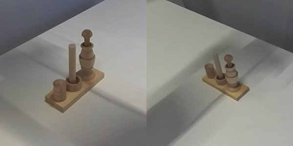
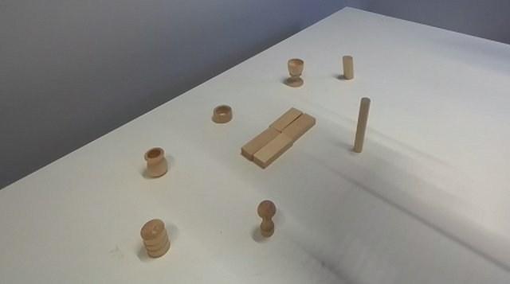
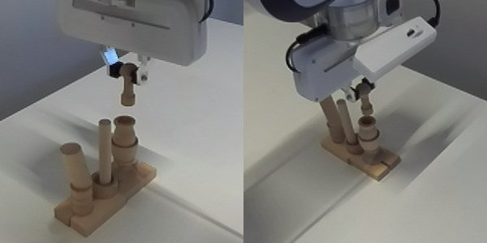
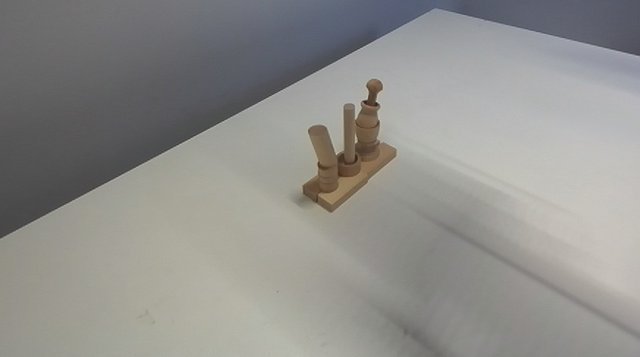
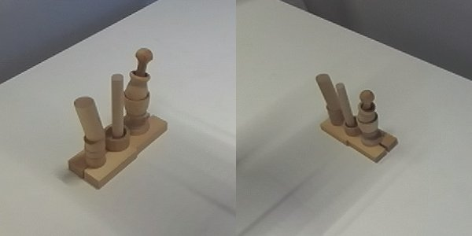

Run 14 (disassembly with the committed code), cycle 1 and earlier runs:


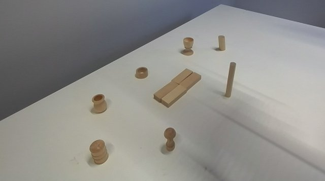
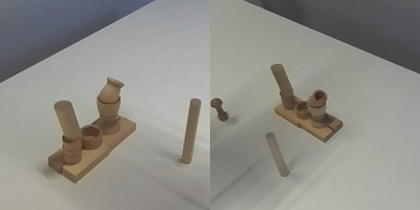
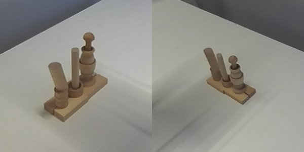
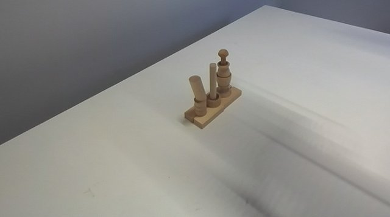

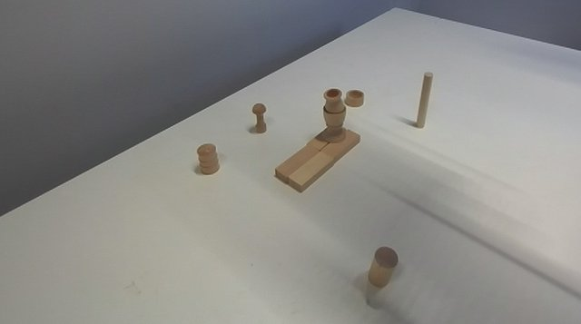
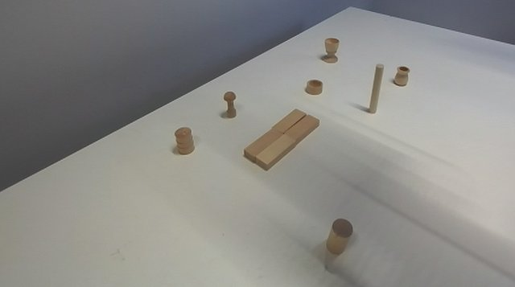
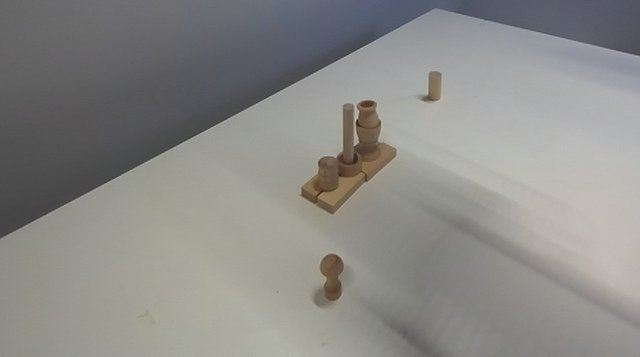
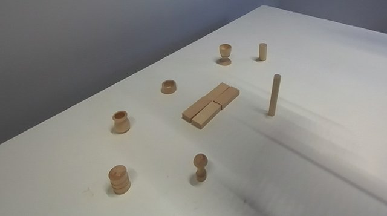
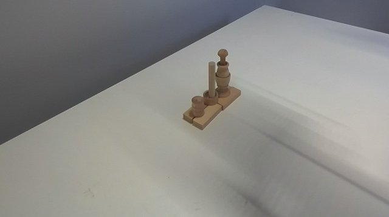
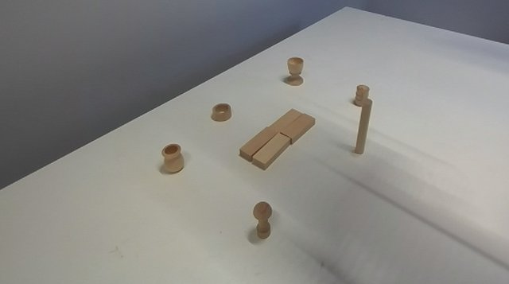
