# Bimanual box pick-and-place (floor <-> table)

Session `20261009T023700Z_practice_pnp_box_61befa` (task practice_pnp_box, 2026-10-08/09). Unifies and replaces
`bimanual-box-squeeze` (floor squeeze, torso lift) and `box-floor-to-table-squeeze` (carry, table approach,
place), both removed from the library on 2026-10-09 (restore with `git checkout before-deprecated-removal --
skills/<name>`). Status `draft`: both directions succeeded once each on the robot step by step with
the agent at the checkpoints and fixing one step by hand in each run (see Evidence); the fixes are in the code
but not yet re-run.

## When to use

- A closed carton about 0.40 x 0.22 x 0.26 m (long side 0.36-0.42), upright, on the floor with ~0.6 m clear floor
  in front of a long side, or on a table with a dark top at 0.65-0.75 m standing within ~0.15 m of an edge the
  robot can face on open floor. Grippers carry the round add-on fingers, closed into "balls" (centre 0.195 m along
  -z_ee).
- `floor_to_table`: box on the floor in view (<= ~2.5 m), the table ahead behind it (straight final approach).
  `table_to_floor`: box on the table in view, open floor around the robot for the in-place turns and behind the
  grasp stance for the 0.35 m reverse.
- Tested: one carton, one black-top drawer island (1.0 x 0.62 m), one lab, both directions once.
- Not for: boxes wider than ~0.5 m or heavier than ~2 kg (wrist loads), tables above ~0.75 m, boxes deep inside a
  table, cluttered approaches, unattended use (draft).

## Preconditions

Checked in code: armed, no EMO / fault (`core/posture.prepare`, also homes and closes the grippers and sets torso
`ready` / `zero` and arms `ready`); nothing held (world); the box localized fully visible (Gemini `box_fully_visible`
+ depth size gates - partial views caused the v1 crash A2); stance checks before grasping (box 0.47 m ahead for the
floor, 0.60-0.62 m for the table, yaw and offset tolerances); every base segment checked against fresh depth of
its swept footprint; a reverse only along the straight path just driven (+3 cm odometry tolerance).

## Procedure

Module map (`code/bimanual_box_pnp/`):

| Module | What |
|---|---|
| `core/robot.py`, `kin.py`, `geom.py`, `world.py`, `frames.py`, `footprint.py` | tool wrappers and body constants; pinocchio FK / IK incl. the ball tool; base <-> odometry; objects in the odometry frame + grip data; frame loading, `pixel_point`, `ray_plane`; robot footprint for base checks |
| `core/vlm.py` | Gemini `point`, `check`, `segment`, `usage` on frame ids: a thin wrapper over the harness gemini skill's shared helper (`.agents/skills/gemini/scripts/vlm.py`, moved there 2026-10-09); change Gemini behaviour there |
| `core/runner.py` | Step runner: checkpoints with briefs, resume, `status.json` heartbeat, STOP-file guard on motion tools |
| `perception/locate.py`, `sensing.py`, `box.py`, `table.py` | Gemini-seeded box (`locate_box`) and table top (`locate_table_mask`, `table_near_edge` from the segmentation mask + depth); find / relocate / verify on table or floor / check held; depth-only detectors as fallback |
| `motion/navigation.py` | turn-drive-turn plans, swept-footprint depth check per segment, `plan_stance_straight` (straight final leg, clearance to known surfaces), `look_around_torso` (torso yaw +-1.9 to see beside / behind before in-place turns), `check_surface_stance`, `final_table_approach`, `retreat` |
| `motion/squeeze.py`, `touch.py` | ball-tool IK pre-grasp, squat, touch by wrist force, +4 mm squeeze, grasp from floor / table, releases |
| `motion/carry.py`, `place.py` | torso paths with arms fixed, squeeze-regulated Cartesian z moves, lift from floor, recentre, set down on the floor, place on a table by force touchdown |
| `tasks/floor_to_table.py`, `tasks/table_to_floor.py` | the two compositions (lists of Step) |

`table_to_floor`: prepare (torso zero) -> find_table (Gemini mask) -> find_box (cp) -> plan_stance (cp: straight
0.35 m final leg, box 0.62 m ahead, facing the box) -> look_around (torso yaw) -> drive_stance (per-segment depth
check) -> check_stance (cp) -> grasp from the table (cp: hands above the ends, down beside them, touch, squeeze,
lift 8 cm) -> retract (box onto the base x axis, hands to x 0.375) -> back_off (reverse the straight leg) ->
set_down (cp) -> verify_floor (depth top height + Gemini).

Run grasp and lift as ONE chain (`--start grasp --stop-after lift --no-checkpoints`): the grasp checkpoint would
otherwise hold the robot squatted while you look; the code's touch / squeeze / lift force checks gate the chain
(P3: touch 8.5 / 11.8 N, squeeze 19 / 21 N, lift loads < 40 %). Look at the lift frame afterwards.

`floor_to_table`: prepare -> find_box (cp) -> plan_approach -> drive_approach -> check_stance (loops) -> grasp from
the floor (cp: squat to lowest, touch, squeeze) -> lift (cp: torso up with arms fixed, hands to ee z 0.92, torso
zero, hands to 1.17) -> find_table -> approach_table (cp: Gemini-mask edge, drive to edge 0.385 m ahead) -> place
(cp: hands forward so the near face is 6.5 cm past the edge, 1 cm steps down until base-frame Fz changes > 4 N,
release 2.5 cm out + up) -> verify (cp) -> retreat 0.3 m.

Set-down rules (from P1): squeeze capped at 20 N while lowering (26 N put left_arm_5 at 131 %), arm lowering stops
at 125 % load and the torso does the rest; the final drop is the squat straight from torso_1 0.8 to the lowest
posture WITHOUT lean (0.9-1.1 is where the knee link meets the top of a box held this close; lean 0 puts the box
~2 cm further forward); no controller Cartesian moves at the squat (one twisted right_arm_6 to 210 %).

## Code

```
python3 skill-library/skills/bimanual-box-pnp/code/run.py table_to_floor            # to the first checkpoint
python3 skill-library/skills/bimanual-box-pnp/code/run.py table_to_floor --resume output/runs/<run> --start <next>
python3 skill-library/skills/bimanual-box-pnp/code/run.py floor_to_table [--resume ... --start ...]
MPLCONFIGDIR=$TMPDIR python3 skill-library/skills/bimanual-box-pnp/code/offline_test.py [--gemini]
```

`main(ctx, task, start=None, resume=None, checkpoints=True, params=None, stop_after=None, **task_kwargs)` ->
`{ok, measured, why, checkpoint: {step, next, brief}, next, outdir, gemini}`. Outputs in
`output/runs/<time>_<task>/` (log.txt, report_*.json, world.json, status.json, path_*.jpg). Parameters (tested):
table_to_floor `stance_d` 0.60-0.62, `straight` 0.35, `face_blend` 0 (box-facing; 0.5 tested in P1);
floor_to_table `carry_z` 1.17. Inside: BALL_Z 0.18 above the support, standoff 0.09, squeeze +4 mm, touch 4.5 N,
touchdown 4 N, path stop 25 points, segment 0.30 m / 0.6 rad, table stance edge 0.385 m.

Gemini (`core/vlm.py`, i.e. the gemini skill's helper): images downscaled to 640 px; `max_tokens` 16384 (reasoning shares it; 2048 truncated an
answer); effort `low` for points / checks (median 5.9 s, 2.2-47 s), `minimal` for segmentation (3-6 s, the docs'
recommendation); a full-size image once timed out and kept a $2.81 reservation. The mask edge repeats to
~1.5 cm (0.391 once, then 0.414-0.417 in 5 calls on the same frame; coarse 6-10-vertex polygons may sit ~2 cm
inside the true edge); placing tolerates it (near face 6.5 cm past the edge,
touchdown by force). The mask polygon comes back as
[y, x] normalized to the full image (like box_2d), not the documented [x, y] - also when the prompt explicitly
asks for [x, y] (4/4 answers, test 2026-10-09); `segment` decides the order per answer by containment in box_2d. Gemini calls are serialized with
robot calls by the host: ask between motions.

**Hyper-parameters** are in one list, `code/bimanual_box_pnp/params.py`; the modules import them from there. They moved there unchanged on 2026-10-15: every value was compared before and after with each module imported offline, and no behaviour changed. In a setup this skill was not tested in, calibrate the values marked CALIBRATE (`BALL_D`, `TORSO_READY`, `ARM_READY`, `MAX_FORWARD_CALL`, `TORSO_MAX_STEP`, `MAX_LOAD`, `CARRY_Z`); each comment says how to measure it. The modules are the package `code/bimanual_box_pnp/` (renamed from `boxpnp` on 2026-10-15 so that a package name is the skill's slug): import it as `bimanual_box_pnp` with `code/` on `sys.path`, or run a module from the workspace root with `PYTHONPATH=<skill>/code python -m bimanual_box_pnp.<module>`.

## Checks

- find: Gemini says the box is present and fully visible; depth top-face rectangle 0.28-0.50 x 0.10-0.30 m,
  top 0.18-0.34 m above the support; Gemini corners within 8 cm of the depth rectangle (measured 0.5-1.5 cm).
- base segments: <= 25 obstacle depth points in the swept footprint; known surfaces >= 3 cm from the swept base;
  the box re-detected within 10 cm of its prediction.
- grasp: both touches |dF| > 4.5 N within 11 cm; squeeze min |dF| >= 9 N. Lift-off is measured by depth (box top
  height), not asked (Gemini said "resting" for a box lifted 7 cm).
- carry / set-down: squeeze 8-30 N (20 N cap when lowering), loads < 130 % (125 % stop when lowering).
- placement: touchdown dFz > 4 N; verify: box top 0.21-0.31 m above the table top, centre inside it, Gemini yes.

### Perception checkpoints

| Step | Subagent | Frames | Question | Expected answer | Pass if | On fail |
|---|---|---|---|---|---|---|
| find_box (both) | haiku / Gemini check | the find frame | Is the cardboard box standing alone on the support, fully visible, nothing on or leaning on it? | yes / no + why | yes | stop, ask |
| plan_stance | haiku | path_plan_stance_*.jpg | Is the floor under the drawn footprint free of people and objects (the target cabinet may be close)? | yes / no + what | yes | replan |
| check_stance | haiku | relocate frame | Is the box straight ahead, centred between the arms? | yes / no | yes | stop |
| grasp | haiku | frame after the squeeze | Is the box held between both grippers at the middle of each end face, level? | yes / no + why | yes | lower back, release, stop |
| lift | haiku | lift frame | Is the box held level, clear of the floor? | yes / no | yes | set down, stop |
| approach_table | haiku | edge view | Is the table top directly in front of the held box, nothing where it goes? | yes / no | yes | stop |
| place / set_down | haiku + Gemini check (verify) | verify frame | Is the box standing on the top / floor with both grippers clear? | yes / no | yes | stop |
| any motion step (monitor) | haiku, background | runtime/stream newest frame every ~10 s | box tipping / slipping / pushed, base pushing the box, a person within 0.5 m? | ok / anomaly | ok | write <run>/STOP + rby1_hold |

Monitor protocol: the runner writes `<run>/status.json`; a background haiku subagent reads it and
`python3 -m api.stream latest`, looks at the newest frame and on a clear anomaly writes `<run>/STOP`; the next
motion call raises `StopRequested`, the runner holds and reports. Measured: ~9-11 s per check, 28 checks over P1 /
P2 without a false stop.

## Failure modes

1. Set-down by lowering the arms (table-grasp arm shape, squeeze 26 N) -> left_arm_5 131 %: stopped by the load
   check; now squeeze cap + load stop + torso squat (P1).
2. Box touched the robot's front during the squat at torso_1 0.98 (knee link vs box top); now squat straight to
   lowest without lean (P1).
3. Controller Cartesian forward move at the squat twisted right_arm_6 to 210 % (torque stop); no Cartesian moves
   at the squat; release by IK joint move (P1, also v1 failure 6).
4. Far dark-pixel table fit half-hidden by the held box read the edge 17 cm too far; the per-segment depth check
   stopped the drive at 3434 hits; now Gemini mask edge (P2).
5. Gemini pointing with "left / right of the box" put both points on one side when an arm hid the right side
   (edge 0.302 vs 0.394 m); masks / several points along the visible edge instead; views with < 400 masked top
   points are rejected (P2).
6. Gemini answer truncated at max_tokens 2048 -> depth-only fallback ran; now 16384 (P2).
7. A cancelled `request_operator` kept blocking the host's call queue until its timeout: don't cancel it.
8. From v1: partial box view -> wrong pose -> crash A2 (now Gemini full-visibility + size gates); base backend
   error stops the run (no retry).
9. Two dark-top cabinets in view and the held box hiding the near top (P3): the mask edge read 1.053 m (the farther
   cabinet) for a top 0.45 m ahead; the per-segment path check blocked the drive (4222 points), correctly. Now
   `approach_table` takes `edge_x` from the agent: look at the image yourself, query the drawer-face / edge
   pixels below the box with `rby1_pixel_to_position` (face 0.47 m -> edge ~0.45), pass
   `--start approach_table --params '{"edge_x": 0.45}'`.
10. The place step puts the box on the robot's axis: check the free top's lateral extent against the box before
   placing (P3: top 0.47 m wide, box 0.39 m; a 9 cm offset was corrected by a turn-drive-turn side step; the box
   ended flush with one edge +-1 cm).
11. P4 (trial 2, 2026-10-10): the free part of a 0.8 x 0.56 top beside a bucket was only ~0.44 m along the edge the
   robot first faced - the box (held long side across the robot, 0.38 m) would not fit there; it fitted from the
   SHORT edge (0.23 m side inward). The held box hid the near edge and the drawer face: the edge came from top
   points seen beside the box before the last side step plus the odometry of that step (0.99 - 0.25 = 0.74 m); with
   `edge_x` the final drive must be <= 0.25 m (drive closer by hand first). `verify` raised KeyError 'table' when
   find_table had been skipped -> it now falls back to the edge notes (top straight ahead). In the base path check
   the held box itself adds ~20 "obstacle" points as soon as the swept base reaches its image position: tell them
   from real obstacles by checking the legs separately and looking at the points.

- v4 (trial 3, 2026-10-10): `prepare` refused on a stale fault record (as in the bucket skill) -> closed the
  grippers + torso ready by hand, resumed at find_box. Next to a bucket standing on one end of a 0.9 m top, the
  far short edge needed a 180 deg turn in unseen space and its straight route cut the cabinet corner -> placed from
  the LONG side onto the free far half (0.54 m free for the 0.375 m box: ~8 cm each side). The held box hides the
  near top: measure the drawer face below it by pixel depth (0.60 -> edge_x 0.59), then approach_table + place.
## Evidence

| Run | Date | Task | Outcome | Unattended | Conditions |
|---|---|---|---|---|---|
| P1 | 2026-10-08 | table_to_floor | success (agent finished the set-down) | no | box on the island, robot 0.55 m from it at a 0.47 rad skew |
| P2 | 2026-10-09 | floor_to_table | success (agent fixed the edge measurement) | no | box on the floor 0.67 m ahead, island ~1 m ahead |
| P3 | 2026-10-09 | floor_to_table | success (agent planned the carry route, measured the edge, side-stepped) | no | compositional session: box ~1.6 m beside the robot; grasp + lift chained without a pause (no time bent over); target = the free one of two dark-top drawer units (the other held a bucket), approached from its free side |
| P4 | 2026-10-10 | floor_to_table | success (agent route around the cabinet, edge from pixel depth + odometry, skill verify crashed -> fixed) | no | compositional trial 2: box 1.5 m ahead on the floor, placed on the free end of the bucket's cabinet from its short edge |
| P5 | 2026-10-10 | floor_to_table | success | no | trial 3: floor -> cabinet free far half from the long side, 9 cm from the bucket; find / plan / drive / check_stance x2, grasp + lift chained; edge_x 0.59 by pixel depth; touch -4.4 N |

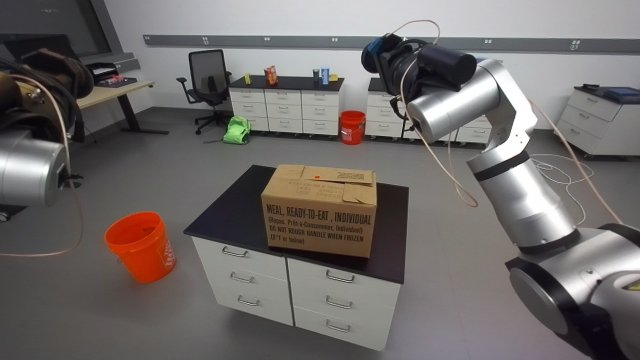
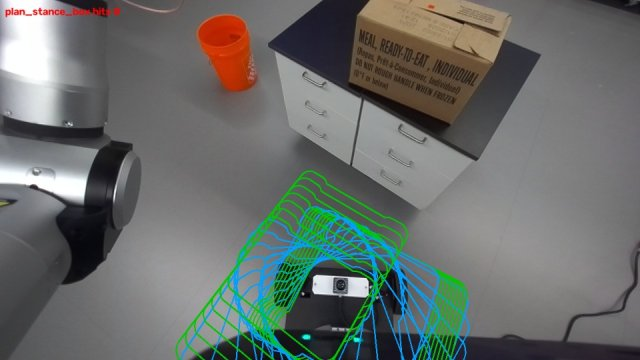
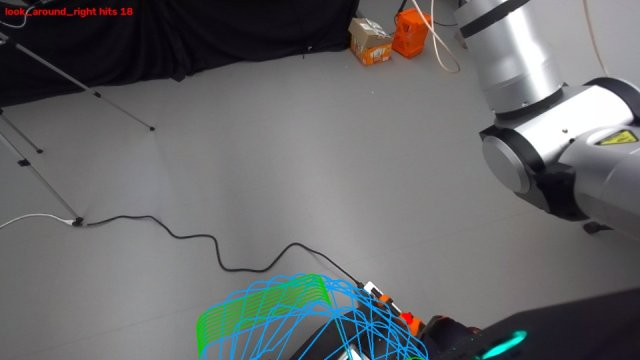
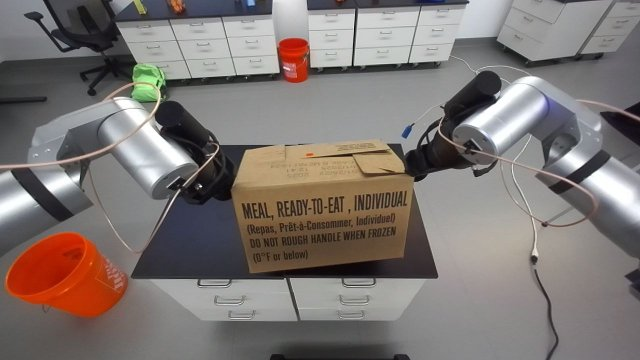
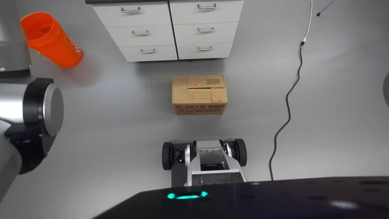
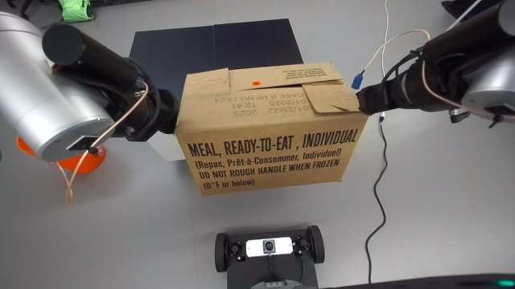
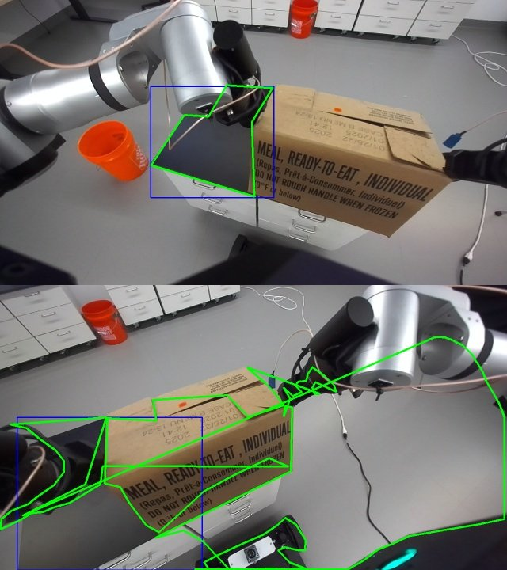
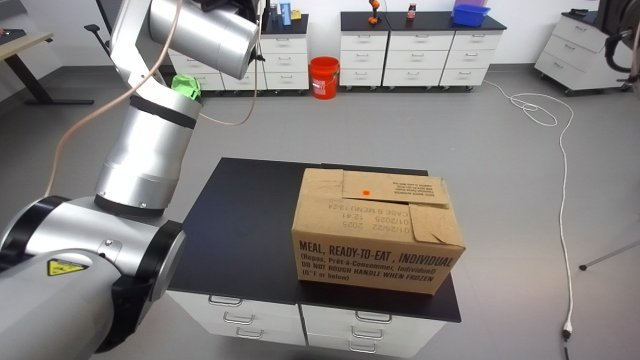
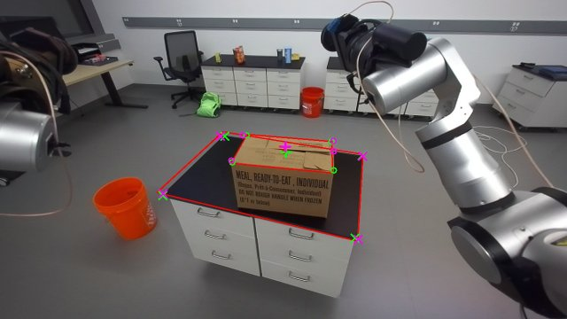
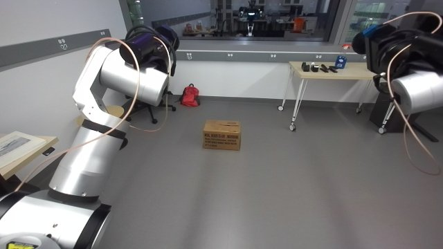
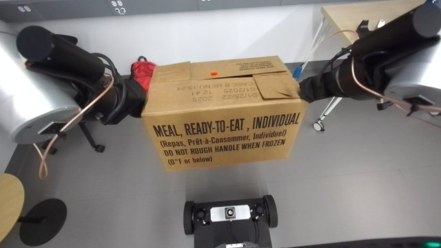

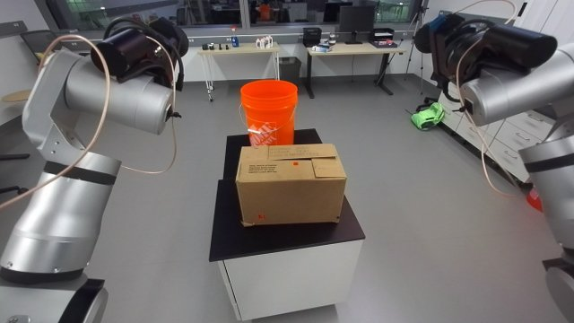

