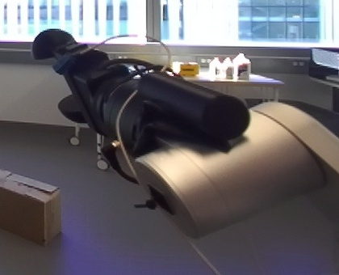
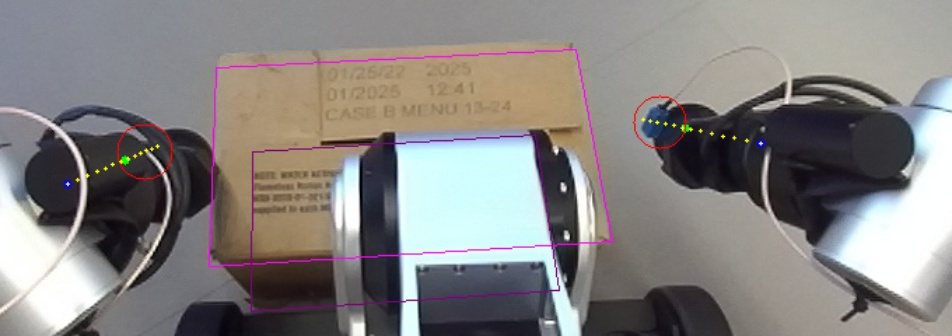
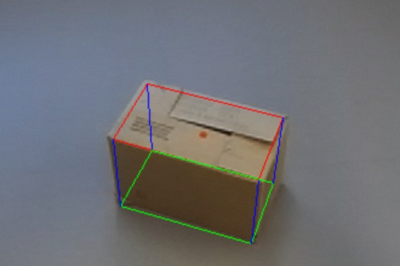
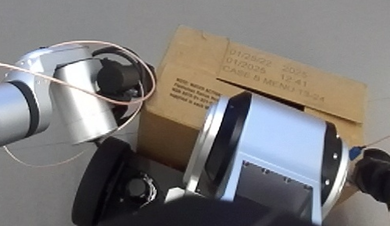

# Bimanual ball-squeeze of a box on the floor

Learned in session `20261008T212446Z_pnp_box_f7b297` (task pnp_box, 2026-10-08) and imported into the
library by the operator after that session ended (it predates the library). The text below
is the agent's own, rearranged into the library's sections; the original is
`evidence/ORIGINAL_SKILL.md`. Status `draft`: the grasp and torso lift worked twice on the
robot run step by step (not unattended); the chained controller `scripts/grasp.py` has
only been dry-run offline.

## Tools available now (operator note, 2026-10-09)

This skill was written with fewer tools than a session has now. Its own IK
(`scripts/kinematics.py`, scipy on a downloaded URDF) and its joint-space stepping were
workarounds for tools that did not exist then. Before re-running it, consider these
(numbers measured on this robot, see the robot-interface skill):

| Now available | What it replaces in this skill | Measured |
|---|---|---|
| `rby1_optimal_control` (component `body`): the robot controller's **whole-body IK** with targets for both hands at once, joint preferences and a centre-of-mass target | `kinematics.solve_ball`, `plan.grasp_waypoints` and two-arm `rby1_move_body` stepping; a two-hand squeeze or lift as one command with the torso helping | 4–5 cm hand targets within 2–3.3 mm in 3.8 s; 10 cm within 0.2 mm in 7.7 s; paths within 1 mm of straight |
| `rby1_cartesian` (`right_arm` / `left_arm` / `body`): straight-line hand moves solved by the controller | the 1 cm inward touch steps in `touch.step_until_contact` (straight, exact steps) | 5 cm in 2.4 s within 0.1–0.2 mm, within 0.4 mm of straight |
| `rby1_move_eef` now uses the controller's Cartesian command | single-arm moves | 0.1–0.2 mm |
| `rby1_joint_impedance` (one arm): compliant joint moves | a softer final squeeze | ends about 0.018 rad short by design |
| `rby1_fk`, `rby1_check`: poses, collisions, joint loads and "would this be accepted" without moving | offline checks of the plan | — |
| `robot-model/` in every workspace: the vendor URDF + meshes and `model_v1.0.standard.urdf` for pinocchio / yourdfpy (pinocchio is installed) | `assets/model.urdf` and the scipy FK | standard copy matches the vendor SDK to 1e-9 |
| Torque stop at 150 % of rating (was 100 %), never locking motions that hold or ease a load; wrist force stop 60 N (was 40 N) | Failure 4b, where a squeezed box at 100 % on right_arm_5 blocked every motion | — |
| Forward lean up to about +0.7 rad with the arms out (at `ready` height), squat to `lowest` | reaching the floor box | not yet run beyond +0.15 rad lean |

Note: the controller modes take the hand to `ee_*`; the closed round fingers' ball centre
is 0.195 m along -z_ee (Hardware facts), so convert ball targets to `ee_*` targets first.
Verify the new path in small steps and record the runs in `evidence/runs.jsonl`; the skill
stays `draft` until two unattended successful runs.

## Deprecated

Replaced by `bimanual-box-pnp` (session 20261009T023700Z_practice_pnp_box_61befa, 2026-10-09): its floor squeeze (closed-ball tool 0.195 m along -z_ee, stance 0.46-0.47 m, touch by wrist force, +4-5 mm squeeze, torso lift) lives on in `bimanual-box-pnp` (`motion/squeeze.py`, `motion/carry.py`) with the controller tools, carry, placing and both directions. Kept for its evidence and the original notes.

## When to use

A closed box wider than the 0.1 m gripper standing on the FLOOR in front of the robot,
tested with a carton about 0.40 x 0.22 x 0.25 m (long side 0.38-0.42 m, top ~0.25 m, about
1.4 kg), clear floor around it, on an RB-Y1 whose grippers carry the round add-on fingers
(see Preconditions). It grasps by squeezing the box's two end faces with both closed
grippers ("balls") from the `lowest` squat and lifts it with the TORSO only, to about
0.35-0.4 m. Do not use it to lift further with the arms (Failure modes 4) or to place the
box: placing on a table is not covered yet (see Next steps).

## Preconditions

armed, no fault, torso `ready`, arms `ready`, both grippers empty, the box on the
floor ahead, clear floor around. Report: `output/runs/<time>_box_squeeze/report.json`. On failure
the robot is left where it stopped (no automatic release); `grasp.set_down(ctx, log, yaw)` is the
abort path to put a held box back on the floor (UNTESTED).

Hardware facts it depends on (the agent's notes):

- The grippers carry add-on ROUND fingers that are not in the URDF. Closed (`rby1_gripper close`,
  0.5 A, width ~0) they form a ball: centre `BALL_D` = 0.195 m along -z_ee from `ee_*` (checked by
  projecting into RGB), visual radius ~0.03 m; touch put the box face ~0.05 m from the ball centre.
  Never squeeze with open fingers: their pads reach ~5 cm below the URDF fingertip. The right
  gripper has a blue cable connector at its tip.
- `assets/model.urdf` (rby1-sdk `models/rby1a/urdf/model.urdf`, v1.0) matches the measured ee poses
  to 0.1 mm. Image x points to the robot's RIGHT: the image-right gripper is the right one.
- The base turns in place about the wheel axle at x = +0.228 (the origin shifts ~0.228·θ
  sideways); the bumper is at x = +0.304. The squat moves the torso "knee" forward to
  x = 0.35·sin(torso_1) (0.33 m at `lowest`) and the shoulders down to z = 0.67 + 0.7·cos(torso_1).
- Depth: good for the box centre/top from >= 1 m at torso `ready`; box END faces were off by
  3-5 cm and the robot's own knee/front enters the depth when squatting or very close. So localize
  before squatting and find the end faces by touch.

## Procedure

1. `locate`: look at the floor, `perception.find_box` (largest box-sized depth cluster, top-face
   rectangle, 1/99 % extents; points within x < 0.36, |y| < 0.32 are the robot), centre the head on
   it, localize again. Tested range: long side 0.38-0.42 m, top ~0.25 m.
2. `align`: `plan.stance_moves` plans the wheel-axle point: turn, drive (<= 0.5 m per call, a rough
   depth corridor check before each), turn 0.35 m before the stance, then straight approach steps
   (<= 0.15 m, re-localized, heading error > 0.03 rad corrected) until the box centre is
   `STANCE_D` = 0.46 m ahead (near face ~4-5 cm from the bumper). When already close it only turns
   to face the box and approaches.
3. `prepare`: chest yaw = atan2(box_y, box_x) clipped to +-0.15 (torso_5 = -0.10 centred a box 5 cm
   to the right and moved load from the wrists to the elbows); waypoints from
   `plan.grasp_waypoints` (ball x = box centre x, gripper axis tilted 0.5 rad forward-down in the
   base x-z plane, faces = depth ends widened 2 cm, start 5 cm outside them, one IK branch seeded
   with arm shapes that worked, joint margins >= 0.2 rad, `plan.check_plan` rejects misses / jumps);
   close both grippers; one `rby1_move_body`: torso `ready` + lean 0.07 + yaw, arms to pre-grasp.
4. `squat`: torso_1 0.785 -> 1.047 -> 1.2 with torso_3 = torso_1 + 0.07 (stays 0.2 rad inside its
   limit); the arms are fixed, so the balls drop vertically beside the box ends (torso_2 48-56 %).
5. `touch_squeeze`: descend at the standoff to ball z 0.235, 0.18 (7 cm below the box top), then
   1 cm inward steps of both arms (`touch.step_until_contact`) until each wrist force changes by
   > 4.5 N from its no-contact baseline; then +5 mm inward (|dF| ~25 N per side on the robot),
   eased to +2.5 mm above 32 N, refused below 10 N. A 40 N contact stop while descending means the
   face is further out: back off 3 cm out / 2 cm up, re-plan with that face 3 cm out, retry once.
6. `torso_lift`: torso (0.9, lean 0.07) -> (0.6, lean 0.07) -> `ready` without lean (drivable), arms
   fixed so the squeeze is preserved; stop if a side's |dF| drops below 6 N. Hold check:
   `perception.moved_with_hands` compares the box-top patch with where a box left on the floor
   would reappear (validated: held 1.9 px vs 26.5 px expected if static; a static box 11.5 px from
   the static prediction). Wrist loads after the lift: arm_5 73-80 %, elbows ~57 %.

## Code

Entry `scripts/grasp.py`, `main(ctx, at_stance=False, log=print)`; helpers in `scripts/`
(`kinematics.py`, `perception.py`, `plan.py`, `touch.py`), the robot model in
`assets/model.urdf`. From the workspace root (`api/runtime.py` must exist there; the
scripts find it upward), with `<skill>` = `skill-library/skills/bimanual-box-squeeze`:

```
python3 <skill>/scripts/grasp.py --selftest                     # offline checks on the bundled evidence
python3 <skill>/scripts/grasp.py --dry-run --frame evidence/frames/20261008180413b03176
python3 <skill>/scripts/grasp.py --dry-run --frame <frame_id>   # plan on a new runtime/frames/<id>
python3 <skill>/scripts/grasp.py --at-stance                    # robot already faces the box at ~0.46 m
python3 <skill>/scripts/grasp.py                                # locate, align, grasp, torso lift
```

Report: `output/runs/<time>_box_squeeze/report.json`. On failure
the robot is left where it stopped (no automatic release); `grasp.set_down(ctx, log, yaw)` is the
abort path to put a held box back on the floor (UNTESTED).

In this session the MCP tools had no IK for a custom tool point and no coordinated two-arm control:
`rby1_move_eef` solves one arm at a time for the URDF `ee_*` frame (no ball offset). So this skill
carries its OWN offline IK - `scripts/kinematics.py` (URDF FK + scipy least squares on the ball
centre, 0.2 rad joint margins, one IK branch along a path) - and sends the resulting joint targets
through `rby1_move_body`. Future sessions will have native IK and control tools: prefer those and
replace `kinematics.solve_ball`, `plan.grasp_waypoints` and the joint-space stepping in `touch.py`
with the native calls. Keep the task-level recipe and lessons: closed-ball tool (0.195 m along
-z_ee), stance 0.46 m, 5 cm standoff, contact by wrist force, +5 mm squeeze, torso-only lift, and
the failure list below (especially: no large arm reconfiguration while squeezing).

Files (the agent's list):

- `scripts/kinematics.py` URDF FK, limits, ball-tool IK (`solve_ball`), robot constants.
- `scripts/perception.py` `find_box`, `moved_with_hands`, `project`, `load_points`.
- `scripts/plan.py` stance moves, chest yaw, grasp waypoints, squat / lift torso sequences, plan check.
- `scripts/touch.py` wrist-force baseline and `step_until_contact`.
- `scripts/grasp.py` staged controller, `set_down` abort path, `--dry-run`, `--selftest`.
- `evidence.json` the two robot runs (joint values, forces, frame and image paths) and the offline
  checks; `evidence/README.md` captions every file; `evidence/frames/<id>/` 23 complete head-camera
  frames (RGB, depth, meta.json); `evidence/images/` overlays and crops (ball calibration, contacts,
  open-finger failure, connector, box fit, target table). Everything is inside this folder.
- `assets/model.urdf` robot model (rby1-sdk v1.0 URDF).

## Checks

From the procedure and the code:

- Locate: `perception.find_box` returns a box-sized depth cluster; the head is centred on
  it and it is localized again before moving.
- Align: a rough depth corridor check before each drive; approach steps re-localize and
  correct a heading error above 0.03 rad; stance reached when the box centre is 0.46 m
  ahead.
- Plan: `plan.check_plan` rejects waypoints that miss their targets or jump; joint margins
  at least 0.2 rad.
- Contact: each wrist force changes by more than 4.5 N from its no-contact baseline.
- Squeeze: +5 mm inward giving about 25 N per side; eased to +2.5 mm above 32 N, refused
  below 10 N.
- Lift: stop if a side's force change drops below 6 N; hold check
  `perception.moved_with_hands` (validated: held 1.9 px vs 26.5 px expected if static; a
  static box 11.5 px from the static prediction).
- Offline: `scripts/grasp.py --selftest` (4 dry-run plans + 2 hold checks on the bundled
  frames) must pass before a robot run.

### Perception checkpoints

None in this deprecated version (its agent checkpoints were image reviews without subagent briefs). The current checkpoint table is in `bimanual-box-pnp` (## Checks).

## Failure modes

1. Ball descended onto the box top edge -> 40 N contact guard: depth ends were 3-5 cm short.
2. Open fingers touched the box edge 5 cm above the URDF-predicted fingertip height.
3. Percentile 3-97 % extents shrank the box ~6 %; the detector picked up the robot's knee at the squat.
4. ARM-SPACE LIFT WHILE SQUEEZING: (a) an IK step with a 0.29 rad joint change released the box at
   once (dropped upright); (b) with continuity IK (dq <= 0.28, model separation drift < 1 mm) the real
   squeeze grew to ~37 N, right elbow arm_3 hit 101 % of 40 N m and the right wrist arm_5 then sat at
   100 % of 10 N m: the backend refused EVERY motion, even unloading ones; the operator removed the
   box. The ball is ~0.35 m from the wrist centre: ~0.3 N m on arm_5 per newton of squeeze.
5. Asking for > 100 % does not help: the backend's torque guard is fixed at the rating.

Operator note (harness changes after this session, 2026-10-08): the torque stop is now at
150 % of each joint's rating (100 % here), and a joint already over it when a motion starts
no longer blocks motions that hold or ease its load, so failure 4b would no longer lock
every motion; the wrist force stop is 60 N (40 N here). The squeeze still loads arm_5 at
about 0.3 N m per newton: keep it light. `rby1_ik` no longer exists; the controller's own
Cartesian and whole-body modes are now available (see "Tools available now").

## Evidence

Two attended runs on the robot (`evidence/runs.jsonl`, details in `evidence.json`; every
file is captioned in `evidence/README.md`; 23 complete head-camera frames in
`evidence/frames/`):

| Date | Run | Outcome of this skill's scope | Unattended | Afterwards |
|---|---|---|---|---|
| 2026-10-08 | 1, by hand | grasp + torso lift ~0.35 m, held | no | arm-space lift step released the box (fell upright) |
| 2026-10-08 | 2, with `plan` / `touch` functions | grasp + torso lift to ~0.4 m, held | no | arm-space lift tripped the torque guard; operator removed the box |






## Next steps (untested ideas, the agent's)

- Squeeze only to |dF| ~15 N for a ~1.4 kg box; keep right_arm_5 < ~80 %.
- To reach a ~0.71 m table the box still needs ~0.25-0.3 m above the torso lift (torso `zero` adds
  ~9 cm). Try 1 cm arm steps with force regulation (|dF| > 22 N: 1 mm out; < 10 N: 1 mm in) and stop
  at 85 % on any wrist, or a chest yaw / elbow swivel that shares the moment between arm_4 and arm_5.
- Carry low and lift only at the table so the box is held for as short a time as possible.
