# Bimanual bucket pick-and-place by rim pinch (open fingers)

Session `20261009T151644Z_pnp_orange_basket_54c973` (task pnp_orange_basket, 2026-10-09). Status `draft`: one
manual success (M1), one manual reverse (cabinet -> floor) and one controller run C1 that succeeded with two agent
interventions; both failure causes are fixed in the code, which was not re-run (robot disarmed at the end).

**Grip rule (operator guidance):** for buckets / baskets OPEN the fingers and pinch the rim wall between them - firm;
close the fingers into "balls" only to squeeze box-like objects (bimanual-box-pnp).

## When to use

- A round, open-top plastic bucket, rim outer radius ~0.15 m, height ~0.37 m, thin wall (pinch reads 3-11 mm), light
  (empty, ~1.5 kg with a small object inside), upright on the floor with ~0.8 m free floor on one side; a wire bail
  handle is fine (its ears must end up front/back, see the checkpoint).
- Target: a black-top drawer cabinet / table, top 0.66-0.70 m, with free space >= 0.42 m from what stands on it
  (tested: MRE box on the far half of a 0.60 x 0.84 m top).
- Tested: one bucket, one cabinet, one lab; bucket at the cabinet side and 0.4 m in front of a cabinet side.
- Not for: buckets wider than ~0.32 m (gripper span), heavy / full buckets (wrists at ~100 % already), floor-level
  rims below ~0.33 m or above ~0.42 m (IK window), unattended use (draft).

## Preconditions

Checked in code: armed, no EMO / fault, grippers open (`prepare` sets torso mid, arms ready); bucket found by Gemini
segmentation + silhouette fit, not cut by the image border; cabinet top found (Gemini mask + depth rectangle) and the
box on it (Gemini point); stance: bucket 0.595 +- 0.015 m ahead, |y| < 0.04 (`final_approach`), knee capsule
clearance >= 3 cm and pinch IK within 2 mm for pre-grasp and grasp (`pregrasp`); every base segment looked along and
<= 25 depth points in its swept footprint (`drive_plan`); pinch widths 2-15 mm (`grasp_lift`).

## Procedure

1. **find_bucket**: look ahead / left / right; Gemini `segment` picks the orange bucket (the red one far away is
   rejected by the prompt); the convex orange (HSV 3-22) region inside Gemini's box is the silhouette; a truncated cone
   (r 0.131 -> 0.152, height 0.30-0.42) on the floor plane seen in that frame is fitted by IoU (0.96-0.98 straight on)
   - depth inside the bucket is smeared beyond ~1.3 m, so the rim is never fitted on depth there.
2. **find_cabinet**: Gemini mask of the black top + depth points at table height -> `cv2.minAreaRect`, top z; Gemini
   point on the box -> depth.
3. **plan_grasp_approach / drive**: stance with the bucket 0.595 m ahead along the bearing (+ `heading_offset` from
   the ears checkpoint); turn-drive-turn routes about the wheel axle with footprint clearance >= 0.12 m to bucket and
   cabinet (straight final leg); when already aligned no moves.
4. **final_approach**: re-localize and drive straight in steps to the stance. Checkpoint: the handle ears must be
   FRONT/BACK (if left/right go 90 deg around: the pinch would land on an ear boss).
5. **pregrasp**: close-range rim (silhouette + depth rim fit agree within 1 cm), IK (pinocchio, library kin) for both
   arms: fingers tilted 0.6 rad forward, closing axis = base y, pinch point 0.20 m along -z_ee, 5 cm below the rim
   top on the wall (r 0.146); arms to the pre-grasp (10 cm above) at torso mid, then torso low -> lean +0.1 -> +0.2
   (`[0, 1.047, -2.094, 1.247, 0, 0]`), arms fixed.
6. **grasp_lift**: controller Cartesian descent of both hands (torso pinned; stops at the right wrist / shin
   self-collision guard near ee z 0.472, deep enough); close RIGHT first at 0.35 A (the free bucket self-centres),
   then LEFT; `relieve_pinch_load` (3 mm hand moves while a wrist joint is > 110 %); then LIFT AT ONCE: torso
   `[0,.85,-1.7,.95]` -> ready -> zero with the arms fixed, hands (-0.03, 0, +0.10), +0.15, +0.04 -> ee z ~1.23,
   bucket bottom ~0.75 m.
7. **plan_place / drive / approach_edge**: free target 0.21 m inside the edge facing the robot, >= 0.42 m from the
   box; stance with the bucket 0.62 m ahead; final straight approach measured on the depth edge at table height until
   the bucket centre (from the hand poses) is 0.21 m inside, bumper >= 6 cm from the edge.
8. **lower_to_touch**: torso squat with the arms fixed (chest upright: arm loads unchanged) in 0.06 rad steps until
   a wrist force change > 4 N (C1: torso_1 0.44, dF 30-40 N).
9. **release / verify**: open both, hands +12 cm (current torso pinned), arms ready, back 0.3 m along the approach,
   view from torso ready over the bucket to the box; Gemini yes / no.

## Code

```
python3 skill-library/skills/bimanual-bucket-rim-pnp/code/run.py                       # to the first checkpoint
python3 skill-library/skills/bimanual-bucket-rim-pnp/code/run.py --resume output/runs/<run> --start <next> [--params '{"heading_offset": 1.57}']
MPLCONFIGDIR=$TMPDIR python3 skill-library/skills/bimanual-bucket-rim-pnp/code/offline_test.py [frame_dir]
```

`main(ctx, start=None, resume=None, checkpoints=True, params=None, stop_after=None)` -> `{ok, measured, why,
checkpoint: {step, next, brief}, next, outdir}`; outputs in `output/runs/<time>_basket_pnp/`. Modules:
`perception.py` (orange mask, silhouette fit, `locate_bucket`, depth rim fit), `nav.py` (turn-drive-turn, swept
footprint, clearance, `plan_route`, `depth_hits`), `grasp_plan.py` (pinch geometry, IK with measured seeds, knee
capsule clearance), `steps.py` (the steps), `controller.py` (steps + briefs), `lib.py` (library modules: vlm, frames,
runner, footprint, geom, kin from bimanual-box-pnp). Parameters (tested values): STANCE_D 0.595 (IK ok 0.58-0.60 for
y -0.04..+0.045 at rim 0.37, fails at 0.62), TILT 0.6, PINCH_DEPTH 0.05, PRE_DZ 0.10, CLOSE_A 0.35, PINCH_MAX_W 0.015,
EDGE_IN 0.21, BUMPER_GAP 0.06, TOUCH_DF 4 N. Gemini: ~$0.002-0.003 per call, 2-6 s (one 27 s outlier).

**Hyper-parameters** are in one list, `code/bimanual_bucket_rim_pnp/params.py`; the modules import them from there. They moved there unchanged on 2026-10-15: every value was compared before and after with each module imported offline, and no behaviour changed. In a setup this skill was not tested in, calibrate the values marked CALIBRATE (`PINCH_D`, `TORSO_READY`, `ARM_READY`, `LOAD_STOP`); each comment says how to measure it. The modules are the package `code/bimanual_bucket_rim_pnp/` (moved there on 2026-10-15; only the imports changed: the modules import each other relatively): import it as `bimanual_bucket_rim_pnp` with `code/` on `sys.path`, or run a module from the workspace root with `PYTHONPATH=<skill>/code python -m bimanual_bucket_rim_pnp.<module>`. Its `__init__.py` puts the code of the skills it imports (bimanual-box-pnp) on `sys.path`, so modules import them as packages too.

## Checks

- find_bucket: Gemini mask present, silhouette IoU (0.96-0.98 measured), not touching the border; upright / fully
  visible flags.
- stance: bucket 0.595 +- 0.015 m ahead, |y| < 0.04; pinch IK <= 2 mm, joint margin >= 0.1 rad; knee clearance >= 3 cm.
- descent: no wrist force change > 8 N (a finger on the rim) else back off 5 cm and stop.
- pinch: widths 2-15 mm (thin wall: 4.6-6.9 mm both hands in M1 / C1 / reset).
- lift: summed |dFz| at the wrists >= 6 N (bucket weight); loads drop below ~65 % once standing with hands >= 1.03 m.
- place: edge 0.38-0.40 m ahead after the approach; touchdown dF > 4 N; verify view from torso ready.

### Perception checkpoints

| Step | Subagent model | Frames | Question | Expected answer | Pass if | On fail |
|---|---|---|---|---|---|---|
| find_bucket | haiku | find frame + bucket overlay | Does the green ellipse lie on the rim of the ORANGE bucket on the floor beside the white cabinet (not a red bucket far away)? Upright? | yes / no + why | yes | point the head at the right bucket, rerun |
| find_cabinet | haiku | find frame | Is there a white drawer cabinet with a black top and a cardboard box on that top? | yes / no | yes | other looks, rerun |
| plan_grasp_approach | haiku | plan picture + look frame | Does the swept area avoid the red outlines (except the bucket at the end)? Floor free of people / objects? | yes / no + what | yes | replan with another heading_offset |
| final_approach | agent (zoom) | stance overlay | Are the two handle attachment points FRONT/BACK or LEFT/RIGHT of the bucket in the image? | front_back / left_right | front_back | back off, rerun plan_grasp_approach with heading_offset +-1.57 |
| pregrasp | haiku | pregrasp frame | Are both open grippers above the rim, one at its left and one at its right side, one finger in and one out? | yes / no + which | yes | raise the hands, re-measure, rerun |
| grasp_lift | haiku | lift frame | Is the bucket hanging level between the grippers, clear of the floor? | yes / no | yes and held_dFz >= 6 N | set it down, redo |
| plan_place | haiku | place plan picture | Does the route reach the cabinet edge straight on without crossing the outline, target far from the box? | yes / no | yes | params edge_choice |
| approach_edge | haiku | edge frame | Is the held bucket above the black top (not over the floor), clear of the box? | yes / no | yes | adjust a few cm |
| lower_to_touch | haiku | touch frame | Is the bucket standing on the top with its whole bottom on it, upright? | yes / no | yes | lift 3 cm, adjust, lower |
| verify | haiku + Gemini check | verify frame (torso ready) | Bucket upright on the black top next to the box, grippers away? | yes / no | yes | report |

## Failure modes

- v2 (2026-10-09, compositional session): `CAB_DESC` no longer requires a box on the cabinet (Gemini rejected the
  cabinet without one). The second pinch overloaded the left wrist (150 % stop); small corrective moves did not
  help, standing up at once did (torso ready -> zero with the arms fixed, hands up: loads 55 %; operator "stand up
  fast to relieve") - do the LIFT AT ONCE immediately, do not fiddle.
- After placing, a hand-planned 151 deg base turn swung the base's rear into the cabinet (not this skill's retreat):
  check the whole swept footprint (rear r 0.63 m about the axle) before any turn near the cabinet.
- v3 (trial 2, 2026-10-10): `find_cabinet` could not see a cabinet BEHIND the robot (looks ahead / +-0.5 only):
  pick and lift the bucket first, turn with it, look at the cabinet yourself, measure its top corners by pixel depth
  and write `world.objects['cabinet']` = {corners_odom, top_z} before `approach_edge`; approach an edge the route
  reaches without passing near other floor objects (the front edge route swept the base's rear over a box).
- Handle ears at the left / right but BELOW the pinch height (5 cm under the rim top) are fine (operator).
- left_arm_5 150 % stop half way LIFT1 -> READY (the bucket held the cups + banana): holding still the load fell to
  137 % and re-sending the same torso target stood up; at torso zero with the hands up loads were 61 %. grasp_lift
  now re-sends the stopped torso target once (operator: "just try lift it").
- PENDING (operator: "no brute force search"): `grasp_plan.solve_arm` still tries 7+ IK seeds per arm for the
  pinch pre-grasp / grasp; convert those moves to oc-hand-reach (`move_hands` with torso=TORSO_GRASP and the
  measured M1 configuration as the posture prior), as office-chair-tuck v3 and stack-cups v2 did.

1. **Second pinch overloads a wrist** (arm_5 rated 10 N m): two rigid pinches on one rim over-constrain the bucket; a
   few mm of mismatch loaded right_arm_5 / left_arm_5 to 150-171 % (torque guard stops, no fault) in M1 and C1. Now:
   close the first gripper with the bucket free (self-centres), tolerate a torque stop on the second close if it
   pinched, `relieve_pinch_load` (C1: left 3 mm inward 144 -> 118 %), then lift at once - loads fall below 65 % once
   standing with the hands high. Blind hand moves in M1 made it worse half the time: keep the sign test.
2. **Pinch read as "closed on air"**: the thin wall gives 1.4-7 mm and `blocked_by_object: false`; the first M1 close
   at a shallow depth (fingertips at the rim top) slid over the rounded lip. Now: pinch 5 cm below the rim top.
3. **Handle ears at the sides**: a pinch there lands on an ear boss; M1 re-approached 90 deg around. Checkpoint.
4. **Lowering with the arms** at torso zero tripped right_arm_5 (150-152 %) twice. Now: lower with the torso squat.
5. **Handle caught on the cabinet** when lowering 0.3 m in front of it (reset): back off >= 0.4 m from furniture.
6. **Guard stop mistaken for touchdown** (C1 v1 lower_to_touch). Now: a tool stop raises StepFailed.
7. **Verify from a low view** missed the box hidden behind the bucket (Gemini "no"). Now: torso ready view.
8. Base driver error "This stream is expired" once on a turn: status was fine, one retry worked.
9. IK window: STANCE_D >= 0.62 or rims below ~0.36 fail the pinch IK for the right arm with left offsets; the knee
   capsule needs the bucket >= 0.58 m ahead.

- v4 (trial 3, 2026-10-10): `prepare` refused on the status' stale fault record (MinorFault cleared and re-armed
  by the operator 20 min earlier; the controller itself read Enabled) -> did prepare by hand (grippers open, torso
  mid, arms ready) and resumed at find_bucket; the check itself stays. The lift retry re-sent the torso once (as
  designed). Standing with the bucket the wrist loads crept to 125 / 104 % (operator: "just move to the cabinet
  instead of standing there"): plan the carry route BEFORE grasp_lift. `approach_edge` could not see the edge (the
  held bucket hides it) -> new `edge_x` param (`--params '{"edge_x": X}'`): the agent measures the top / drawer
  face beside the bucket by pixel depth. The cabinet outline from odometry was 0.1-0.25 m off after an hour:
  re-measure it on the way. Never send a base drive and the next turn in one parallel batch: the drive (1.15 m >
  1 m cap) was refused and the turn still ran in the wrong place (no contact).
## Evidence

| Run | Date | Outcome | Unattended | Conditions |
|---|---|---|---|---|
| M1 manual | 2026-10-09 | success | no | bucket left of the cabinet, re-approach for the ears, carry to the cabinet side |
| reset manual | 2026-10-09 | success | no | cabinet top -> floor (reverse) |
| C1 controller | 2026-10-09 | success with 2 interventions (fixed in code, not re-run) | no | bucket 0.79 m ahead, cabinet behind it |
| 2026-10-09 | compositional_manipulation | B1 steps (run 20261009_221136_basket_pnp) | bucket (with cups + banana inside) on the cabinet's left unit, right unit left free for a box | no | lift at once after a wrist stop; world.held set by hand, edge_choice 0 |
| 2026-10-10 | compositional_manipulation | B2 trial 2 steps (run 20261010_004716_basket_pnp) | bucket on the cabinet's end, rest free for the box | no | cabinet written by the agent (find_cabinet blind behind), lift retried after a 150 % stop |
| 2026-10-10 | compositional_manipulation | B3 trial 3 steps (run 20261010_202414_basket_pnp) | bucket on the cabinet's near short end | no | trial 3: bucket with nested cups + banana onto the cabinet NEAR short end; prepare by hand (stale fault record); agent route + pixel-depth edge; touch 25/19 N |

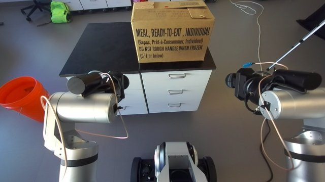
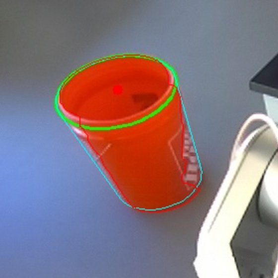
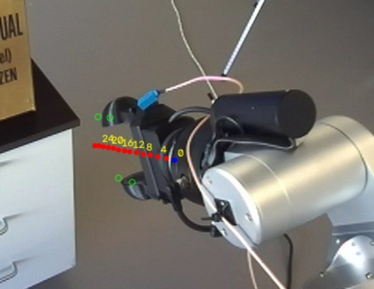
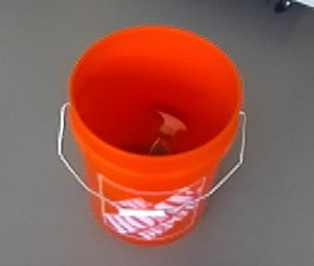
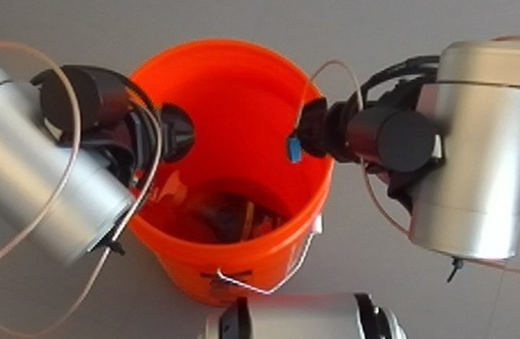
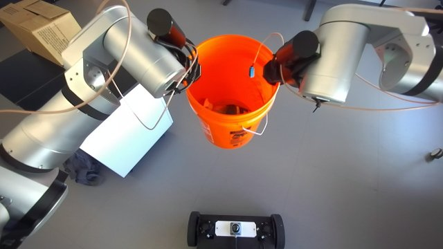
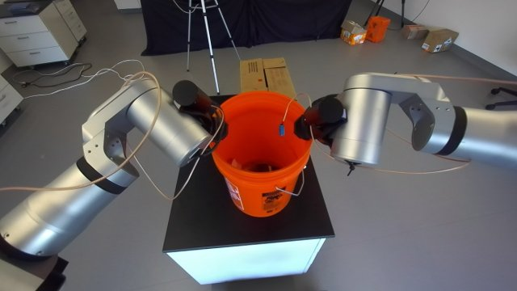
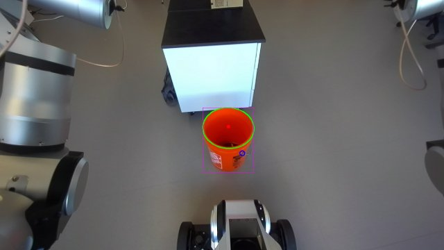
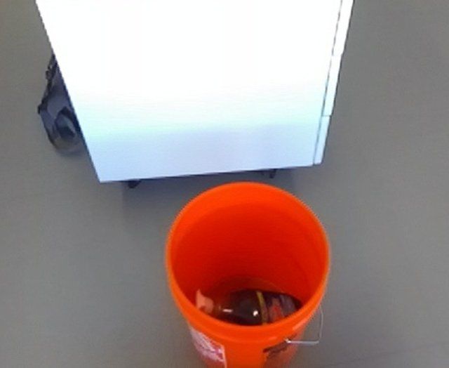
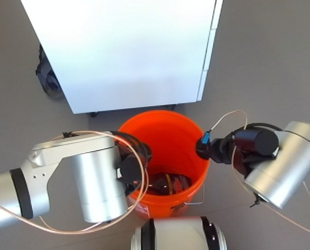
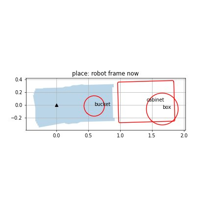
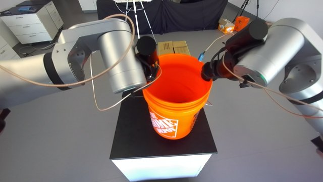
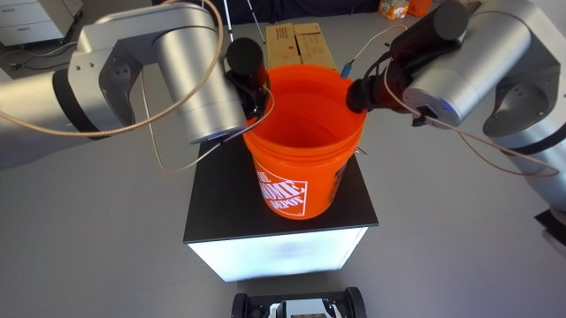
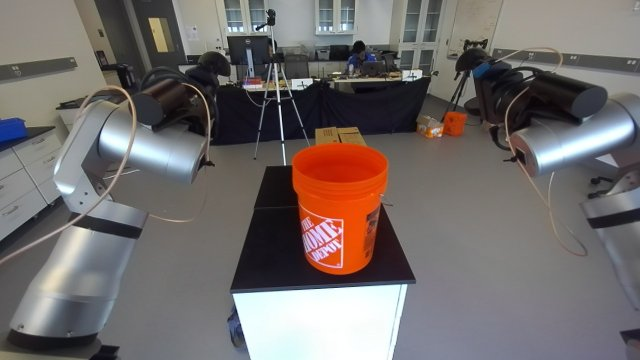
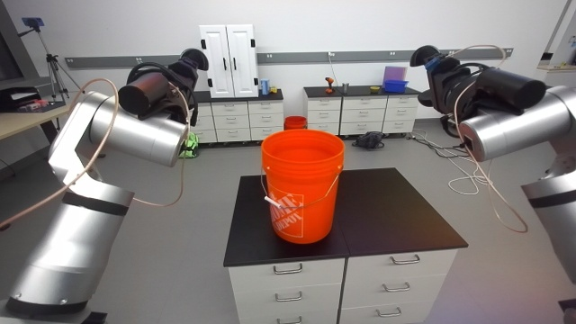
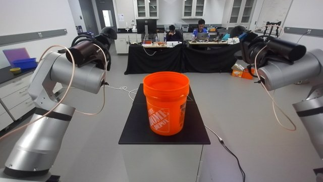
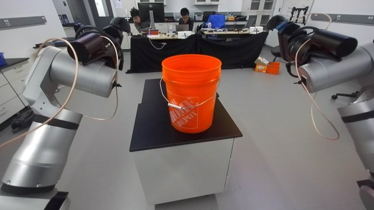
