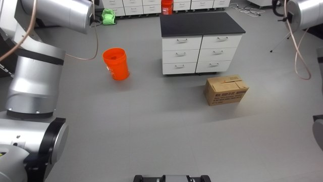
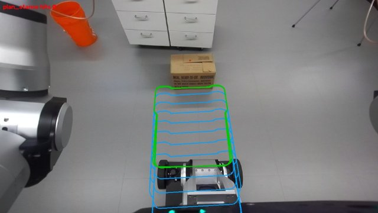
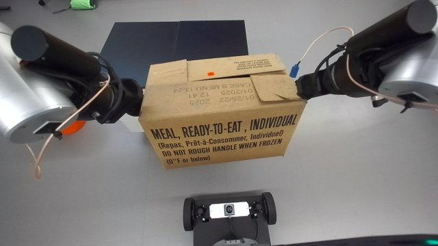
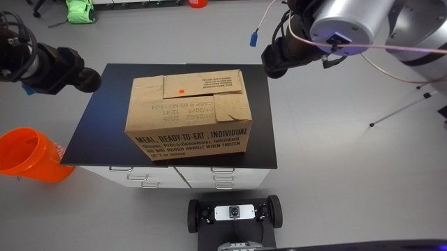
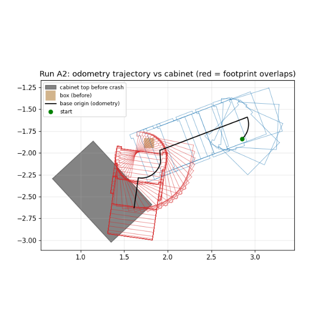

# Box from the floor onto a table (bimanual squeeze, agent checkpoints)

Session `20261009T000539Z_pnp_box_f75f61` (task pnp_box, 2026-10-08). Builds on the library skill
`bimanual-box-squeeze` (closed-ball tool, stance, touch-by-force, torso lift) and adds what it lacked: lifting
higher than the torso allows, carrying, choosing / approaching the table, placing, verifying, and safe base
motion. Status `draft`: one manual success (M1) and one success run checkpoint by checkpoint with the agent
deciding (A3); two automated runs failed (A1 backend error; A2 **crashed into the cabinet**, see Failure modes).

## Deprecated

Replaced by `bimanual-box-pnp` (session 20261009T023700Z_practice_pnp_box_61befa, 2026-10-09): the same squeeze / carry / place primitives refactored into one modular package (core, perception, motion, tasks) with both directions (floor -> table and table -> floor), Gemini-seeded perception (box / table identity, full visibility, table-top segmentation mask for the edge) instead of the colour / size / dark-pixel rules, subagent-monitored steps (STOP-file guard) and the set-down / edge fixes from its runs. This folder is kept unchanged for reference (v1 code in `code/rby1_tasks/`).

## When to use

- A closed carton about 0.40 x 0.22 x 0.26 m (long side 0.36-0.42 by depth), upright on the floor with ~0.6 m of
  clear floor in front of one long side; the robot within ~4 m, torso/arms `ready`, grippers carrying the round
  add-on fingers (closed into "balls", centre 0.195 m along -z_ee).
- Target: a table with a dark top at 0.65-0.75 m (tested: black drawer island 1.0 x 0.62 m, top 0.67 by touch),
  with one side reachable on open floor; the box goes onto it with its long axis along that side.
- Not for: boxes wider than ~0.5 m or heavier than ~2 kg (wrist arm_5 / arm_6 loads), tables above ~0.75 m
  (carry height), cluttered approaches the camera cannot see, unattended runs (the table approach needs the
  agent's judgment at checkpoints; see Failure modes).

## Preconditions

Checked by `posture.prepare` and the steps: armed, no EMO / fault; grippers homed and closed (closes them if
open); torso and arms at `ready` (moves there otherwise); nothing held. `find_box` must see the whole box
(a closer detection smaller than 0.33 x 0.15 m is a partial view and is rejected). The table position is
identified by the agent from images (an odometry prior drifted ~0.45 m after many moves).

## Procedure

Task `tasks/pnp_box.py` (checkpoints marked cp: the run stops, the agent looks at the pictures, then resumes):

1. `prepare`; `find_box` (cp): look sweep, depth clusters in the box-top height band (0.15-0.36 m above the
   support) + cardboard colour (hue 10-25, sat 55-185) + size gates; the box is stored in the odometry frame.
2. `plan_approach_box` (cp) -> `execute_approach` -> `check_stance` (loops): turn-drive-turn about the wheel axle
   (x 0.228) to a pre-stance 1.05 m in front of the box's long side, then to the stance: box centre 0.47 ahead
   and 0.025 m right (the touch-based centre is ~2.5-3.3 cm left of the depth centre: knee clearance). Each
   segment (<= 0.30 m / 0.6 rad) first looks along its swept area and stops if > 25 depth points (stride 3,
   own body / held object / image border / flying pixels removed) lie in the swept footprint (+6 cm); the plan
   is drawn on the camera image for the agent. `check_stance` re-detects the box and stops if it moved > 10 cm.
3. `grasp` (cp): own IK (pinocchio) for the pre-grasp at torso lowest+0.07 (balls 9 cm outside the ends, z 0.20),
   one `rby1_move_body`, squat 0.785 / 1.047 / 1.2, balls down to 0.18, `rby1_cartesian` 1 cm touch steps until
   |dF| > 4.5 N (knee guard |ee y| >= 0.205), +4 mm squeeze with the hand further from the knee (~1.4 N/mm).
4. `lift` (cp): torso 1.1 / 0.9 / 0.7 / ready+lean with the arms fixed (squeeze unchanged), hands to ee z 0.92
   with `rby1_cartesian` component body + all torso joints pinned (wrist load fell 94 % -> 40-60 %), torso to
   zero, hands to ee z 1.17 (box bottom ~0.81); squeeze kept 11-30 N (tighten 2 mm / open 1 mm, body commands).
5. `find_table` (cp): dark points at 0.60-0.85 m; picture with the sides numbered. **The agent identifies the
   table's position and picks the side** (an approach side on open floor; the held box hides the near part of the
   top, so look past both sides of the box). `plan_table` (cp, `--param side=K`) -> `execute_table`.
6. `final_table` (cp): edge measured below / beside the held box (2nd percentile of the dark top's x), drive so
   the top edge is 0.385 m ahead (bumper ~8 cm: drawer handles clear).
7. `place` (cp): hands forward so the box's near face is 6.5 cm past the edge, fast down to ~10 cm above the top,
   then 1 cm steps until a side's base-frame Fz changes > 4 N; release 2.5 cm out + 8 cm up; arms to ready
   (split under the 1.2 rad per-call cap). `verify` (cp): box top - table top 0.21-0.31 m and inside the top.
8. `retreat`: reverse only back along the straight path just driven (no camera behind the robot).

## Code

- Entry `code/run.py` `main(ctx, start=None, resume=None, checkpoints=True, params=None)` -> `{ok, measured, why,
  checkpoint, next, outdir}`; resume with `resume=outdir, start=next` (and `params={'side': K}` for
  `plan_table`). CLI: `python3 <skill>/code/rby1_tasks/run_task.py pnp_box --checkpoints [--resume DIR --start
  STEP --param side=1]` from the workspace root (set `MPLCONFIGDIR=$TMPDIR`).
- Package `code/rby1_tasks/`: `core/` (robot wrappers, `kin.py` pinocchio IK/FK on `robot-model/`, `footprint.py`,
  `world.py` objects in odometry, `runner.py` steps / checkpoints / goto), `perception/` (`box.py`, `table.py`,
  `frames.py`), `primitives/` (`sensing`, `navigation`, `squeeze`, `touch`, `carry`, `place`, `posture`),
  `tasks/` (`pnp_box.py`, `box_table_to_floor.py`: the reverse, used as a scene reset; its set-down was run
  piecewise by hand once). New tasks compose the same primitives.
- Tuned values (tested ranges): stance 0.47 / -0.025 m, standoff 0.09, BALL_Z 0.18, squeeze +4 mm, carry ee z
  1.17, table stance edge 0.385 m, edge margin 0.065, touchdown 4 N, path stop 25 points, segment 0.30 m.
- Offline check: `MPLCONFIGDIR=$TMPDIR python3 <skill>/code/offline_test.py` (needs this session's frames;
  skips missing ones). Outputs: `output/runs/<time>_pnp_box/{log.txt, report_*.json, world.json, *.jpg}`.

## Checks

- find: full-size box (0.33-0.50 x 0.15-0.30 m, top 0.18-0.34 above the support, >= 45 % cardboard pixels).
- each base segment: <= 25 obstacle depth points in its swept footprint; box re-detected within 10 cm of its
  prediction (else stop: contact?).
- grasp: both touches |dF| > 4.5 N within 11 cm; squeeze min |dF| >= 9 N.
- lift / carry: |dF| 8-30 N, every joint load < 130 %.
- placement: touchdown dFz > 4 N; after release |dF| < 4 N; verify height 0.21-0.31 m and inside the top.

### Perception checkpoints

None in this deprecated version (its agent checkpoints were image reviews without subagent briefs). The current checkpoint table is in `bimanual-box-pnp` (## Checks).

## Failure modes

1. **A2 crash (2026-10-08)**: a half-occluded box gave a wrong pose; an unchecked close-range drive pushed the box
   0.5 m, the following in-place turn swept the robot's rear into the island cabinet and a blind 0.35 m reverse
   pushed it ~0.5 m. The base has no contact sensing and the cabinet rolls on casters, so odometry looked normal.
   Now: partial views rejected, every segment checked by perception, reverse only along the path just driven,
   moved-object check, agent checkpoints. Reconstruction: `evidence/images/a2_crash_trajectory.png`.
2. Base backend error ("This stream is expired") -> the run stops (no automatic retry: it hid a broken backend).
3. Table position from an odometry prior was ~0.45 m off after many moves and turned the robot away from the
   table: the agent identifies the table from images. A partial table fit (top hidden by the held box) planned a
   path through the table's corner; the perception check refused it (`a3_06_...jpg`).
4. False path hits: image border depth, depth flying pixels at the held box's edges, the robot's forearms ->
   filtered (border 20 px, 5x5 depth jump > 5 cm, arm envelope + link capsules).
5. Box detector merged the box with a cabinet front through floor noise -> clusters only the box-top band.
6. Wrist torque at the floor: after long Cartesian chains the left arm drifted nearly straight and a 1 cm step
   down tripped left_arm_6 (166 %): when lowering near the floor, release with one IK joint move instead.
7. Off-centre box (> ~4 cm) puts the near wrist into the knee link (model self-collision stop): the knee guard
   refuses the step; re-approach.

## Evidence

| Run | Date | Outcome | Unattended | Conditions |
|---|---|---|---|---|
| M1 | 2026-10-08 | success | no (by hand) | box ~4 m away, carried ~3 m to the island |
| A1 | 2026-10-08 | failure | yes | backend error on a base move |
| A2 | 2026-10-08 | failure (crash) | yes | partial detection, unchecked drive / turn / reverse |
| A3 | 2026-10-08 | success | no (agent checkpoints) | box 0.4 m in front of the island; agent chose the table approach |

