# Find the cube (shell game: track the shuffle, uncover, pick)

Imported from session `20261003T235019Z_find_the_cube_aa6d82` (2026-10-03, 20:07-22:42 local, one Franka FR3
with a Franka Hand, wrist RGB-D camera). The operator's task (TASK.md): "First wait for the operator to place a
cube under a green cup and watch it permute the positions of the cups. after it finishes, you should identify
the cup with the cube insides and lift the cup away, then grasp the cube and lift it in the gripper, as
success". During the session the operator also changed the hiding method (drop the object into an upright
cup, turn it over, then shuffle) and the object (a red wedge instead of the white cube). The agent wrote
`controller.py` and ran it 17 times (11 trials, 6 resumes); trials 4-6 were unattended end-to-end successes,
but the code changed after them (see Evidence), so the skill is a draft.

## When to use

- A person hides one small rigid object under one of several identical inverted cups on the table and
  shuffles them while the robot watches; the robot must say which cup, uncover it and pick the object.
- Tested scene (all of it; nothing else was tried):
  - white table, top at z = 0.09 m in the base frame (the wrist depth reads it 1-3 cm high at the watch pose);
    workspace box x 0.25-0.80, y -0.45..0.45, z 0.10-0.70;
  - 4 green Speed-Stacks-like plastic cups, ~9.3 cm tall, inverted: top at z 0.17-0.19, top disc radius
    2.2-2.5 cm, gripped 1.2 cm below the top at width 0.054-0.056 m;
  - objects: a white cube ~4 cm (held at width 0.0393-0.0396 m; depth footprint 37-53 mm) and a red
    wedge / triangular prism ~4 cm (held across its end faces at width 0.039 m);
  - object start positions x 0.41-0.57, y -0.24..+0.19; cups after the shuffle in a rough row
    x 0.48-0.65, y -0.28..+0.25; shuffles of 46-96 s by one person with both hands from the far (+x) side;
  - hiding moves identified live: a cup put over the object (trials 4, 5, 8), the covering cup slid away with
    the object inside (4, 5), the object uncovered, moved ~6 cm and re-covered (6); identified only by an
    offline replay of the current code, then picked by a resumed run: the object moved by hand with a decoy cup
    on its old spot (3), pushed by a cup and then covered (7), dropped into an upright cup that is then turned
    over (9, 10, 11).
- Cameras: only the wrist camera (1280 x 720, ~7 cm behind the TCP, tilted ~20 deg forward; 30 Hz RGB and
  1 Hz depth in the harness stream). At the watch pose TCP (0.47, 0.0, 0.62) pointing down it sees the table
  over x 0.35-0.95, y -0.5..0.5; image rows below 520 px show the fingers and are ignored.
- Not for: cups that leave the wrist view or are stacked, a shuffle that starts before the arm is at the watch
  pose (trial 0 was lost that way), two cups lifted and swapped high above the table while hidden by the arm,
  objects that are green (masked out as cups), lower than 1-1.5 cm or wider than 8 cm (the start detection
  limits), other tables or cups without editing the absolute heights at the top of `controller.py`
  (TABLE_Z 0.09, cup tops > 0.15 / 0.165 m).

## Preconditions

- Motion armed, gripper free, nothing held; the operator is ready to answer `request_operator` (kind `reset`).
- The code (re)checks: `goto_watch` opens the gripper and reaches the watch pose; `find_cube` must find the
  object in a fresh wrist observation from there (else `ok False`, "object not visible from the watch pose");
  `count_cups` counts 2-6 cups from the green blob areas (falls back to 4; only 4 were tested).
- The object must be visible, not under or touching a cup, before the operator is asked to hide it
  (`--setup` asks the operator to lay the scene out first). The arm must already be at the watch pose when the
  operator starts: the controller asks only after `find_cube`, so do not hide before the request.
- Workspace root as the working directory (`api/`, `runtime/frames/`, `runtime/stream/`, `output/`).
- Launch it as a tracked background job; a process started with `&` inside a shell call was killed when that
  call returned (trial 11).

## Procedure

1. `goto_watch`: open; if not at the watch pose, rise to z 0.30 without turning, go via (0.49, clip(y, +-0.1),
   0.45) turning to straight down, then to (0.47, 0.0, 0.62). A straight rise to 0.62 m off-centre while turning
   was refused by the IK (joint step > 0.2 rad).
2. `find_cube` (watch pose, one `franka_observe` of the wrist): back-project depth; table = per-48 px-block 40th
   percentile of the non-green depth (the wrist depth on the white table reads 1-3 cm high with a bias that
   varies across the image, so a fixed table z found a 918 x 424 mm "cube" in trial 1); object = the largest
   non-green connected blob 1.5-10 cm above that local table (1.0 cm if none), 12-80 mm across, >= 8 mm wide,
   not within 30 px of the image edges / finger region, inside x 0.28-0.80, |y| <= 0.45. Object model = depth
   footprint, area, height and Lab colour; colourful objects (chroma >= 20) are sized by their colour blob
   (depth sees only part of a small red wedge). Cup count from the green blob areas.
3. `wait_shuffle`: `request_operator` (kind `reset`, 900 s timeout) asking to hide the object and shuffle and to
   reply "done"; the shuffle window [t0, t1] is the time of the request to the reply. The window's wrist frames
   (+ 1 Hz depth) are copied to `output/runs/<ts>/wrist/` with `meta.json` (replayable).
4. `identify_cup` (`shuffle.identify` over the stream frames of the window):
   - cups: green pixels (HSV 55-100, S >= 90, V >= 50, half resolution) clustered every frame by k-means
     seeded with the previous centres; a cluster with < 40 px (hand on top) keeps its position;
   - object: its last pixel P; a 60 x 60 px template matched within +-20 px of P every frame (>= 0.85 visible,
     >= 0.92 followed); every 1 Hz depth frame is searched for an object-like bump (relative to the model: short
     side >= 0.6x, long side <= min(90 mm, 1.5x), area 0.4-2.5x, height >= max(8 mm, 0.5x)) > 30 px from P;
     2 consecutive detections within 20 px (3 while covered) = moved by hand: P moves, template re-captured
     (only if the patch has < 5 % green/skin);
   - covered: object occluded at P while one cup track is within 65 px of P for 12 frames; from then on the
     object travels with that cup (other cups passing over P do not count); only a clear view (score >= 0.92)
     cancels the cover;
   - dropped in: an object-coloured hole inside a green cup blob (shadowed wall ignored, object colour never
     counted as skin) within 70 px of a cup track for 8 frames while the template is not visible;
   - fails (no motion) if no cup ever covered / received the object, or two tracks end < 45 px apart.
   Writes `tracks.jpg` (16 frames, red C = the cup holding the object).
5. `locate_cups`: new wrist observation; k-means seeded with the final track pixels; each cup = median of the
   depth points with z > 0.15 in a 25 x 25 px window; stop if any cup drifted > 40 px since the shuffle ended.
6. `remove_cup`:
   - close look from (x - 0.10, y, 0.50) (camera ~0.4 m away, inside the depth range); the top disc = green depth
     points above 0.165 m nearest the cup (within 6 cm); centre = disc edge nearest the camera minus the radius
     (2.2-3.5 cm, from the width across the view) because depth misses the far half of the disc (trial 3: 2.4 cm
     error, finger on the cup top);
   - yaw from {90, 45, -45, 0} deg with the most clearance between the 21 x 6 cm hand body and other cups
     (trial 1: with the fingers along the row the body rested on the neighbours);
   - descend via z 0.42 and top + 3 cm to top - 1.2 cm (tolerance 4 mm, a stop <= 8 mm short counts);
     grasp width 0.04 at 8 N; `wait_gripper` polls until the fingers have moved and settled; check width
     0.035-0.078 m. Trial 8 gripped 3 cm below the top at 15 N and pinched the cube inside through the wall;
   - a stalled descent: back up 8 cm, look again from 10 cm to the side, average the two centres, retry once;
   - lift to top + 15 cm; drop spot = nearest free point of the grid x {0.42, 0.47, 0.62, 0.68} x
     y -0.30..0.30 (step 0.05; far side only |y| <= 0.15) at >= 9 cm from the other cups and the object;
     travel in <= 0.35 m segments, release 2 cm above the grasp height; an IK refusal high up tries the next
     spot (x 0.36 at z 0.165 hit the J4 limit; (0.68, -0.33) and (0.68, -0.23) exceeded the 0.2 rad joint step).
7. `grasp_cube`:
   - look from (x - 0.02, y, 0.36); object = `find_cube` within 8 cm, or the colour blob for colourful objects;
     height clipped to 1.2-9 cm; colourful objects: orientation from the lit top face, a ridge (two halves
     differing > 12 in L) means a wedge;
   - closing direction: square footprint -> a face pair; wedge -> along the ridge onto the parallel end faces
     (squeezing the sloped faces pushed it away); elongated -> across the narrow side; each at the half turn with
     >= 4 cm hand-body and >= 8 cm wrist-camera clearance to other cups (the camera touched a cup in trial 10);
     a cup that still blocks is moved first (`remove_cup(prefer='clear')`);
   - descend via 0.25 and top + 5 cm to mid-height (>= table + 8 mm), close to contact (width 0) at 12 N
     (< 45 mm) or 20 N; < 6 mm = closed on nothing -> retry; 2 cm test lift: fingers closing in > 4 mm = slipping
     -> set down, open, retry; plan (axis 1, default force), (axis 2, default), (axis 2, 6 N), (axis 1, 6 N);
   - lift to z 0.25; success when 0.006 < width < 0.078 (an empty closed grasp still reports `is_grasped`).
8. Rescue: if no object is under the lifted cup, lift that cup again from its drop spot and look where it was
   set down (for an object carried inside the cup). Never triggered on the robot.

## Code

Entry `code/run.py`, run from the workspace root:

```python
import importlib.util
spec = importlib.util.spec_from_file_location('find_cube', 'skill-library/skills/find-the-cube/code/run.py')
fc = importlib.util.module_from_spec(spec); spec.loader.exec_module(fc)
r = fc.main(ctx)                                   # full trial: watch, ask, identify, uncover, pick
r = fc.main(ctx, resume={'final_px': [[717.0, 384.5], [875.6, 346.8], [606.3, 368.1], [441.8, 373.6]],
                         'cover_id': 0})   # start at locate_cups; add 'model' from the run's wrist/meta.json
```

or `python skill-library/skills/find-the-cube/code/run.py [--setup] [--resume JSON] [--object-name NAME]`.

`main(ctx, resume=None, setup=False, object_name='white cube', out_dir=None)`:
- `setup`: first ask the operator to lay out the cups and the object in plain view (trial 10 only).
- `resume`: `{'final_px', 'cover_id'[, 'model']}` from `replay.py` (or a previous run's report); skips
  find/wait/identify. Used 6 times after an identification failure or a crash.
- `object_name`: the object named in the operator request (new parameter; the session always said "white cube").
- `out_dir`: default `output/runs/<YYYYmmddTHHMMSS>/` under the working directory.
- Returns `{ok, measured, why}`; `measured`: `failed_step`, `error`, `duration_s`, `run_dir`, `object_xy`,
  `object_model`, `cover_id`, `cup_px`, `events`, `cup_xyz`, `cup_dropped_at`, `grasp_width_m`, `grasp_yaw_deg`,
  `grasp_attempts`, the per-step results `steps` (with frame ids) and `checkpoints` (below). `why` is
  `"<step>: <reason or exception>"`. The run directory holds `report.json`, `log.txt`, `tracks.jpg`, `wrist/`.
- On failure the arm stays where the step stopped: at the watch pose for perception failures, or holding the
  cup / object above the table if a later step failed.

Modules: `controller.py` (the pipeline: `goto_watch`, `step_find_cube`, `find_cube(frame)`, `local_table`,
`count_cups`, `wait_shuffle`, `identify_cup`, `locate_cups_now`, `remove_cup`, `disc_centre`, `grasp_cube`,
`grasp_yaws`, `blocking_cup`, `wait_gripper`, `move` / `move_far` / `safe_move`, `main(ctx, ...)` -> the session's
report dict), `shuffle.py` (`identify(frames, depth_frames, cube_px, detect, roi, n_cups, model=...)`,
`cube_in_cup`, `save_sheet`; no robot), `tracker.py` (green mask, seeded k-means), `replay.py` (offline
identification of a saved `wrist/` recording: `python replay.py <run_dir>/wrist <frame_id> [sheet.jpg]`, needs
`runtime/frames/<frame_id>`), `reset.py` (put a held object down where it is, back to the watch pose),
`arrange.py` (`--object-at X Y --home`: put the object down, line the cups up at x 0.55, y +-0.06/+-0.18, home).

Tested constants (top of `controller.py` / `shuffle.py`): WATCH_POS (0.47, 0, 0.62), ROI rows < 520 px,
TABLE_Z 0.09, CUP_GRASP_BELOW_TOP 0.012 (0.03 pinched the cube), CUP_FORCE 8 N (15 N pinched), CUBE_FORCE 20 N,
SMALL_FORCE 12 N, GENTLE_FORCE 6 N, SLIP_MM 4, HAND 0.21 x 0.06 m, HAND_CLEARANCE 0.04, CAM_CLEARANCE 0.08,
DROP_CLEARANCE 0.09, DROP_ABOVE_GRASP 0.02, CLOSEUP_BACK 0.10, CLOSEUP_Z 0.50; shuffle COVER_PX 65 (45 missed
trial 7's cover), COVER_FRAMES 12, VISIBLE_SCORE 0.85, UNCOVER_SCORE 0.92, INSIDE_FRAMES 8.
`controller.COVER_PX = 45` is a stale unused constant (identification uses `shuffle.COVER_PX`).

Changes from the session's final code (session repo HEAD `2070978`, identical to the working tree; the robot's
last runs used `cb1fa99`, which lacks only `remove_cup(dest=...)`, used by `arrange.py`):
- `run.py` is new: the library entry around the session's `controller.main` (run directory, report.json /
  log.txt as the session's CLI wrote them, `{ok, measured, why}`, perception checkpoint briefs).
- `ROOT` (frames, output, `api`) is the working directory instead of `parents[2]` of the file;
  `reset.py`, `arrange.py`, `replay.py` put the working directory on `sys.path` the same way.
- `from api import stream` moved into the two functions that use it (and into `tracker.track`), so the
  perception code imports without the harness.
- `wait_shuffle` / `main` / `run_steps` take `object_name` (default the session's "white cube").
- comments only: the stale `controller.COVER_PX`, docstring paths.
- Left out: `replay_all.py` (regression over that session's recordings with hard-coded paths and answers),
  `run_recorded.py` (trial-1 script; calls a `main(skip_wait=...)` that no longer exists), `README.md`
  (distilled here).
No algorithm, threshold or motion was changed. Offline check of the library copy (2026-10-15): `replay.py` on
the trial-4 and trial-11 recordings reproduces the session's answers (cover 0, final px (893.9, 226.5); dropped
in cup 0, final px (717.0, 384.5)), and `find_cube` on the trial-4 start frame gives the same 45 x 47 mm,
area-793 object.

**Changed since the session's runs:** `code/run.py` is new: it wraps the session's `controller.main` to return `{ok, measured, why}`, and adds the `object_name` parameter (the session always asked for "white cube"). Output paths now resolve against the working directory. These changes were checked offline only (every module imports with a stubbed `api.runtime`); they have not run on the robot. No motion, perception or threshold changed. The hyper-parameters later moved unchanged into `code/find_the_cube_params.py` (2026-10-15).

**Hyper-parameters** are in one list, `code/find_the_cube_params.py`; the modules import them from there. They moved there unchanged on 2026-10-15: every value was compared before and after with each module imported offline, and no behaviour changed. In a setup this skill was not tested in, calibrate the values marked CALIBRATE (`ROW_X`, `ROW_Y`, `WATCH_POS`, `ROI`, `TABLE_Z`, `CUBE_Z`, `CUP_TOP_MIN_Z`, `CLOSEUP_Z`, `CAM_OFFSET_TCP`); each comment says how to measure it.

## Checks

- `goto_watch`: every `franka_move_pose` reached (or <= 8-10 mm short where `accept_mm` is given).
- `find_cube`: an object 12-80 mm inside the table area; logged model (trials: footprint 37-53 mm,
  area 571-824 px, height 2-4 cm).
- `identify_cup`: a cover / dropped-in event and final tracks >= 45 px apart (trials 3, 4, 11: 112-148 px).
- `locate_cups`: every cup has >= 20 depth points with z > 0.15 at its centre; drift <= 40 px (trials 0-10 px).
- `remove_cup`: cup top 0.14-0.24 m (trials 0.182-0.191); grasp width 0.035-0.078 (trials 0.054-0.056).
- `grasp_cube`: object found within 8 cm of the cup's spot; width after the 2 cm test lift not > 4 mm below the
  closing width; final width 0.006-0.078 at z 0.25 (cube 0.0393-0.0396, wedge 0.039).
- Success: the object between the fingers above the table (wrist and exterior image), the moved cup standing
  at its drop spot.

### Perception checkpoints

| Step | Subagent model | Frames | Question | Expected answer | Pass if | On fail |
|---|---|---|---|---|---|---|
| find_cube (before the request) | haiku | `runtime/frames/<find_cube frame>/wrist.jpg` and the logged pixel | Is there exactly one small object at pixel (u, v) on the table, clear of the cups, and is it the object to hide (not a finger edge, shadow or cup)? | yes / no + what is there | yes, and `object_xy` inside x 0.28-0.80, abs(y) <= 0.45 | stop; ask the operator to place the object in view; run again (trial 10's false detection sat at the image corner) |
| identify_cup | agent (you) or a strong model | `<run_dir>/tracks.jpg` | Follow the red C track: is C the cup that was put over the object (or that the object was dropped into), and does it end on a cup apart from the others? | yes / no + the pixel of the cup that holds the object | yes | `replay.py <run_dir>/wrist <frame>` (or the live stream), check its sheet, then `main(ctx, resume=...)` |
| remove_cup (after the drop) | haiku | close-up wrist frame of `grasp_cube` (`steps.grasp_cube.frame`) | Is the object visible on the table where the lifted cup stood? | yes / no | yes | the object may be inside the moved cup (trial 8): the rescue step lifts it again; check the exterior view |
| grasp_cube (after ok) | haiku | a new `franka_observe` (wrist + left) | Is the object held between the gripper fingers above the table, and are the other cups standing? | yes / no + what moved | yes, and 0.006 < `grasp_width_m` < 0.078 | look where the object is; put it down with `reset.py` before retrying |

The code returns the identify and final-grasp briefs in `measured.checkpoints`; in the session the agent ran
these checks itself by looking at the frames and sheets.

## Failure modes

- Operator shuffles before the arm reaches the watch pose (trial 0): the exterior-camera tracker lost the cups.
  Not detected by the code; the controller asks for the shuffle only after it is at the watch pose.
- Wrist depth bias at the watch pose (trial 1: a 918 x 424 mm "cube"): local table map. A finger-edge
  detection in an image corner (trial 10: 8 x 56 mm at (0.77, 0.52)): edge and workspace filters; still check
  the found pixel (checkpoint) - a wrong start pixel makes identification fail later with "not seen being
  covered".
- Missed cover: the cup blob centre 53 px from the object under it (trial 7) -> COVER_PX 65. Shows as
  `identify_cup` ok False "the cube was not seen being covered by a cup", before any motion; replay with a fix,
  then resume.
- New hiding move the tracker does not know (trial 9: dropped into an upright cup, no events) -> `cube_in_cup`.
  Same symptom; an unknown move today fails the same way (safe).
- Object moved by hand with a decoy cup on its old spot (trial 3: the old static-cube code picked the decoy) ->
  depth move detection; verified by replay and a resumed pick only.
- Cup centre off from the half-disc depth (trial 3: 2.4 cm, finger on the cup top, 38.6 mm stall) ->
  `disc_centre`; a stall triggers one side look and retry, then ok False "fingers blocked above the cup twice".
- Hand body on neighbouring cups (trial 1, fingers along the row, 41-42 mm stalls) -> yaw by clearance.
- `franka_gripper` replies before the fingers move (trial 3 resume 1: width 0.080, grasp rejected) ->
  `wait_gripper` waits for motion; a width outside 0.035-0.078 opens, rises and returns ok False.
- Cup pinched the cube inside it (trial 8, 3 cm / 15 N; operator: "you grasped them together") -> 1.2 cm /
  8 N. Shows as "no cube under the lifted cup"; the rescue step (never run on the robot) lifts the moved cup
  again.
- Drop spot refused by the IK (trial 2: J4 margin at x 0.36, z 0.165; trials 3/5: joint step 0.204-0.205 rad at
  (0.68, -0.33)/(0.68, -0.23); trial 10: moves > 0.4 m) -> x >= 0.42, far side |y| <= 0.15, move splitting,
  next spot on a refusal high up; "no reachable drop spot" leaves the cup held above the table.
- Final descent near the table times out ~5 mm short (trial 2: 4.8 mm) -> `accept_mm` 8-10 mm.
- Wedge slides out when squeezed on its sloped faces / pushed away (trial 10: closed on nothing twice, slip
  0.0385 -> 0.023 m and 0.0418 -> 0.0268 m) -> slip-checked test lift, other axis, 6 N; final hold on the end
  faces at 0.039. Wrist camera touched a cup (trial 10; operator asked to clear the cup) -> camera clearance and
  the make-room step (added after that trial; never run on the robot).
- `is_grasped` is true for an empty closed grasp (width 0.0002): only widths are trusted.
- Controller killed when launched with `&` inside a shell call (trial 11): no report; the shuffle was
  recovered from the 10-minute stream and identified offline, then resumed.
- Not seen but possible from the code: `wait_shuffle` does not check the reply status, so a 900 s timeout
  would run identification on whatever the window holds; `main` relies on the operator not touching the cups
  after "done" (drift > 40 px stops it).

## Evidence

Runs of the controller in session `20261003T235019Z_find_the_cube_aa6d82`, all 2026-10-03, all `pre-library`
(details in `evidence/runs.jsonl`). "Resume" = started at `locate_cups` with an identification computed
offline by the same identification code, so never unattended end-to-end.

| Run | Code | Outcome | Unattended | Conditions |
|---|---|---|---|---|
| 1 | pre-git | failure (finished by hand) | no | white cube, cup over it + swaps; identification correct, both descents stalled ~41 mm |
| 2 | pre-git | failure (2 manual steps) | no | identification + cup grasp correct; drop refused (J4), cube descent 4.8 mm short |
| 3 | adf0434 | failure | yes | cube moved by hand + decoy cup: wrong cup; finger on the cup top |
| 3 resume 1 | 629a8c9 | failure | no | grasp check fired before the fingers moved (fixed) |
| 3 resume 2 | d564623 | success, 110 s | no | right cup (replayed identification), drop fallback, cube 0.0393 |
| 4 | 3ea94a3 | success, 167 s | yes | cup over the cube, slid across, shuffled 49 s; cube 0.0393 |
| 5 | d780f4b | success, 231 s | yes | covering cup slid away, 96 s shuffle, drop fallback; cube 0.0394 |
| 6 | 2d80ef3 | success, 194 s | yes | covered, uncovered + moved 6 cm, re-covered; cube 0.0394 |
| 7 | e429c49 | failure (safe stop) | yes | cube pushed then covered: cover missed (53 px > 45) |
| 7 resume | 2292d63 | success, 88 s | no | COVER_PX 65 replay; cube 0.0396 |
| 8 | c2477e0 | failure | yes | right cup, but the 3 cm / 15 N cup grasp carried the cube away inside the cup |
| 9 | 0bfa24b | failure (safe stop) | yes | cube dropped into an upright cup: no events |
| 9 resume | e2f8db3 | success, 98 s | no | dropped-in replay; first 1.2 cm / 8 N cup grasp; cube 0.0393 |
| 10 | d4f7782 | failure (safe stop) | yes | red wedge: false start detection at the image corner |
| 10 resume | 7b51167 | failure | no | right cup; wedge slid out; finished with many fixes and help |
| 11 | cb1fa99 (final) | failure | no | red wedge; process killed by the sandbox while waiting |
| 11 resume | cb1fa99 (final) | success, 86 s | no | wedge dropped into a cup; offline identification; wedge grasped first try, 0.039 |

Status: draft. The three unattended end-to-end successes (trials 4, 5, 6) ran code that was changed afterwards
in identification (COVER_PX, dropped-in, object model), cup grasp (1.2 cm / 8 N), object grasp (slip check,
camera-aware yaw, colour detection) and drop spots, so they do not count for the committed code. The committed
behaviour ran on the robot only in trial 11 (killed) and its resume (success, not unattended). To verify: two
unattended end-to-end runs of `code/run.py`, ideally one per hiding move and object. Outside these runs: trial 0
(operator shuffled before the watch pose; offline exterior-camera tracking lost identity), the manual finishes
of trials 1, 2, 8 and 10, the session's `replay_all.py` regression (8/8 recordings identified correctly, as the
session reports it), and an `arrange.py` reset (wedge placed at (0.45, -0.28), cups lined up at x 0.55).

Start (trial 4): the cube beside four inverted cups, exterior left camera and the wrist view the code uses.

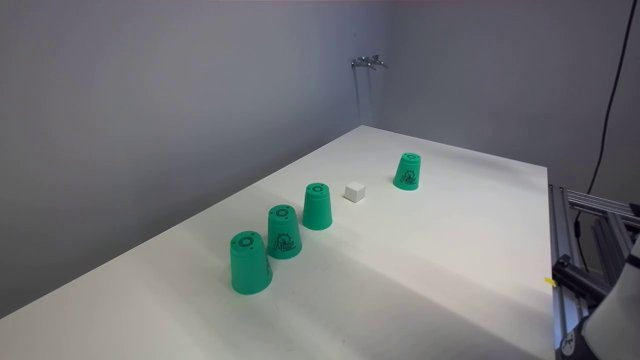
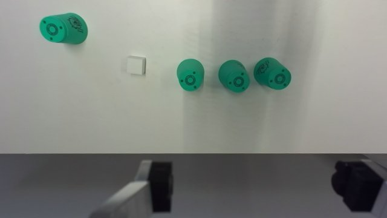

Identification (trial 4 `tracks.jpg`, 4 of 16 frames): the yellow box is the cube; cup C is put over it
(covered at 21:05:38), carried across and ends at the right of the row.

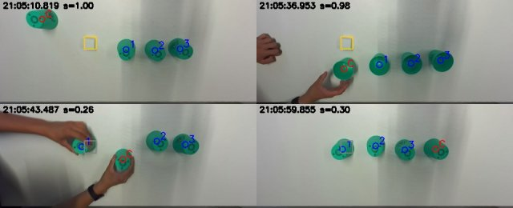

Success (trial 4): the cube held 0.25 m up, wrist and exterior right camera.

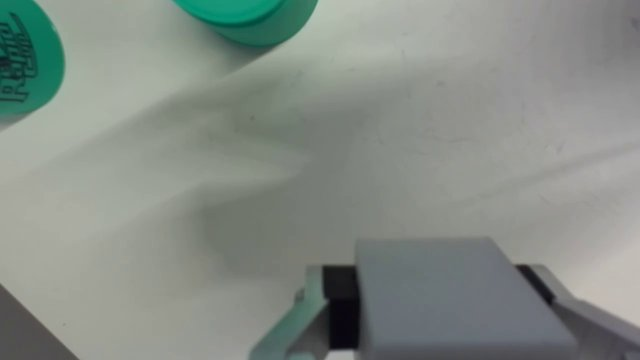
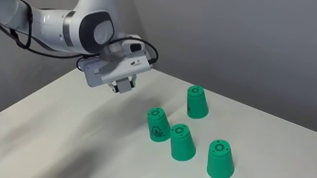

Success of the final code (trial 11 resume): the red wedge lifted, cups standing.

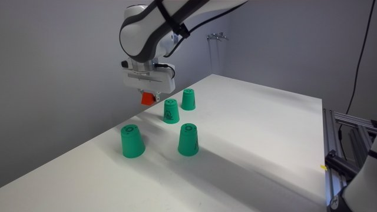
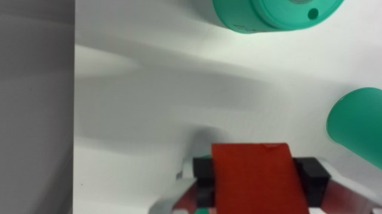
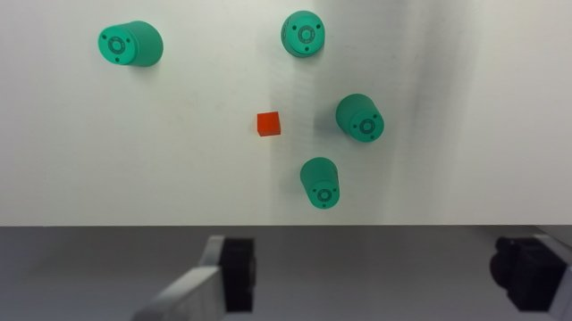
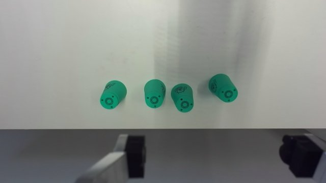

Dropped-in hiding (trial 9 replay sheet: the cube detected inside an upright cup, red circle).

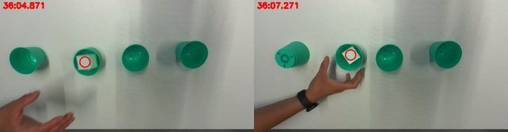

Other successful runs, start (cups after the shuffle or the cube at the start) and end (object held):

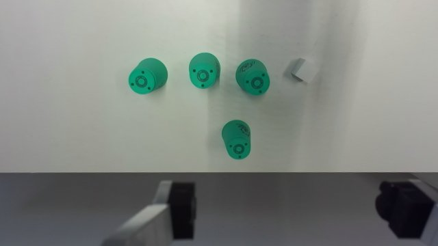
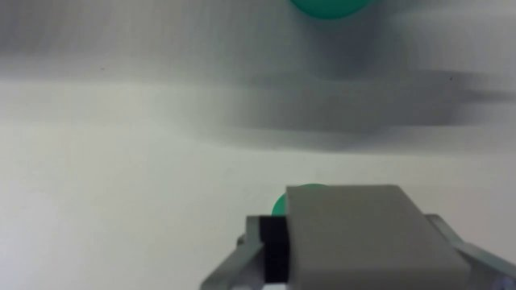
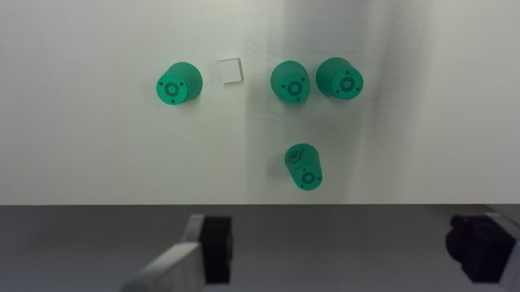
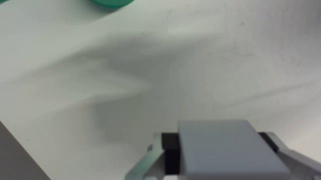
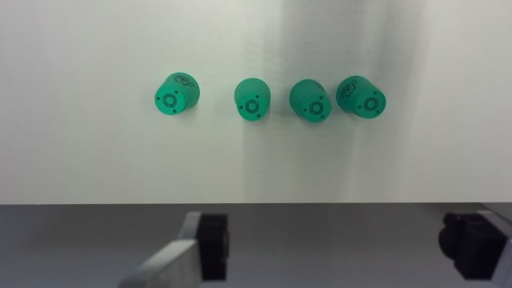
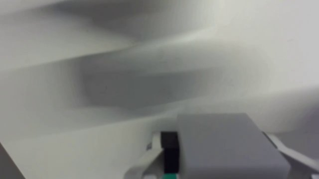
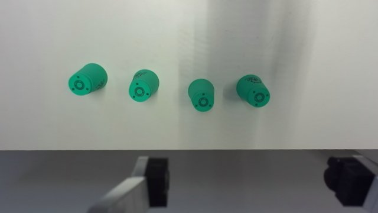
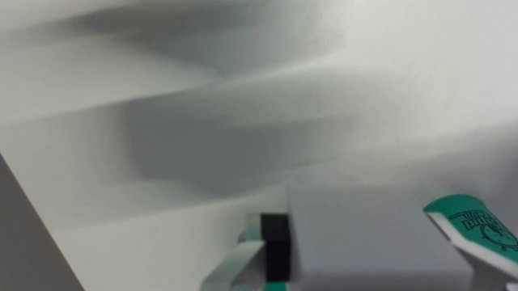
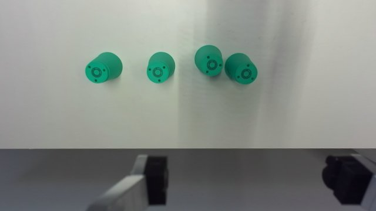
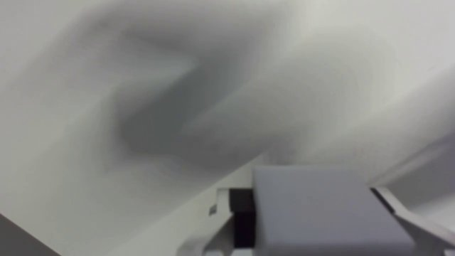
