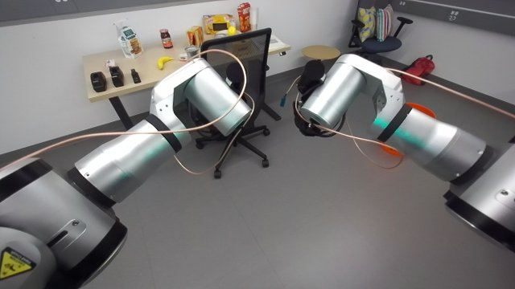

# Hand reach by whole-body optimal control (no IK search)

Session `20261010T011251Z_compositional_manipulation_aa1adf` (2026-10-09). Written on the operator's request:
"adapt the skills using the optimal control tools with no brute force search". The library skills solved IK
locally and searched: office-chair-tuck v3 tried 3 seeds per arm (once it took a flipped-shoulder solution,
joint1 -3.1, and the next Cartesian descent timed out), bimanual-bucket-rim-pnp tried 7+ seeds, stack-cups looped
over rim angles x pitches x yaw flips, and the compositional session searched gripper yaws for a natural elbow.
Here the controller solves ONE weighted problem on the robot, continuously from the current joints, so the
solution cannot jump branches and nothing is searched.

## When to use

- Any hand pose (position + orientation) for one or both hands in free space or approaching an object from
  clearance: pre-grasp poses, hands up / out of the camera's view, poses over a container for a drop.
- The final straight contact moves (descend onto a bar, insert, touch) stay with `rby1_cartesian` (translation,
  torso pinned), which the skills already use.
- Tested: torso `ready` and `zero`, hands 0.40-0.57 m ahead, z 1.05-1.39, y +-0.10 .. +-0.30, fingers pitched -45
  deg with yaw up to +-0.17 rad, rotations up to ~1 rad from `ready`.
- Not for: moves that need the torso to squat / lean a lot (give `torso=` the 6-vector, untested beyond holding),
  contact moves, speed (each call takes 6-12 s; ~23 s for a ready -> pre-grasp move).

## Preconditions

Armed, no fault (the tool refuses otherwise). Every waypoint command is dry-run with `rby1_check`
(`rby1_optimal_control`: reach and per-call caps) before it is sent; the backend watches joint limits (stops a
joint within 0.03 rad of its limit), torque (150 %) and self-collision while it runs.

## Procedure

1. Read the status: start poses of the hands, torso value to hold (the START value, not re-read per waypoint: a
   re-read let the soft hold drift 0.01-0.03 rad).
2. Waypoints: n = max over hands of ceil(distance / 0.20 m), ceil(rotation / 0.35 rad); position linear,
   orientation slerp (0.8 rad per call spiked left_arm_6 to 151 %).
3. Per waypoint, one `rby1_optimal_control` (component `body`): link targets `ee_<side>` for the moving hands
   (translation weight 10, rotation weight 5, or < 1 for "position only"), the non-moving hand at its measured pose
   (weights 10), joint targets torso_1/2/3/5 = hold values (weight 10; the backend adds torso_0 = torso_4 = 0) and
   the posture prior per moving arm: joint 1 (shoulder roll) -> -+0.45 weight 1.5, joint 3 (elbow) -> -1.9
   weight 0.2, joint 5 (wrist pitch) -> 1.2 weight 0.6 (<= 10 joint targets per call).
4. After each call: measured error and loads; stop on a refusal, a backend stop or loads > 130 %.
5. Final check: position error <= 5 mm, rotation error <= 0.03 rad (only when the rotation weight >= 1).

## Code

```python
import importlib.util
spec = importlib.util.spec_from_file_location('oc_reach', 'skill-library/skills/oc-hand-reach/code/oc_reach.py')
O = importlib.util.module_from_spec(spec); spec.loader.exec_module(O)
r = O.move_hands(ctx, {'right': {'pos': [0.52, -0.10, 1.05], 'quat': O.quat_yaw_pitch(-0.17, -0.785)},
                       'left':  {'pos': [0.52, 0.10, 1.05], 'quat': O.quat_yaw_pitch(0.17, -0.785)}})
# or the entry: run.main(ctx, targets={'right': {'pos': [...], 'yaw': -0.17, 'pitch': -0.785}})
```

`move_hands(ctx, targets, torso=None, posture='natural', w_posture=0.2, w_torso=10, step_m=0.20,
step_rad=0.35, tol_m=0.005, tol_rad=0.03, max_load=130, log=print)`:
- `targets`: `{side: {'pos', 'quat' (None = keep), 'w_pos' 0-10 (10), 'w_rot' 0-10 (5; < 1 = position only)}}`.
- `torso`: None = hold (tested), a 6-vector = move there with the hands (linear per waypoint; untested),
  `'free'` = no torso targets (untested).
- `posture`: `'natural'` (NATURAL x PRIOR weights scaled by w_posture / 0.2), None, or `{side: 7-vector}` (e.g.
  a measured successful configuration as the reference).
- returns `{ok, why, measured: {side: {pos, quat, err_pos_m, err_rot_rad, arm}}, calls, seconds, loads, torso}`.
Helpers: `quat_yaw_pitch(yaw, pitch)` (R = Rz(yaw) Ry(pitch), fingers along ee -z), `yaw_toward(ctx, side, pos)`
(closed-form yaw from the shoulder towards a point, via `rby1_fk`), `slerp`, `R_from_quat`, `quat_from_R`.
Users: office-chair-tuck v4 (`move_arms_joint`, `hands_up`, measure pose), stack-cups, bimanual-bucket-rim-pnp.

## Checks

- Each waypoint: `rby1_check` accepted; after it, loads < 130 % (else stop).
- End: hands within 5 mm (and 0.03 rad when orientation matters) of the targets; the other hand did not move
  (measured 0.0 mm in test 1); torso within a few mrad of the hold value.

### Perception checkpoints

| Step | Subagent model | Frames | Question | Expected answer | Pass if | On fail |
|---|---|---|---|---|---|---|
| after a move near an object (caller) | agent / haiku | head_camera after the move | Are the fingers where the plan puts them, clear of the object and the robot? | yes / no + what touches | yes | back off along the approach, replan from a new observation |

The primitive itself moves in free space; callers own the object checkpoints.

## Failure modes

1. Weak shoulder-roll prior (0.2): with both hands close together in front, right_arm_1 adducted to -0.012 rad and
   the backend stopped the move (hands 2-5 mm from the target). Now joint 1 -> -+0.45 at weight 1.5.
2. 0.8 rad of rotation per call: left_arm_6 torque 151 % at the start of the move. Now <= 0.35 rad per call.
3. A target that needs a joint at its stop: chair hands_up (0.40, -+0.30, 1.30) pitched -45 deg at torso zero
   needed right_arm_5 at 1.89 (limit); even with a wrist prior it converged 8 mm off at 1.794. The controller does
   not know the 0.2 rad margin rule: give such "position only" targets a low rotation weight (0.3), or change the
   target. Failures show as `ok False` with the backend reason; the robot holds in place, still controllable:
   recover with a joint move away from the limit (e.g. arms to `ready`).
4. Soft torso hold drift (0.01-0.03 rad) when the hold value was re-read per waypoint: now the start value.
5. Trial 2 (2026-10-10), on the robot: with the 'natural' prior from a start far from NATURAL (an arm at `ready`
   going to fingers-down yaw -165 deg, the chair-grasp pose going to hands-up, a fingers-down carry pose going to a
   pitched drop pose) the FIRST waypoint moved several joints 0.5-0.9 rad at once and the backend stopped it:
   left_arm_6 166 % and 168 %, right_arm_5 at its limit. The robot held in place each time. Use posture='current'
   (anchor at the live joints) or a joint move (one local IK solve, joint-space interpolation at the backend's
   speed caps) for big reorientations; the chair / cups / drop callers now use joint moves there.
6. Two hands + prior settle 3-7 mm off (chair pre-grasp, twice): accept ~12 mm when the next move goes to an
   absolute target.

## Evidence

| Run | Date | Session | Outcome | Unattended | Conditions |
|---|---|---|---|---|---|
| T1 | 2026-10-09 | compositional_manipulation | success | yes | right hand 12 cm + 0.4 rad, 0.5 mm |
| T2a | 2026-10-09 | same | failure | yes | two hands to y +-0.10: shoulder-roll limit stop |
| T2b | 2026-10-09 | same | failure | yes | same, 0.8 rad per call: wrist torque stop |
| T2c | 2026-10-09 | same | success | yes | fixed prior + 0.35 rad steps: 1.1 / 1.2 mm, 23 s |
| C1 | 2026-10-09 | same | success | yes | chair v4 pre-grasp (synthetic bar), 0.3 mm |
| C2 | 2026-10-09 | same | failure | yes | chair hands_up exact -45 deg: wrist-limit stop |
| C3 | 2026-10-09 | same | success | yes | hands_up position-only (w_rot 0.3): 1.7 mm |
| T3 | 2026-10-09 | same | success | yes | both hands visible pose, 1.0 / 0.8 mm |
| T4 | 2026-10-10 | same | failure | no | trial 2 on the robot: 3 first-waypoint stops from far-from-natural starts (posture='current' added) |
| C5 | 2026-10-10 | same | success | no | trial 2 chair two-hand pre-grasps: 5.5/6.5 and 3.3/4.2 mm |

All in free air (no object); the object-level use is evidenced in the calling skills once they run with it.


