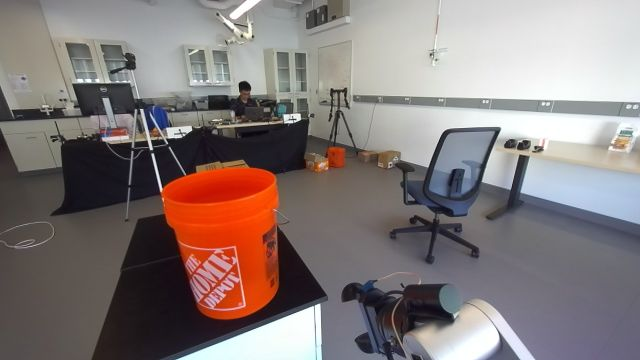
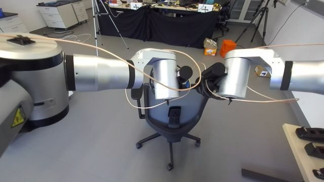
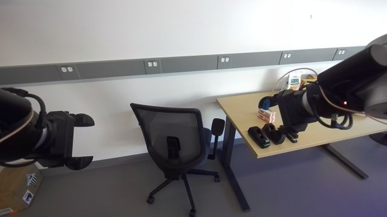
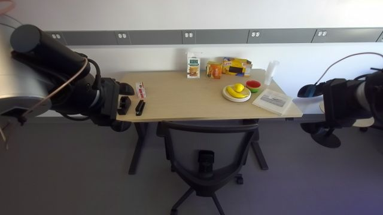

# Office chair: grasp the backrest and tuck / park the chair

## When to use
- A 5-star office chair on casters with a framed mesh backrest whose top bar is at z≈1.0-1.05 m (tested: one
  chair, bar ≈0.40 m wide, curved: x ≈ 1-1.7·y² around its middle, ≈2.5 cm thick), armrests ≈0.70 m high.
- Tuck it under a desk (tested: light-wood sit-stand desk, top 0.745 m, the armrests pass under) or park it against
  a wall; any start pose as long as the robot can stand square behind the backrest with open floor around
  (the base turns sweep r≈0.62 m behind the drive axle; the held chair sweeps ≈1.0 m around the axle).
- Not for: chairs without a graspable top bar, lifting chairs, stairs/ramps, a person sitting on the chair.

## Preconditions
- Custom round fingers (closed ball 0.195 m, open tips ~0.20 m along ee -z; robot-interface "Custom fingers").
- Torso ZERO (standing: shoulders 1.37 m), chest 0, hands up/wide (`measure` puts them there), grippers homed.
- The robot stands square behind the backrest, bar front surface ≈0.55-0.65 m ahead (`measure` reports
  `bar_x`); `square` turns by the measured chair yaw and lane-changes to centre the bar (|y| < 0.06 m).
- Before `tuck`: the robot square to the desk and `measure` has seen the desk front (desk front x stored).

## Procedure
1. `measure`: hands wide (y ±0.42-0.46), head (0, 0.66), observe; depth+colour bar profile (dark points
   z 0.95-1.06 per 2.5 cm y bin: front x, top z), flat-top centre, curvature, chair yaw from the bar ends; desk front
   edge from light-wood colour at z 0.70-0.80.
2. `square`: turn the base by the chair yaw (if > 0.06 rad), lane change (back, turn ±35°, drive, turn back to the
   stored odometry yaw) to centre the bar.
3. `grasp`: hands at bar centre ±0.10 m; each gripper yawed to the local bar tangent (yaw = -atan(dx/dy)),
   pitched -45°; ee = bar centre - 0.20·f (f = finger direction); pre-grasp 0.10 back along f and 4 cm up. Pre-grasp
   by JOINT moves (local IK, `rby1_check`ed), descent by two Cartesian translations (torso pinned), close left
   0.4 A then right 0.4 A; a wrist joint over 85 % -> open that side to 4 cm and re-close at 0.25 A.
4. Move the chair with the base only: `pull` (right hand caged at 4.5 cm, left grips), `turn_to` absolute odometry
   yaw (0.15 rad steps land ~5 % short, so it re-measures and corrects), `drive`, lane changes. Every step checks
   loads (stop > 110 %) and wrist force change (stop > 55 N).
5. `tuck`: push by desk_front_x - bar_x - 0.42 m (0.10 m steps, the last 0.10 m in 3 cm steps, stop on a wrist
   force rise of 30 N).
6. `release`: open, back out 0.10 m along f and 4 cm up, hands up. 7. `verify`: gap, centring, yaw + checkpoint.

## Code
`code/run.py:main(ctx, step, args)` -> `run_tuck.main` (state in `output/push_chair_state.json`). Modules:
`chair_ctl.py` (primitives: `bar_profile`, `bar_grasp_targets`, `grasp_bar`, `release`, `hands_up`,
`base_drive`, `base_turn`, `base_turn_to`, `pull`, `push`, `lane_change`, `measure`, `chair_yaw`), `perception.py`
(`desk_front`, Gemini `chair_pose` / `desk_edge` for coarse localization from afar), `geom.py` (depth -> base frame),
`kin.py` (pinocchio IK). Parameters (tested values): `HAND_HALF` 0.10, `FINGER` 0.20, `PITCH` -45°, `GRIP_A` 0.4,
`GRIP_SOFT_A` 0.25, `RELIEVE_PCT` 85, `ABORT_PCT` 110, `WRIST_ABORT_N` 55, `TUCK_GAP` 0.42 (bar front surface to desk
edge with the armrests just under the edge). Every base command retries once on the transient SDK error
"This stream is expired" (seen on ~every second base call on 2026-10-09).

## Checks
- measure: profile ok, bar span ≥ 0.3 m, curvature > 0 (inverted = contaminated by fingers), z_top 1.0-1.05.
- grasp: both widths 15-30 mm with `blocked_by_object`, wrist loads < 100 %; closing on air (< 8 mm) -> open, stop.
- moves: loads < 110 %, wrist Δ < 55 N per step; pulling with both grips overloads right_arm_4 -> `pull` cages it.
- tuck success: `verify` bar-to-desk-edge 0.42 ± 0.06 m, bar centre |y| < 0.10 m, image shows the chair under the
  desk, square, armrests at/under the edge.

### Perception checkpoints
| Step | Subagent model | Frames | Question | Expected answer | Pass if | On fail |
|---|---|---|---|---|---|---|
| measure | haiku | `measure` frame | Is the office chair directly in front of the robot with its backrest towards the camera, and is anything (person, object) between the robot and the chair? | yes/no + what is in between | chair in front, backrest towards camera, nothing between | reposition (drive/turn) and measure again |
| before every base turn / reverse | agent (you) | head pan ±0.47 / chest look-around frames | Is the floor clear where the robot's rear (r 0.62 m) and the held chair (≈1.0 m) sweep? | clear / obstacle + where | clear | plan another sequence (lane change, smaller turn) |
| grasp | haiku | `grasp` frame (head 0, 0.75) | Are both robot grippers closed around the top bar of the chair backrest? | yes/no per gripper | yes for both (widths 15-30 mm agree) | open, back out, measure, retry once |
| near furniture | agent (you) / operator | stream / observe | Are the chair's casters or armrests touching the desk legs or edge? | yes/no | no | back off 0.1 m, lane change away, retry |
| verify | haiku | `verify` frame | Is the office chair pushed under the light-wood desk, facing it squarely, armrests at or under the desk edge, roughly centred? | yes/no + angle / offset | yes | pull out 0.3 m, square, re-centre, tuck again |

## Failure modes
- Fingers modelled with the URDF length (0.073-0.09 m) hit the bar (left wrist +45 N): use 0.20 m.
- Two rigid grips on the curved bar with yaw 0: closing the second gripper twisted right_arm_4 to 108-153 %
  (watchdog re-target): fixed by tangent-matched yaw (both grips then ≤78 %).
- Changing gripper yaw with the Cartesian controller tripped left_arm_6 (8 N·m) at 154-173 %, even in free air:
  change yaw only with joint moves; lateral arm shifts of the held chair also tripped it -> use base lane changes.
- Left hand reaching across to y < -0.05 at torso zero: left_arm_1 at its limit, command timed out.
- Tucked fingertips (0.20 m) hang at z≈0.76: rotating the chest near a desk swept them into the desk top (+50 N).
- Pulling with both grips: right_arm_4 98-113 % -> `pull` cages the right hand.
- Casters / armrests caught on the desk's leg while parking beside the desk (operator stop): keep ≥0.15 m
  lateral clearance from desk legs; lane change sideways.
- Transient SDK "This stream is expired" on base moves: one retry each (handled).

## Evidence
| date | session | run | outcome | unattended | conditions |
|---|---|---|---|---|---|
| 2026-10-09 | push_chair_4ab505 | M1 manual | tucked | no | chair at the desk's left end facing away; many operator hints |
| 2026-10-09 | push_chair_4ab505 | P1 controller steps | parked left of the desk against the wall | no | 1 operator stop (casters vs desk leg) |
| 2026-10-09 | push_chair_4ab505 | P2 controller steps | tucked, square, centred, gap 0.419 m | no | from the parked, 20° yawed chair; steps chained by the agent |

