# Peg insertion (NIST ATB M1 board, L1 -> L2 -> L3)

Imported from session `20261007T024357Z_peg_insertion_cc65b7` (2026-10-06 22:43 to 2026-10-07 03:22, robot-local
time UTC-4, as in the frame ids). The task (TASK.md): "There is a white transparent board in front and below you.
There are openings on top that match the shape of the silver metal pegs (3 of them. rectangle. triangle and
hexagon). You need to grasp them up and insert into the holes upright. Reminder: the depth of the wrist is not
accurate at close distance, so you can locate approximately and probe the position and yaw based on force feedback,
to succeed in the fine insertion."

The session never wrote a controller. Its notes say so: "all supervised/manual-assisted; no unattended controller
runs yet". Phase 1 (22:43-01:47) worked out each level with the session's modules, run from inline python. In the
full run (02:28-03:22), the operator asked for "just do a full run L1 l2 and L3". The agent did the grasps, carries,
releases and surface touches with direct tool calls. It ran `step.py` and `l3_tilt_insert.py` from the shell, with
parameters it computed by hand. `code/run.py` chains those same functions in that order, but it was written when the
skill was imported and **has never run on the robot**.

## When to use
- The board: the ManipulationNet NIST ATB M1 peg-in-hole board, clear acrylic, 320 x 250 x 25 mm. It has 5 shape
  columns (circle, hexagon, triangle, rectangle, L) and 4 clearance rows, given as diametral clearance from the CAD:
  L1 3 mm, L2 1 mm, L3 0.2 mm, L4 0.03 mm. The holes are blind, 21.8 mm deep. The board lies flat on a table in
  reach. Tested poses: centre (0.546, -0.011) at yaw 91.4 deg, then (0.528, -0.060) at yaw 87.3-87.4 deg. Row L1 is
  the farthest from the robot.
- The pegs: metal, 50 mm long, with no chamfers. Hexagon 17.01 mm across flats; rectangle 16 x 12 mm; triangle
  14.0 mm from a face to the opposite apex. Each stands upright on the white table: tested in a row at y ~0.21, x
  0.46-0.64. Or it is already held in the gripper.
- Use it when a held prismatic peg must go into a hole that is tighter than the cameras can resolve, and a looser
  hole of the same shape on the same rigid board can serve as a fixture. Absolute wrist-camera positions were off by
  about 6.4 mm. The exterior cameras were off by 6-13 mm.
- Tested: hexagon, triangle and rectangle into L1, L2 and L3.
- Not tested: L4, the circle and L columns (they are in `board_model.json`), any other board, pegs lying down.
- Not for: pulling a peg out of L3. It is a press fit. `wiggle_pull` failed, and the operator pulled the pegs out
  by hand.
- Not for: a board without its CAD model, because registration and every transfer use the CAD hole positions.
- Not for: unattended use.

## Preconditions
- Cameras: the wrist RGB-D camera (1280 x 720) and the left/right exterior cameras.
- Tools used: `franka_observe`, `franka_status`, `franka_gripper`, `franka_move_pose` and `franka_guarded_move`.
  The full run needed the `integral`, `settle`, `frame` and `tolerance_mm` options of `franka_move_pose`, and needed
  `franka_guarded_move`. These came with the backend change that went live at the 01:59 relaunch; phase 1 ran
  before it. Check the live tool schemas first: without these tools, `step.hop` and `wiggle_pull` cannot run.
- The working directory is the workspace root. The code reads frames from `runtime/frames/<id>/` and writes overlays
  to `output/inspect/` and logs to `output/runs/`.
- Fix the board to the table. Before it was taped (01:30), a pressed spiral dragged it ~5 mm and lifting a jammed peg
  moved it. Even taped, it moved +1.3 mm in x during the full run.
- Measure heights by touch with a closed, vertical gripper. Fingertip TCP z on the table: 0.1014 at x 0.38, 0.1052
  at x 0.50, 0.1125 at x 0.71 (the table rises ~3.4 mm per 10 cm in +x). On the board top: ~0.132.
- With a peg held: touch the surface beside the target hole each time to get `z_ref`. Then
  `Lb = z_ref - z_board`; tested 0.043-0.046 m.
- Open the gripper before lifting from any hole.
- The code checks little itself. `l3_tilt_insert.py` (CLI) asserts `is_grasped`. `run.py` checks nothing before it
  moves: the caller checks the state.

## Procedure
This is the session's full-run recipe for one peg. Steps 1-2 run once per board pose.
1. **Register the board.** Overview pose: TCP (0.54, 0, 0.40), quaternion [1, 0, 0, 0]. Call `franka_observe`, then
   `register.fit`. It searches cx, cy and yaw so that the CAD hole outlines, projected onto the plane
   `z_top = 0.119 + 0.0336 (x - 0.5624)`, lie on image edges. Look at the overlay, then add the wrist-camera bias
   +(6.4, -0.8) mm. The bias was calibrated from pegs whose holes were known by force centring; with it, L2
   rectangle went in on the first probe.
   - After the board moves: multi-start the fit (x +-1.5 cm, y +-3 cm, yaw +-4 deg).
   - After any jerk, or after 2+ L3 estimates "rest on surface": re-register near the last pose (span 12 mm / 3 deg).
2. **Locate a peg on the table.** Nadir wrist view: TCP = peg + (0.072, 0.030), z 0.31. Run `fitpeg.fit_both`: the
   CAD peg outline at `z_top` = table contact + 0.05 (0.1406-0.1466 tested), both edge polarities. Look at the
   overlay, then add the bias.
   - The triangle's fit was wrong (reflections). The agent measured its top-face corners in a zoomed crop instead.
3. **Grasp.** Take the gripper yaw from `plan.grasp_options`; fingers close on flat faces. The triangle closes
   face-to-apex, with the TCP 2.03 mm toward the apex. TCP z = table contact + 0.05 - 0.017.
   - Force: 55 N for hexagon and rectangle (at 40 N the hexagon pivoted under ~11 N presses). 40 N for the triangle;
     its apex sits in a groove of the pad, width 12.3 mm.
   - Read `franka_status` after grasping: an early gripper reply was stale.
4. **L1 (3 mm).**
   - Rotate high (z >= 0.19): big rotations shift the TCP 2-3 mm.
   - Go to `hole - G(psi) c`, where c is the in-hand offset.
   - `franka_move_pose` (tol 0.25 mm) to 1.5 mm above the surface contact, then the guarded drop `step.hop`:
     `franka_guarded_move` down at most 30 mm, 4 mm/s, 4 N. A contact more than 3 mm below the surface means the peg
     is in.
   - Release, check the peg is upright, re-grasp at the same TCP.
5. **Centre in the loose hole.**
   - `step.centre` (`fixture.centre_in_hole`): push +-a and +-b with 1.5 mm moves. A wall is a 1.5 N force rise, or
     two short moves in a row. The centre is the midpoint of the walls.
   - `step.centre_tri` for the triangle: three pushes along the hole's face normals.
   - Rectangle: use only b. Pushes along the long axis stall.
6. **In-hand offset c.** Take it from the centred TCP and the CAD hole. `fixture.solve_two_yaw` worked in phase 1 for
   the triangle. In the full run it wedged at +120 deg, and it was unreliable along the rectangle's long axis.
7. **L2 (1 mm).**
   - Target: centred L1 TCP + R(board yaw)(CAD_L2 - CAD_L1) at the same yaw, or the CAD hole with c for a new yaw.
   - `step.hop`: rings of 0.5, 1.0 and 1.5 mm.
   - Release, re-grasp shifted so that c ~ 0 (re-grasping centred is what made hexagon L3 work), then `step.centre`
     in L2.
8. **L3 (0.2 mm).**
   - Hole: L2 centred TCP + R(CAD_L3 - CAD_L2), or the hole from a re-registered board.
   - Do a guarded touch beside L3 for `z_ref`. Read `Fb`/`Mb`: the free-space wrench at the insertion yaw.
   - Move above the hole and run `l3_tilt_insert.run`:
     1. Tilt 6 deg toward the lead vertex.
     2. Place the vertex `margin` inside the hole corner (1.8 mm hexagon/triangle, 2.5 mm rectangle).
     3. Descend to `-depth_in`: 1.8-2.0 mm. Shallower than that, the vertex popped out at the first upright steps.
     4. Slide to the corner and seat the vertex there.
     5. Rotate upright in 12-16 steps while pressing 0.3-0.6 mm.
     6. `wiggle_push`: rock +-0.7 deg (yaw +-0.3 deg for the rectangle), at most 10 N down. Lateral unloading:
        a shift of -dF/3000 m (dF in N), clipped to 0.1 mm. The z ratchet steps 0.3 mm. It stops when the depth passes 19 mm.
9. **Open the gripper, then lift.** At each level the session released the peg so it was seen standing upright.

## Code
Entry: `code/run.py`, `main(ctx, steps, log_dir='output/runs')`. This wrapper is new and has **never run on the
robot**. `steps` is a list of `{'step': name, ...params}`. The wrapper runs them in order and stops at the first
`ok: False` or `motion.MotionError`. It returns
`{ok, measured: {steps: [per-step results], log}, why}`. Every printed line also goes to
`output/runs/peg_insertion_<UTC>.log`.

| Step | Calls | Params (tested values) | Returns |
|---|---|---|---|
| `register` | `register.fit` (no motion) | frame_id, init [cx, cy, yaw rad], z_top 0.119, z_slope_x 0.0336, x_ref 0.5624, span/steps | score, pose, overlay `output/inspect/register_<frame>.jpg`, checkpoint |
| `fit_peg` | `fitpeg.fit_both` (no motion) | frame_id, shape, init_xy, z_top 0.1406-0.1466, span 0.006 | centre, yaw_deg, score, margin, polarity, overlay, checkpoint |
| `move` | `motion.move` -> `franka_move_pose` | pos, quat, tol_mm, timeout_s, integral/settle | reached / stalled, measured pose |
| `gripper` | `franka_gripper` | action, width, force (55 / 40 N) | the reply; ok = is_grasped for `grasp` |
| `insert` | `insert.insert` (phase-1 L1/L2) | hole_xy, yaw_deg, z_surface, depth, search | ok, xy_found, inserted_m |
| `hop` | `step.hop` | xy, z_surf, yaw_deg | ok, xy, z, depth, probes (1-36) |
| `centre` | `step.centre` | centre, z, yaw_deg | ok, centre, spans_mm |
| `centre_tri` | `step.centre_tri` | centre, z, yaw_deg, hole_yaw_deg | ok, centre, travels_mm |
| `l3` | `l3_tilt_insert.run` | see below | ok, depth_m, or stage + reason |
| `pull` | `l3_tilt_insert.wiggle_pull` | psi_deg, c, Lb, Fb | ok, rise_m (failed in the session) |

`l3` parameters, with the values from the three full-run successes:
- `psi_deg`: 33.13 hexagon, 105.1 triangle, 117.25 rectangle.
- `c`: in-hand offset in m: (0.0002, 0) hexagon, (-0.0012, 0.00095) triangle, (0.00089, -0.00035) rectangle.
- `rel_deg`: 0 hexagon/rectangle, 30 triangle.
- `vertex` and `shape`.
- `Lb`: 0.0437-0.045.
- `z_board`: 0.11732-0.11737.
- `hole`: base-frame xy in m.
- `r_hv`: 0.00978 hexagon, 0.00917 triangle, 0.00975 rectangle.
- `margin`: 0.0018 hexagon/triangle, 0.0025 rectangle.
- `tilt_deg`: 6.
- `depth_in`: 0.0018-0.002.
- `upright_steps`: 12-16 (default 16).
- `upright_press`: 0.0003-0.0006 (default 0.0006).
- `yaw_wiggle_deg`: 0.3, rectangle only.
- `z_ref`: 0.16107-0.16233.
- `Fb`/`Mb`: measured each time.
- `target_depth`: 0.019.

The session ran the same functions from the shell, from the workspace root (now with `<skill>/code` on `PYTHONPATH`):
`python3 -u -m peg_insertion.step hop '{"xy":[x,y],"z_surf":z,"yaw_deg":psi}'` and
`python3 -u -m peg_insertion.l3_tilt_insert '<json>'`. `python3 -m peg_insertion.fitpeg FRAME SHAPE X Y Z_TOP` is a CLI too.

Modules:
- `geom` (frames, projection), `board` + `board_model.json` (CAD geometry in the board frame), `register`
- `pegvision` + `fitpeg` (peg top-face edge fit), `plan` (grasp and insert yaws, hole poses)
- `motion` (move wrapper, `touch_down`)
- `fixture` (wall-push centring, `solve_two_yaw`), `insert` (probe-down plus five search variants; only probe-down,
  and the bias-corrected first probe, worked at L2)
- `tilt` (tool rotations, closed-loop vertex placement), `step`, `l3_tilt_insert`
- `code/cad/` holds the offline tools that built `board_model.json` from the public CAD:
  https://github.com/ManipulationNet/mnet_client, branch `ros_2`, `assets/peg_in_hole/cad_files/`.
- `board_model.json` labels `clearance_mm` as 0.1 for L3 and 0.02 for L4 (constants in `export_board_model.py`). The
  CAD outlines in the same file give 0.2 and 0.03 mm diametral: `rectangle_L3` `rect_size` is 16.2 x 12.2 mm for a
  16 x 12 mm peg. No code reads the field; it is left as the session wrote it.

Pressed moves end as a `franka_move_pose` TimeoutError: there were 2239 of them in the session, all with
`control_uncertain: false`. `motion.move` turns such a clean timeout into `{'reached': False, 'stalled': True,
'measured_position': ...}`. Every other error raises `MotionError`.

Changes from the session's code:
- Paths: `geom.load_frame` reads `runtime/frames` relative to the working directory, not relative to the file, and
  takes `frames_dir`. The `fitpeg.py` CLI writes to `output/inspect/` and creates it. Docstring paths were updated.
- `run.py` is new.
- The CAD exporter's docstring names its source.
- No algorithm, threshold or default changed. `l3_tilt_insert.py` is the 03:22 file. Its defaults
  (`upright_steps` 16, `upright_press` 0.0006) were set after the run from the triangle and rectangle successes.
  The three full-run L3 successes passed both values explicitly, so with those arguments the shipped file does what
  ran. Hexagon tries 1-2 ran the old defaults (8 steps, 0.1 mm). Try 1 also ran before the lifted-out return and the
  wiggle-start check were added (02:41).

Left out:
- `probe.py` (superseded; its only run, L2 hexagon, failed).
- `occupancy.py` (an offline helper that read 2 of 3 rows right).
- `tools/hole_geometry.py` (exploration).
- The CAD STLs (the board STL is 2.7 MB).
- The inline one-offs: the 1-D corner-entry search, the two-yaw driver, the L1 drops by hand, the slicing of the peg
  outlines.

Import check: with a stub `api.runtime`, all 18 modules import and the entry loads by path. Offline, on the
session's saved frames, `register` and `fit_peg` reproduce the session's numbers:
- `register`: score 21.34, pose (0.52122, -0.05911, 87.32 deg).
- `fit_peg` hexagon: (0.6430, 0.2037), 31.8 deg.
- `fit_peg` rectangle: (0.4630, 0.2155), 86.6 deg.
- `fit_peg` triangle: 23.2 deg, polarity -1. This is wrong, as the session's fit was.

**Hyper-parameters** are in one list, `code/peg_insertion/params.py`; the modules import them from there. They moved there unchanged on 2026-10-15: every value was compared before and after with each module imported offline, and no behaviour changed. None depends on the setup: the board is registered from the cameras on every run. The board model stays in `board_model.json`. The modules are the package `code/peg_insertion/` (moved there on 2026-10-15; only the imports changed: the modules import each other relatively): import it as `peg_insertion` with `code/` on `sys.path`, or run a module from the workspace root with `PYTHONPATH=<skill>/code python -m peg_insertion.<module>`.

## Checks
- **Registration:** every outline lies on its hole in the overlay, and the score peak is sharp (+-0.5 deg). The L1
  hexagon fell straight in at the registered centre.
- **Peg fit:** the outline sits on the top face. In the offline re-run the margins (best / other score) were 1.35
  for the hexagon (right), 1.59 for the rectangle (right) and 1.25 for the triangle (wrong). No threshold separates
  them, so look.
- **Grasp:** `franka_status` gives `is_grasped` true, a width near the peg (hexagon 0.0167; triangle 12.3 mm) and
  `gripper.is_moving` false.
- **In the hole:** a hop contact more than 3 mm below the surface. Logged drops reached 21.66-23.52 mm.
  `insert.insert` reports `inserted_m` (18.8-20.5 mm).
- **Centred:** the spans come close to the clearance. Hexagon: L1 1.69 / 2.63 mm, L2 0.52-0.69 mm. Triangle L2
  travels sum to 1.48 mm. A span far above the clearance means the peg tipped or the wrong wall was hit.
- **L3:** `l3` returns ok when the depth passes 19 mm (logged: 19.0-21.0 mm). Failures carry `stage` and `reason`:
  - `descend` / `vertex rests on surface (not over hole)`
  - `slide` / `vertex climbed out of the hole`
  - `slide` / `corner not found`
  - `upright` / `vertex lifted out (hole estimate off)`, after which the code lifts 4 mm
  - `wiggle` / `peg not in the hole at wiggle start`
  - `jammed` (best depth below 12 mm)
- **Final:** the image shows each peg upright and flush in its hole.

### Perception checkpoints
| Step | Subagent model | Frames | Question | Expected answer | Pass if | On fail |
|---|---|---|---|---|---|---|
| register | haiku | `output/inspect/register_<frame>.jpg` (CAD outlines at the fitted pose) | Does every red outline lie exactly on the rim of a hole in the board? | yes / no + which outlines are off, by how many pixels | yes | multi-start fit (x +-1.5 cm, y +-3 cm, yaw +-4 deg), look again; never transfer from an unchecked pose |
| fit_peg | haiku | `output/inspect/fit_<shape>_<frame>.jpg` | Does the red outline lie exactly on the peg's top face (same size and turn)? | yes / no + offset in pixels | yes | measure the top-face corners in a zoomed crop and back-project them (the session did this for the triangle); never grasp on a bad fit |
| after each release (L1, L2, L3) | agent (you) | `franka_observe` wrist + left frames | Is the peg standing upright, fully down in the intended hole, and is the board where it was? | yes / no | yes | if tilted: re-seat it before probing (a tilted peg corrupts the wall pushes; the session's hexagon fell over); if the board moved: re-register |
| before L3 after any failed try | agent (you) | overview wrist frame + register overlay | Has the board moved since the last registration? | yes / no + the new pose | no | re-register, recompute the hole and c from the last force-centred TCP |

## Failure modes
- **Blind sub-mm searches at L2.** Around the camera estimate: probe, slide spirals, fine hop grid, adaptive hops,
  raster slide. They found nothing in 23 min, and the camera estimate was off by more than their radius. The fix is
  to centre in L1 by force and transfer by the CAD offset. Operator: "it is too slow".
- **Rectangle L1 pressed spiral.** It went in after 56 steps but dragged the free board ~5 mm. Hops that lift between
  points replaced it.
- **Lifting a jammed peg with the gripper closed** (L3 triangle prototype, 00:56-01:05) moved the board. Always open
  first. At 01:17 the operator wrote: "your first attempt is good, but when you pull up seems like you moved the
  board. Make sure you dot not accidentally lift when success".
- **Hexagon fell over (01:16-01:23).**
  - tilt1 jammed at 0.16 mm.
  - tilt2 was stopped by the agent after the operator wrote "The board moved, maybe recalibrate using L1 and L2".
  - The re-centring in L1 then ran with the peg tilted in the grasp ("the hexagon tilted"), until "the hexagon is
    dropped".
  - The operator re-seated it and taped the board.
  - Avoid repeated ~10 N presses on the surface: the peg pivots in the rubber pads. Grasp at 55 N.
- **Jerk and lift-out during uprighting.** With `depth_in` 1.3-1.4 mm, the vertex (0.8-1.2 mm deep, per TIPS.md)
  popped out of the corner at the first upright steps. This happened to the hexagon in full-run tries 1-2 ("it jerked off", "it is jerking again,
  lower further before twisting") and to the triangle in try 1 ("again lower more").
  - The code now returns `upright / vertex lifted out` and lifts 4 mm.
  - Fix: `depth_in` 1.8-2.0 mm, 12-16 steps, press 0.3-0.6 mm.
  - Try 1 ran before the check existed and went on to the wiggle with the peg out of the hole. The wiggle now
    refuses that.
- **"Vertex rests on surface".** The hole estimate is off by about the margin.
  - Hexagon (phase 1): margin 1.0 -> 1.8 mm.
  - Rectangle (phase 1): a 1-D corner-entry search found the hole +1 mm in x.
  - Rectangle (full run): 3 tries, then re-registration showed the board had moved +1.3 mm. The next try went in.
- **Wrong peg fits.** The nadir fit without the camera bias put the hexagon's in-hand offset at 5.2 mm, so L1 missed
  twice. The triangle fit was wrong outright (reflections). Corrections: apply the bias; for the triangle, measure
  the corners by hand.
- **Two-yaw solve.** It wedged for the triangle at +120 deg and was unreliable along the rectangle's long axis. Use
  the CAD hole instead.
- **Pulling from L3.** `wiggle_pull` rose 1.65 mm and stopped with "still stuck" (pull force ~12 N). The operator
  removed the pegs.
- **Guarded moves.** The TCP sags 1.5-3.6 mm in z (~1 mm in xy) at the start and settles 1.5-2.5 mm off after the
  stop. Before each drop, do a precise `franka_move_pose` (tol 0.25 mm) to 1.5 mm above the surface.
- **Rejected targets.** Two moves in phase 1 were refused (`TargetRejected`: the J4 0.2 rad margin; a max joint step
  of 0.205 rad). Split moves > 0.4 m, and check IK for unusual yaws.

## Evidence
All runs are from one session, at commit `pre-library`. **None ran unattended**: the agent chose and started every
step, and the operator commented during the full run. The lines below summarize `evidence/runs.jsonl`.

| date | session | run | outcome | unattended | conditions |
|---|---|---|---|---|---|
| 2026-10-06 | peg_insertion_cc65b7 | phase 1, L1 hexagon / rectangle / triangle | success x3 | no | free board, probe-down (hexagon 20.5 mm, triangle 19.3 mm); rectangle after a 56-step spiral |
| 2026-10-07 | peg_insertion_cc65b7 | phase 1, L2 hexagon blind searches | failure | no | 7 search variants, 23 min |
| 2026-10-07 | peg_insertion_cc65b7 | phase 1, L2 hexagon / triangle / rectangle | success x3 | no | L1 fixture + CAD transfer (18.8 mm); two-yaw c (20.5 mm); bias-corrected first probe (19.0 mm) after 2 failed fine hops |
| 2026-10-07 | peg_insertion_cc65b7 | phase 1, L3 triangle prototypes, then `l3_tilt_insert` v1 | failure, then success | no | jammed at 7.1 mm; then 19.9 mm in 5 wiggle cycles |
| 2026-10-07 | peg_insertion_cc65b7 | phase 1, L3 hexagon | 2 failures (fell over; rests on surface), then success | no | operator reset + board taped; 19.3 mm |
| 2026-10-07 | peg_insertion_cc65b7 | phase 1, L3 rectangle | 2 failures, then success | no | corner-entry search +1 mm; 19.0 mm |
| 2026-10-07 | peg_insertion_cc65b7 | pull hexagon from L3 | failure | no | press fit, rose 1.65 mm |
| 2026-10-07 | peg_insertion_cc65b7 | full run, hexagon L1 -> L2 -> L3 | L3 tries 1-2 failed, try 3 20.8 mm | no | pegs upright on the table; step.py + l3_tilt_insert.py |
| 2026-10-07 | peg_insertion_cc65b7 | full run, triangle L1 -> L2 -> L3 | L3 tries 1-2 failed, try 3 19.7 mm | no | CAD in-hand offset; L2 first probe |
| 2026-10-07 | peg_insertion_cc65b7 | full run, rectangle L1 -> L2 -> L3 | L3 tries 1-3 failed, try 4 21.0 mm | no | L2 found after 36 hops; board re-registered (+1.3 mm) |
| 2026-10-07 | peg_insertion_cc65b7 | full run, whole task | success | no | 54 min, all three in L3, 7 failed L3 tries, 8 operator messages |

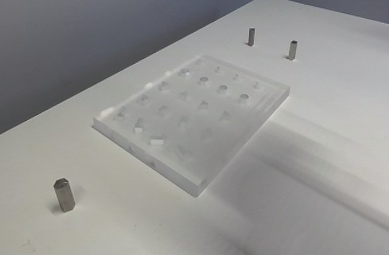
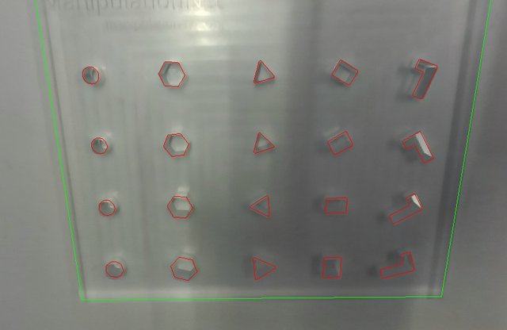
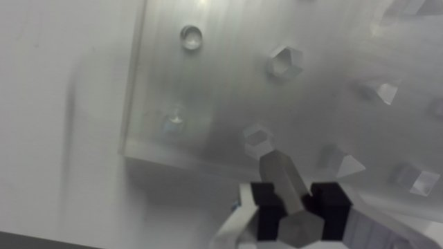
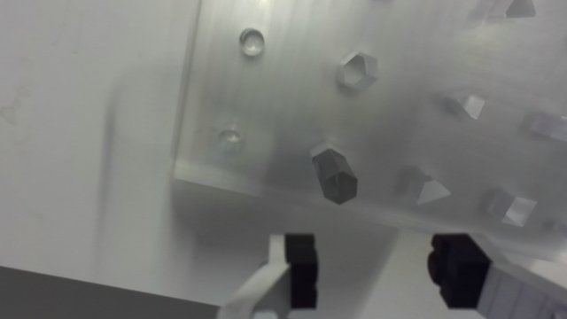
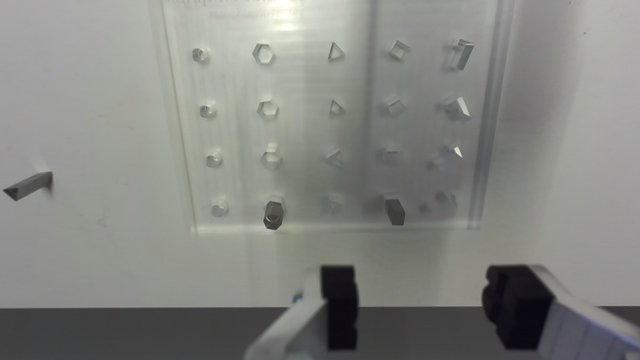
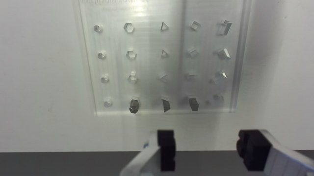
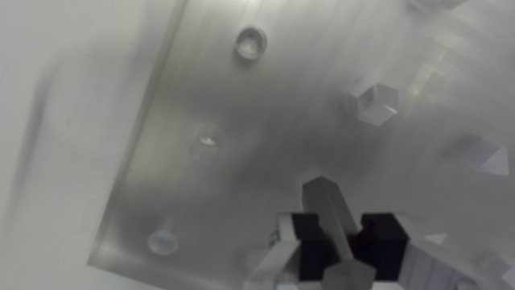
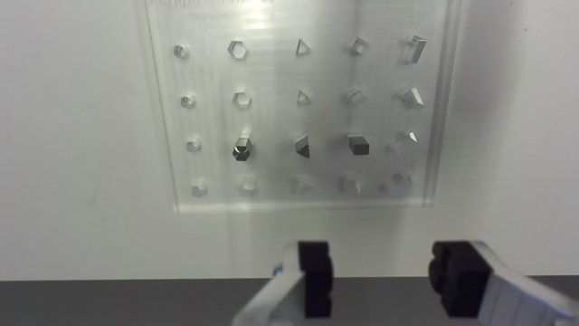
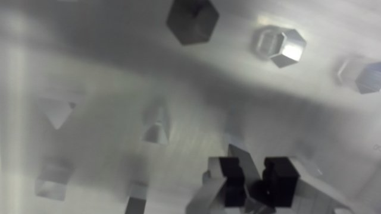
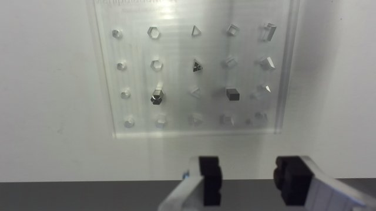
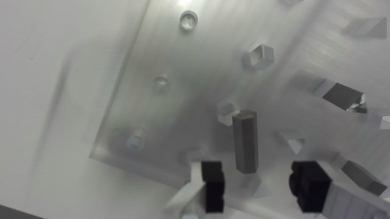
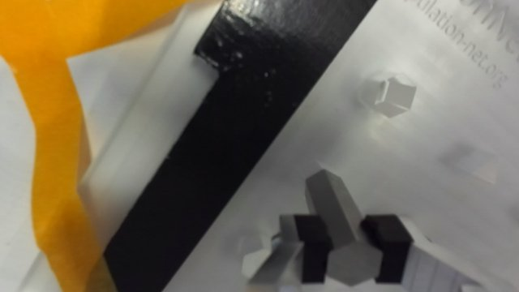
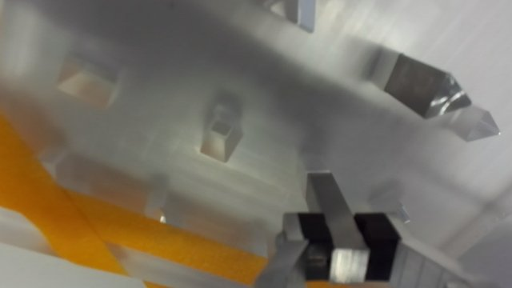
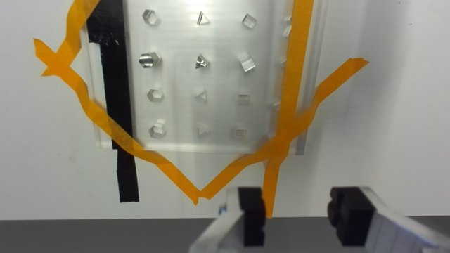
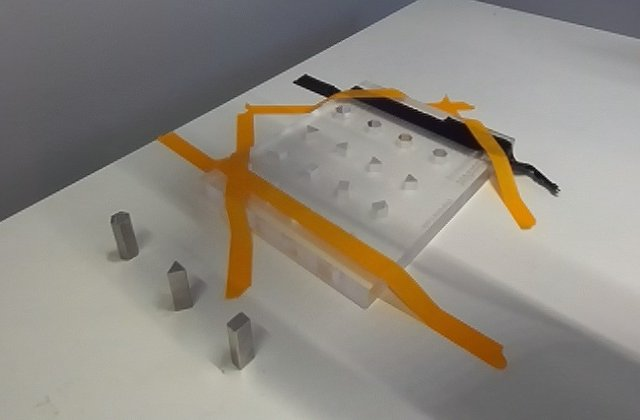
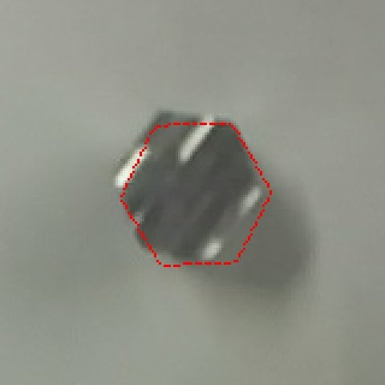
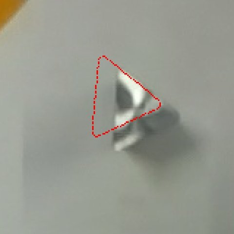
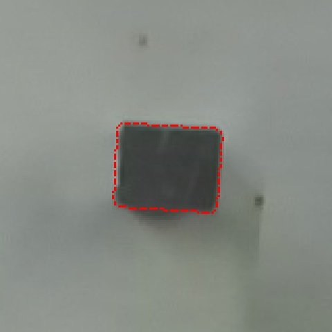
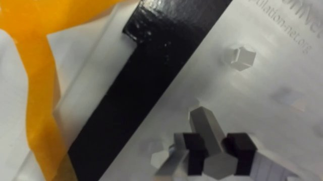
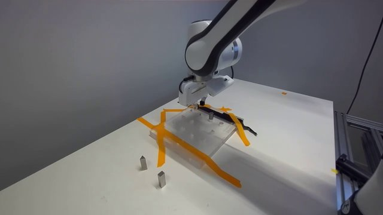
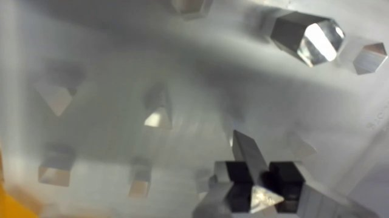
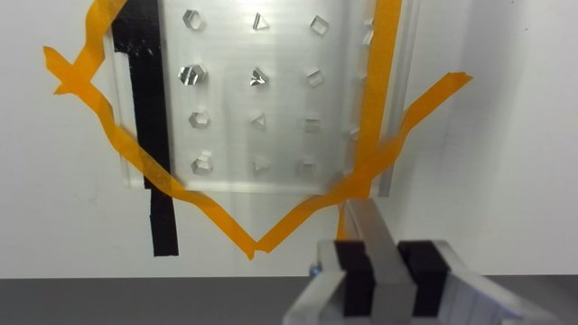
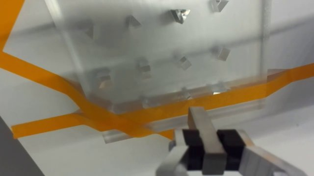
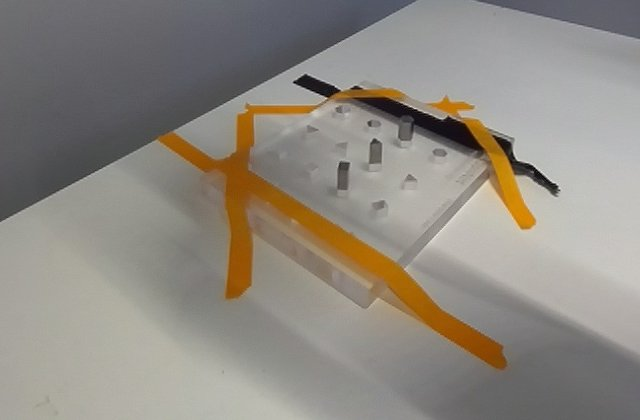
