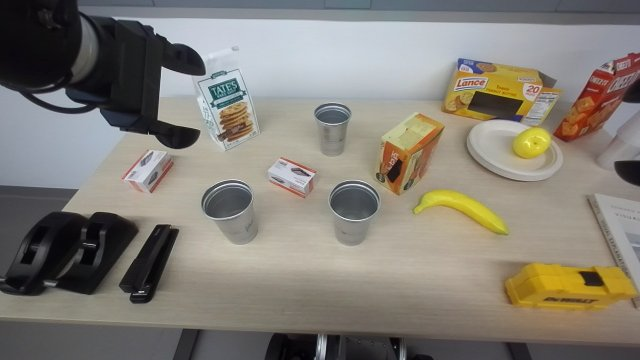
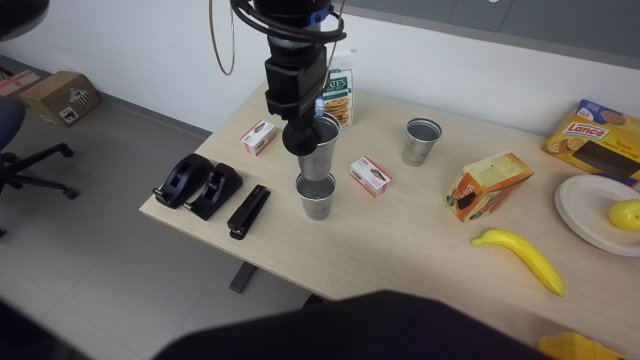
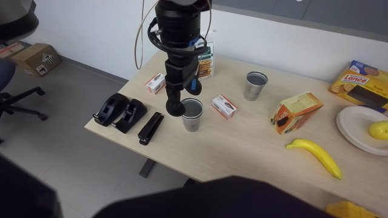
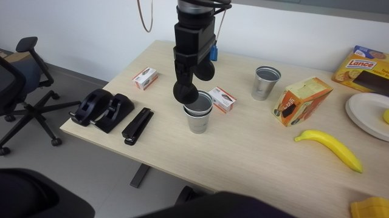
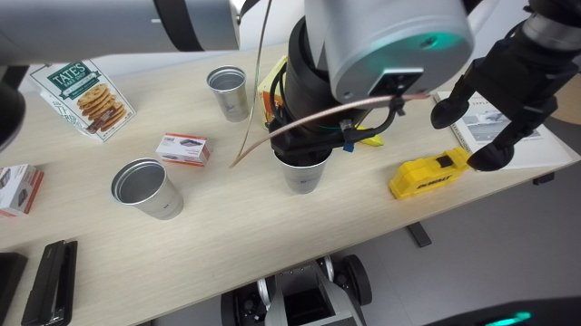
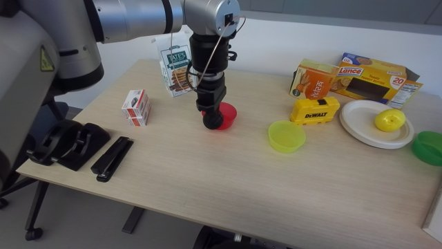
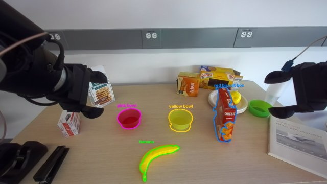
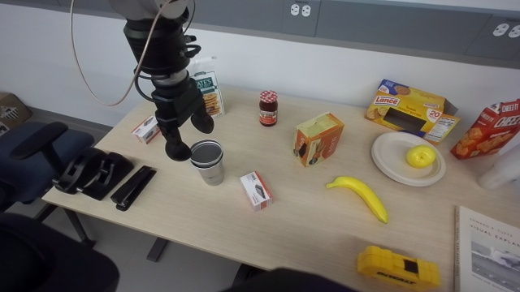
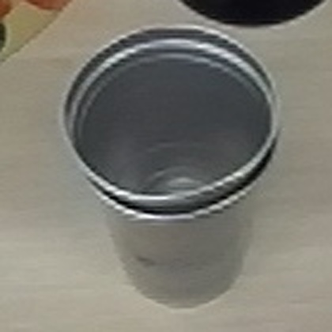

# Stack two cups (nest one cup into another)

## When to use
- Two upright, open, thin-walled cups standing on a table (tested: silver aluminium cups, rim radius 0.045-0.049 m,
  height 0.11 m, ~40 g, 0.24 m apart on a 0.74 m light-wood desk among other objects).
- Both cups within fingers-down reach of one hand: rim point at most ~0.50 m ahead of the base origin, y between
  -0.05 and +0.35 for the left hand (the tested hand), robot square to the desk with its front edge ~0.215 m ahead.
- The cups taper (a cup fits into the other); objects may stand near them but not within ~5 cm of the rim points.
- Not for: cups out of reach (the controller says so; a tilted pinch is NOT used: a cup pinched with tilted fingers
  swung almost horizontal and fell), lying cups, cups with liquid, mugs with handles or cups wider than ~11 cm.
- Inside grips (fingers spread inside the cup) are deliberately not used: the operator rejected them for drinking
  cups.

## Preconditions
- Custom round fingers (open tips' lowest point 0.192 m below `ee`, measured by desk contact 2026-10-09), grippers
  homed, the picking hand free, torso `mid`.
- `scan` locates both cups in a fresh frame (hands first moved out of the camera view) and reports which rim point
  each hand reaches fingers-down; `pick` refuses a cup out of reach.

## Procedure
1. `scan`: both arms to the raised wide pose; per cup a Gemini mask (rim height = 98th percentile of its depth points)
   and four Gemini rim-lip points (near / far / left / right) ray-cast to that height -> centre and radius. The grey
   cups' silhouette extremes were ~3 cm biased; the lip points agreed with the depth rim band within 1 cm.
2. `pick <cup>`: fingers-down rim pinch at the nearest reachable rim point (closing radially, one finger inside, one
   outside), fingertips 2.4 cm below the rim; joint-space pre-grasp 9 cm above (IK with 0.2 rad joint margins,
   `rby1_check`ed); Cartesian descent with a 5 N wrist-force guard; close 0.5 A (the thin wall reads 1-1.7 mm);
   lift 6 cm; held check = the depth points of "the cup held by the robot gripper" have their lowest point >= 2.5 cm
   above the desk (clearly on the desk -> open and back off; unsure -> keep holding, agent checkpoint); raise with a
   joint move until the cup's bottom is >= 6 cm + one nesting rise above the target rim.
3. `align <base>`: the held cup hangs 15-20 deg tilted; its axis is (r - 4 mm) inward of the pinched rim point. Move
   (joint space, at that safe height) so the axis is over the base cup; when the left wrist at yaw 180 has no IK for
   the high pose at torso `mid`, stand up to torso `ready` (operator: "stand up a bit"). Observe, measure the held
   cup's bottom region from depth (corrected 2 cm away from the camera for its unseen far side), move by the offset,
   repeat until < 1.2 cm (tested: 2.5 cm -> 0.5 cm in one correction). The base cup is fixed BEFORE the held cup is
   over it (the hanging cup spoils its segmentation) and that fix is reused.
4. Alignment decision: insert when the depth offset < 2.4 cm AND Gemini says the bottom is over the opening;
   otherwise ok None + checkpoint: the agent looks and runs `insert` or `align --dx --dy` with its own correction.
5. `insert`: lower in 2 cm then 1 cm steps until the wrist force rises > 5 N (cups wedge / outer finger on the base
   rim; tested 18 N on the last 1 cm step) or the nest depth; open; rise 8 cm (joint move).
6. Nested check: depth (top rim over the base = base rim + 2.4 cm +- 1.5 cm) AND Gemini; disagreement -> agent.

## Code
`code/run.py:main(ctx, step, args)` -> `run_cups.main` (state in `output/cup_state.json`):

| Step | Args | Returns (`measured`) |
|---|---|---|
| `scan` | [cup names] | cups {centre, r, rim_z, height}, reachable rim point per hand |
| `pick` | cup, side | pinch {rim_angle, r, rim_in, depth, h, yaw}, rise, width; ok None = holding, unsure |
| `align` | base, side, [--relocate] [--dx m --dy m] | offset (m) of the held bottom from the base axis, hand_xy, topdown image |
| `insert` | side | release_z, contact, nested ('nested' / 'not nested' / 'unsure'), top_rim_z |
| `stack` | base, cup, [side] [--agent] | pick + align + gated insert; `--agent` stops at every alignment |

Modules: `pp_cups.py` (locate, pick_cup, held_check, held_bottom, align_over, insert, nested_check, set_torso),
`pp_perception.py` (Gemini masks: `segment_named` parses all three polygon formats Gemini returns and sharpens
coloured masks; `cup` = lip points + depth; `localize` for elongated / box / round objects; `check`, `flags`),
`pp_grasp.py` (`plan_rim` fingers-down rim pinch with IK; also `plan_top` / `plan_box` for lying and upright objects),
`pp_motion.py` (`move_arm` joint moves from local IK, `cart` with force guard, `clear_view`, `place_down`,
`approach_desk`, floor-bucket `drop_gently`), `pp_vis.py` (depth geometry, `desk_front`, `ray_plane`,
`topdown_check`), `nav.py` (axle-model routes). Imports geom / kin / chair_ctl from the `office-chair-tuck` skill.
Parameters (tested): `RIM_DEPTH` 0.024, `CUP_RIM_IN` 0.004, `CLOSE_A` 0.5, `LIFT_CUP` 0.06, `HELD_CLEAR` 0.025,
`CARRY_CLEAR` 0.06 (0.018 knocked the target cup), `ALIGN_TOL` 0.012, `CONTACT_N` 5, `NEST_RISE` 0.024.
`offline_cups.py` re-runs the perception on recorded frames (needs that session's `runtime/frames`).

## Checks
- scan: both cups located, 0.04 < r < 0.055, lip centre within 1.5 cm of the depth rim-band centre.
- pick: closed width < 6 mm (thin wall), held check 'held' (lowest point >= desk + 2.5 cm); approach force < 5 N.
- align: depth offset < 1.2 cm after correction (gate 2.4 cm) and Gemini yes; else the agent decides.
- insert: force contact or nest depth reached; nested check 'nested' (depth AND Gemini).
- Success: one cup inside the other, upright, both rims together (image), top rim ~2.4 cm above the base rim.

### Perception checkpoints
| Step | Subagent model | Frames | Question | Expected answer | Pass if | On fail |
|---|---|---|---|---|---|---|
| scan | haiku | `seg_<frame>.jpg` overlay | Is each outlined region exactly the cup its label names? | yes / no per label | yes for both | re-scan from another head angle |
| pick (held unsure) | agent (you) | after-lift frame | Is the robot's left gripper holding the cup off the desk? | yes / no | yes -> align | lower it back, open, re-locate, pick again |
| align (checks unsure / disagree) | agent (you) | align frame + top-down image | Is the bottom of the hanging cup directly above the opening of the cup below, so that lowering it straight down puts it inside? If not, which way and how many cm? | yes / no + direction, cm | yes and offset < 2.4 cm | `align --dx --dy` with the correction, look again; never lower a cup that is not over the opening |
| insert (nested unsure) | haiku / agent | after-release frame | Is the released cup nested inside the other cup (upright, both rims together), not lying or beside it? | yes / no | yes | re-locate both cups, pick the loose one again |

## Failure modes

- v3 (trial 2, 2026-10-10): the optimal-control pre-grasp from `ready` to fingers-down yaw -165 deg tripped
  left_arm_6 at 166 % on its first waypoint -> `ARM_MODE` default 'joint' again (single local IK solve per target,
  no search; env `STACK_CUPS_ARM_MODE=oc` for the OC path). `set_torso('mid')` from zero (1.57 rad) was refused
  (1.2 rad per call) -> split moves. A pre-grasp IK at 3.3 mm failed the 3 mm gate -> 5 mm.
- A target cup near the centre line (y 0.03) was out of the LEFT hand's reach for the high carry pose with the held
  cup's yaw fixed by the grasp (IK 115 mm): a chest yaw torso_5 -0.3 (left shoulder forward) made it exact (0.1 mm).
- A joint-space move of the RIGHT arm from its side pose (fingertips 0.80 m) to a cup pre-grasp swept through a book,
  a tool case and the cups (operator "stop"; rby1_check does not see desk objects): `move_arm_joint` now rises
  straight up to the goal's fingertip height first and refuses / raises when the FK-sampled joint path dips > 3 cm
  below its ends. After a disturbance re-localize (the cups had moved 6 cm) and re-grasp with Cartesian moves only,
  keeping the current gripper yaw and choosing the rim point that matches it (away from neighbours: a tool case 3 cm
  from the shoulder-facing rim point).
- The nested check read 'not nested' for two nested cups: after the 8 cm rise the open fingers were still in the
  depth window and Gemini answered "only a single cup" -> rise 15 cm, prompt asks for two concentric rims; the agent
  zoom on the frame decides when they disagree.

- v2 (2026-10-09, compositional session): grasp planning is closed form (`pp_grasp.plan_rim`: the rim point facing
  the hand's shoulder, the radial yaw nearer the hand's current yaw, a forward tilt only for rims > 0.45 m ahead;
  only the 0.69 m reach rule rejects) and every hand move is the controller's optimal control
  (`pp_motion.move_arm` = `move_arm_oc` via oc-hand-reach; `ARM_MODE = 'joint'` restores v1). The v1 search over
  rim angles x pitches x yaws with local IK is kept as `plan_rim_search` (unused). Offline self-test
  (`python3 code/pp_grasp.py`): every closed-form pose reachable by the local-IK oracle (0.0-2.8 mm). NOT yet run
  on the robot with v2: watch the first pre-grasp and lift.
- The head could not point at a cup far to the side ("cannot point", pan limit 0.473): `pp_motion.look_at` now
  clamps the pan to +-0.44 at the same range and height (compositional session).
- An interrupted `align` re-localized the HELD cup as the target (r 0.026, rim 1.033 m): restore the pre-pick scan
  fix of the target before aligning again (look at the align frame before inserting).
- Fingers modelled 0.20 m + 0.03 ball (robot-interface): grasps closed 3-4 cm too high; real open-tip lowest point
  is 0.192 m (desk contact). Fixed in `pp_grasp.TIP_LOW`.
- Inside grip (closed fingers into the cup, spread) held, but the operator rejected it for drinking cups; rim pinch.
- Transfer with the held cup's bottom only 1.8 cm above the target rim knocked the target cup 10 cm (operator "not
  high enough"); the 5 N guard did not see it (a light cup slides). `CARRY_CLEAR` 0.06 and joint moves at that height.
- The hanging cup swings a few cm during a sideways carry: alignment is measured and corrected, never assumed.
- Re-segmenting the target while the held cup hangs over it gave wrong centres: the target fix is taken first.
- A held check by the cup's scene name ("standing alone") after a 4 cm lift misread a held cup as not lifted and
  the controller released it: now the "held cup" is segmented, the lift is 6 cm, and doubt never releases.
- Cartesian raise of the left hand at yaw 180 stalled `left_arm_5` past its limit (1.889 > 1.82): joint moves with IK
  margins for raises; at torso `mid` the high carry pose had no IK -> stand up to `ready`.
- Gemini alone and depth alone each judged 2 of 3 alignment frames right (wrong on different frames): the gate
  needs both, the agent decides otherwise.
- A Cartesian approach with the torso leaned 0.10 rad put the controller in MinorFault (operator cleared it): the
  skill does not lean; cups out of reach are reported.

## Evidence
| date | session | run | outcome | unattended | conditions |
|---|---|---|---|---|---|
| 2026-10-09 | push_chair_4ab505 | C1 manual | nested | no | silver cups 0.24 m apart; primitives run by hand, operator: rim pinch, not high enough |
| 2026-10-09 | push_chair_4ab505 | C2 controller | nested | no | `pick` -> `align` (stood up to ready, 1 correction 2.5 -> 0.5 cm) -> agent checkpoint (yes) -> `insert` (contact 18 N) |
| 2026-10-09 | push_chair_4ab505 | offline perception (final code) | 8/10 single checks (failure); 0 wrong automatic decisions with the depth AND Gemini gates | yes | recorded frames: locate 2/2, align depth 2/3, Gemini 2/3, held 3/3, nested 1/2 |
| 2026-10-09 | compositional_manipulation | S1 steps by the agent (v1 code + look_at fallback) | nested | no | two silver cups on the light-wood desk, left hand; align interrupted once (held cup taken as target, restored) |
| 2026-10-10 | compositional_manipulation | S2 trial 2 steps (joint mode) | nested | no | left hand, chest yaw -0.3 for the align; skill nested check false negative, agent zoom = nested |

