# Wipe a table stain with a wet towel (paper-towel variant included)

Imported from session `20261006T132109Z_swipe_table_9f3e18` (2026-10-06, real Franka FR3, RGB-D, one agent, no
subagents). The operator's task (TASK.md): "You are given a wet towel, and I will ask you to wipe the soy sauce stain
on the table using it. First get familiar with the robot and environment. When you are ready, please call for operator
to pour the soy sauce on the table for you to wipe. Also, if you need help such as adding some soap to the towel also
ask for operator help". The agent first wiped by hand-driven tool calls (09:21-09:52 local time), then wrote the towel
controller (`code/wipe`, v1-v12) and ran it 13 times (trials 1-7b). After the towel trials the operator asked in chat:
"Next time I will ask you to pull paper towels out of the box, wipe table, and then throw them into the waste bin.
Since paper towels are thin, maybe you can pull many towels and pile them at the stain before wiping. Try it out!";
the agent wrote `code/paper` (reusing the towel modules) and ran it 5 times (3 dry, 2 wet). Both are in this folder:
`code/controller.py` (towel, main entry) and `code/paper_controller.py` (paper variant).

## When to use

- A liquid stain (tested: soy sauce poured by the operator - dark puddle with droplets, speckled brown, swirled or
  smeared tan film; 46-314 cm2) on a white table (top z 0.09 m) in front of the arm, to be wiped clean.
- Rig it was tested on: Franka FR3 + Franka Hand pointing down; exterior RGB-D cameras `left` at (0.229, 0.383,
  0.499) and `right` at (0.153, -0.447, 0.684) (1280 x 720, fixed, calibrated in each frame's meta.json) and a wrist
  RGB-D camera; the `home` preset (TCP (0.31, 0.0, 0.48), gripper down) sees the whole wipe area from above, which the
  wrist check needs. Camera keep-out 0.20 m (service).
- Towel entry: a wet dark-grey terry towel (~45 x 35 cm folded, ~45 x 70 cm unfolded, ~1 cm thick) lying flat or as a
  loose heap on the table, peak inside x 0.30-0.68, |y| <= 0.34 (tested: heaps 5.4-9.7 cm high centred at x 0.546-0.584,
  y -0.289 to -0.223, i.e. the robot's right half). Stain bboxes tested: x 0.418-0.705, y -0.057 to 0.345.
- Reach (FR3 here, gripper down): the gripper path is clipped to x 0.33-0.68, |y| <= 0.36 and then shrunk to postures
  with joint margin > 0.3 rad and camera clearance > 0.21 m; near the left camera that leaves about y <= 0.31 for
  x 0.51-0.59. The towel pile reaches 2-3 cm beyond the gripper path (trial 5e cleaned residue to y ~0.334 with the path
  ending at y 0.309). Carrying at z 0.45 works for x <= 0.60, |y| <= 0.32.
- Paper entry (`code/paper_controller.py`): a tissue box (tested: purple, ~22 cm long, 11-14 cm wide, 9.3-9.5 cm high (the session estimated it twice), top z 0.184, near
  (0.40, -0.17), long axis along x) with a sheet sticking out of its slot, and a waste bin whose rim stands 12-25 cm above
  the table inside x 0.45-0.82, y -0.46 to -0.10 (tested: white bin with a black bag, rim top z 0.286-0.296, opening
  ~(0.61, -0.31)); stain at x >= 0.36 (tested 46-63 cm2 around (0.52-0.55, 0.10)). Expect to clean up leftover sheets
  and thin wet scraps under supervision (see Failure modes).
- Not for: dark or patterned tables (the towel is found as dark raised points, stains as darker / yellower cells than
  the clean table), stains under or next to other objects, stains beyond x ~0.68 or nearer than x ~0.40, dried-on
  stains (untested), tasks that need a measured contact force (the press is position-based: contact height - 12 mm).
  Paper: not with a full bin (sheets drape over the rim) or paper hanging over the bin edge.

## Preconditions

- Checked by the code before moving: `status.control_uncertain` false, `franka_status.motion.armed` true, gripper not
  holding anything; then gripper open and `franka_move_joints preset=home`.
- The towel is visible from home (largest dark raised region >= 40 cm2) and its peak is in the grasp area, else
  `StepError`. Each grasp target is checked with `franka_ik` (seeded from the home joints): margin > 0.3 rad and camera
  clearance > keep-out + 1 cm at the pickup point (z 0.11/0.12) and above it (0.25 / carry height).
- A clean-table reference from home: the run's own start frame when the table is clean (it then asks the operator to
  pour), or `reference=<frame id>` when the stain is already there (accepted only if `perception.reference_matches`:
  grey median <= 12 and p95 <= 25 away from the stain). Without one the wrist check is skipped and the exterior limit is
  8 cm2. The module constant `STORED_REFERENCE` names a frame of this session; in another workspace it is absent and
  skipped.
- An operator who can pour on request and add water + soap before pass 3 (`request_operator`, 900 s timeout).
- Paper entry also needs: tissue box found (>= 200 purple raised points), bin opening found (rim ring + hole, or the rim
  hull centre when paper hides the hole), a sheet within box +- 4.5 cm whose upper part is over the box.

## Procedure

Towel (`controller.run` -> `passes`; every step re-observes from home or checks the robot state):
1. Preconditions, open, home, `franka_observe` (left, right, wrist RGB-D).
2. Towel: `perception.locate_towel` - dark (grey < 100) depth points 4 mm-15 cm above the table from both exterior
   cameras, largest connected region; centre, peak (centroid of the highest 40 %), top_h (90th percentile); `heap` when
   top_h >= 2.5 cm.
3. Stain and reference: clean table -> this frame is the reference, `request_operator kind=reset` with the pour message
   (40-65 cm ahead, within ~25 cm of the centre line, >= 15 cm from the towel), ask again (<= 3) if no stain is seen.
   `perception.locate_stain`: orthographic 2.5 mm maps of the table plane from each exterior camera (K, T_base_cam);
   a cell is stain when it is yellower (Lab b* > +5) or darker (L > 12) than the reference in BOTH cameras after ROI-median
   normalisation (without a reference also dark marks > 35 grey); largest mark plus marks within 5 cm; towel cells
   masked. Wipe region = stain bbox + 3.5 cm.
4. Grasp (`steps.grasp_towel`, 3 attempts): flat towel -> joint move to the IK posture above its centre (z 0.20),
   `move_pose` to z max(0.10, top - 3 mm) with tolerance 10 mm (fingertips stall on the cloth at TCP ~0.108 and keep
   pressing), `grasp width 0 force 40 speed 0.03`, lift to 0.22, lower to 0.15 (the towel collapses into a heap), open,
   re-observe. Heap -> open, joint move above the peak at top + 6 cm (>= 0.20), press to top - 4.5 cm (>= 0.11) with
   tolerance 20 mm (stalled at TCP 0.120-0.151), `grasp force 50`; accept when is_grasped and width >= 4 mm (got
   10.5-32.3 mm), lift and re-check is_grasped.
5. Wipe (`steps.wipe_region`): `fit_region` clips to x 0.33-0.68, |y| <= 0.36, then moves the cheaper edge in by 2 cm
   per failing corner until 4 corners + centre at z 0.12 pass `pose_ok`. Pass 1 ('carry'): lift to 0.45 (diagonally
   inwards when far out), joint move (`recentre`) over the stain centre at 0.45, lower to 0.16 (the towel piles up under
   the gripper), blot = press to z 0.12 -> contact height (0.124-0.151 measured), 1 s. Scrub (`motions.scrub`):
   boustrophedon along y then along x, 4 cm spacing (10-30 waypoints), each a `move_pose` to z = contact - 12 mm (never
   below 0.11) with tolerance 20 mm and timeout 15 s; a stall higher than the command updates the contact height; up to
   3 refused waypoints are skipped; lateral lag > 3 cm stops. 'drag' mode (after soap): lower to 0.17, press, drag to the
   first waypoint in <= 10 cm legs so the soapy underside stays down.
6. Park (`steps.park_towel`): back where it was picked up, or sideways in y when that is within 12 cm of the wiped area;
   lift to 0.45, carry, lower to 0.16, open, rise to 0.30. The hanging towel shadows the table, so verification only
   happens after release.
7. Verify (`steps.measure_residue`): home, observe; exterior residue over wiped area + 15 cm (< 4 cm2 with a reference)
   AND wrist residue (1 mm top-down map from the wrist camera at home, Lab b* > +4, or L > 10 with b* > 1.5, blobs
   >= 30 px, wiped area + 6 cm) < 3 cm2.
8. Not clean: pass 2 re-wipes the residue bbox + 1.5 cm with the same towel ('carry'); before pass 3 `request_operator
   kind=help` for water + soap on the towel's underside, then 'drag'. At most 3 passes. Ends at home, gripper open,
   towel parked.

Paper (`paper_controller.run`): preconditions and home; `tissues.tissue_box`, `tissues.bin_opening`; box and bin
(+5 cm, +8 cm on the bin's far side) masked out of stain and residue; reference / pour as above (stain ROI x >= 0.36);
per pass (at most 2):
1. Pull 6 sheets (`pull_one`): sheet = white side-camera points 1.2-20 cm above the box top within box +- 4.5 cm (bin
   excluded); pinch at its upper part at z = max(box top + 3 cm, min(upper - 1 cm, sheet top - 2.5 cm)) with the fingers
   closing along y, `grasp force 20 speed 0.05`, lift to 0.30 then 0.47 (the next sheet pops up); success = is_grasped
   after the lift (read >= 0.6 s after the command); stop if the box outline moved > 3 cm.
2. Drop each sheet with the pinch at z 0.115 (from 0.13 the sheet folded 5-7 cm aside) on the centre and quarter points
   of the fitted region.
3. Pile -> press-grasp at the pile's upper part (press z 0.11, tolerance 20 mm, 40 N; wad 1.2-1.6 mm) -> scrub in
   'drag' mode (as step 5 above).
4. Dispose (`tissues.dispose`): joint move over the bin opening at 0.45, lower to rim + 3.5 cm, open, lift to
   min(rim + 20 cm, 0.45) 3 cm inwards, check `paper_on_fingers` (side-camera light points 1.2-5 cm below the fingertips:
   >= 120 points, or >= 60 in one camera), scrape on the bin's inner walls only if stuck (error after 2 scrapes), close
   by force (`grasp 10 N`, never a position close), push to rim - 2.5 cm, rise, open.
5. Leftover sweep: from home, `tissues.leftover_paper` vs the reference (rise > 5 mm in either camera or grey change > 15
   in both; blobs >= 6 cm2; kept if rise >= 18 mm and >= 2 cm2; bin + 10 cm excluded) -> `pick_paper` (press to z 0.10,
   tolerance 10 mm, 20 N, lift 0.30) -> dispose; at most 8 picks; a spot is given up after 2 misses or when unreachable.
6. Verify as in towel step 7 (4 cm2 exterior limit with or without a reference); next pass on the residue bbox + 1.5 cm.

## Code

```python
import importlib.util, json
from api.runtime import Context
spec = importlib.util.spec_from_file_location("swipe_table", "skill-library/skills/swipe-table/code/controller.py")
wipe = importlib.util.module_from_spec(spec); spec.loader.exec_module(wipe)
with Context() as ctx:                                   # run from the workspace root
    r = wipe.main(ctx)                                   # clean table: asks the operator to pour, then wipes
    # r = wipe.main(ctx, reference='<clean frame id>')   # stain already there
    # r = wipe.main(ctx, resume={'reference': '<clean frame id>', 'region': (x0, x1, y0, y1), 'mode': 'carry'}, max_passes=1)
print(json.dumps(r, default=str)[:2000])
```

CLI from the workspace root (as in the session; run it as a background task and poll the log, never with a shell `&`):
`python skill-library/skills/swipe-table/code/controller.py [--no-pour-request] [--max-passes N] [--reference F]
[--resume-reference F --resume-region x0,x1,y0,y1 --resume-mode carry|drag]`.

`controller.main(ctx, pour_request=True, max_passes=3, resume=None, reference=None)`

| Parameter | Default | Tested |
|---|---|---|
| `pour_request` | True | True (trials 2-7); False untested |
| `max_passes` | 3 | 1-3; 1-pass successes; pass 2 ran in trials 5b, 5d; pass 3 (soap) only requested once (5b, stopped) |
| `reference` | None (then `STORED_REFERENCE` if present) | trial 7b (`--reference` = trial 7's clean start frame) |
| `resume` | None | trials 3b, 5c-5e (agent-supplied region and reference) |

Returns `{ok, measured, why}`: `measured` = the controller report without ok/reason - `stain` {centre, bbox, area_m2},
`passes` [{pass, mode, region (fitted), grasp_attempts, frame, residue_m2, residue_bbox, wrist_residue_m2, wrist_bbox,
seconds}], `frames` {start, reference, after_pour}, `seconds`, `log`, and on a stop `robot_at_stop` {tcp, gripper};
`why` = "clean after pass N" or the stop reason (the exception text, whole). Log and `report.json`:
`output/runs/<YYYYmmddTHHMMSS>/` relative to the working directory. Frames are read from `runtime/frames/<id>/`.

`paper_controller.main(ctx, reference=None, dry_region=None, sheets=6, max_passes=2)` - same return shape (`passes`
also hold leftovers_picked / leftovers_given_up); logs in `output/runs/paper_<stamp>/`. Tested: `dry_region`
(0.5, 0.6, 0.0, 0.1) with 4 sheets; wet runs with 6 sheets, 1 pass each (both stopped by the operator).

Modules (primitives usable on their own; they raise `steps.StepError` / `RuntimeError` instead of returning ok False):
- `perception.py` (frame in, data out, no motion): `load_frame`, `top_down` / `top_down_fine`, `height_map`,
  `locate_towel`, `towel_mask`, `locate_stain`, `detect_stain`, `residue`, `residue_wrist`, `reference_matches`.
- `motions.py`: `move`, `press_move` (a stall or timeout on contact is normal, a refusal returns 'rejected'), `scrub`,
  `boustrophedon`.
- `steps.py`: `observe`, `go_home`, `find_towel`, `find_stain`, `grasp_towel`, `fit_region`, `pose_ok`, `recentre`,
  `wipe_region`, `choose_park`, `park_towel`, `measure_residue`, `gripper_state`.
- `tissues.py`: `tissue_box`, `protruding_sheet`, `grasp_point`, `pull_sheet`, `drop_at`, `bin_opening`, `paper_pile`,
  `paper_on_fingers`, `scrape_fingers`, `dispose`, `leftover_paper`, `pick_paper`.

Tested constants (unchanged from the session): `CARRY_Z` 0.45, `LOWER_Z` 0.16, `PINCH_PRESS_Z` 0.10 / tol 10 mm /
40 N, wad press top - 4.5 cm / tol 20 mm / 50 N, `MIN_WAD_WIDTH` 4 mm, `PRESS_DEPTH` 12 mm, `Z_FLOOR` 0.11,
`CONTACT_PROBE_Z` 0.12, spacing 0.04, `STAIN_MARGIN` 0.035, `RESIDUE_MARGIN` 0.015, `CLEAN_AREA_M2` 4e-4,
`CLEAN_WRIST_M2` 3e-4, `CAMERA_SLACK` 0.01, `PATH_X` (0.33, 0.68), `PATH_Y` +-0.36, `CARRY_MAX_X` 0.60; paper
`GRASP_FORCE` 20, `PULL_Z` 0.47, `DROP_Z` 0.115, `LEFTOVER_RISE_M` 0.018. Scene constants: `perception.TABLE_Z` 0.09
(map grid x 0.20-0.85, |y| <= 0.50), `steps.HOME_JOINTS` (this FR3's home preset), tissue-box search around (0.40,
-0.17), bin search region (0.45-0.82, -0.46 to -0.10).

Changes from the session's code (no algorithm, motion or threshold changed):
- `code/wipe/{controller,steps,motions,perception}.py` (HEAD 6142c56) and `code/paper/{controller,tissues}.py` (HEAD
  af5a7f5) flattened into `code/`; `paper/controller.py` renamed `paper_controller.py`; sibling imports put the module's
  own folder on `sys.path` (`steps.py`, `tissues.py`) instead of `code/wipe`.
- Both entries: the session's `main` (returns the report dict) renamed `run_logged`; a new `main(ctx, ...)` wraps it to
  `{ok, measured, why}`. Run logs `output/runs/...` and frames `runtime/frames/...` are now relative to the working
  directory (they were `<workspace>/...` via `__file__`; the session always ran from the workspace root, so the same
  place). The CLI finds `api.runtime` in the working directory.
- Comments / docstrings: fixed misplaced constant comments (three in `controller.py`, one in `paper_controller.py`),
  docstrings updated.
- Left out: `wipe/dryrun.py` (offline replay of controller.main through a fake context on this session's frames),
  `wipe/run_scrub.py` and the `__main__` block of `motions.py` (manual scrub of a rectangle with the towel already held),
  `paper/pick_leftovers.py` (supervised helper: pick given x,y sheets and dispose; same motions as
  `tissues.pick_paper` + `tissues.dispose`), the two README files (distilled here).
- Caveat: module names are generic (`steps`, `motions`, `perception`, `controller`); a process that also imports another
  skill's module of the same name gets whichever was imported first.

**Changed since the session's runs:** `main` in `controller.py` and `paper_controller.py` is a new wrapper around the session's entry (renamed `run_logged`) that returns `{ok, measured, why}`. Log and frame paths now resolve against the working directory and sibling imports against the skill's `code/` folder. These changes were checked offline only (every module imports with a stubbed `api.runtime`); they have not run on the robot. No motion, perception or threshold changed. The hyper-parameters later moved unchanged into `code/swipe_table_params.py` (2026-10-15).

**Hyper-parameters** are in one list, `code/swipe_table_params.py`; the modules import them from there. They moved there unchanged on 2026-10-15: every value was compared before and after with each module imported offline, and no behaviour changed. In a setup this skill was not tested in, calibrate the values marked CALIBRATE (`STORED_REFERENCE`, `Z_FLOOR`, `STAIN_ROI`, `TABLE_Z`, `MAP_X`, `MAP_Y`, `CARRY_Z`, `LOWER_Z`, `SAFE_Z`, `MAX_SEG`, `PINCH_PRESS_Z`, `PATH_X`, `PATH_Y`, `CARRY_MAX_X`, `CARRY_MAX_Y`, `HOME_JOINTS`, `CONTACT_PROBE_Z`, `GRASP_X`, `GRASP_Y`, `PULL_Z`, `DROP_Z`, `TRAVEL_Z`); each comment says how to measure it.

## Checks

- Towel found: region >= 40 cm2; heap if top_h >= 2.5 cm (flat towel then gets the pinch-to-heap step).
- Pinch (flat): is_grasped true after the grasp (pressed pinch held at width ~2.5 mm; an unpressed pinch slid off at
  1.3 mm). Wad: is_grasped and width >= 4 mm, still grasped after lifting (else open, retry, 3 attempts).
- Region: all 4 corners + centre pass `pose_ok` (margin > 0.3 rad, camera clearance > 0.21 m) after fitting; nothing
  usable left -> stop.
- Scrub: every stroke's measured TCP within 3 cm laterally of its target; <= 3 refused waypoints; towel still grasped
  after the scrub (`towel lost during scrubbing` otherwise).
- Success (each pass, towel released, arm home): exterior residue < 4 cm2 (8 cm2 without a reference) AND wrist residue
  < 3 cm2, or the wrist view does not cover the area (coverage was 0.76-0.91 in the trials). Trials 6 and 7b: 0.0 / 0.0
  cm2 at coverage 0.82 / 0.91; before wiping the same checks read 290.6 / 225.5 and 176.3 / 167.1 cm2 (re-run offline on
  the recorded frames with this folder's code).
- Paper: sheet held after the lift; pile found (>= 200 white points); wad grasped; no paper on the fingers after release
  (0 points in the wet runs after the fix; a stuck sheet read 268-1308 points); leftovers rise >= 18 mm.

### Perception checkpoints

The code has no built-in checkpoint: it decides from the depth / colour checks above and returns the frame ids in
`measured.frames` / `measured.passes[].frame`. The session's agent (no subagents) looked at these frames itself after
every run; keep doing so - the operator, not the code, caught the trial-3 streaks and the paper leftovers.

| Step | Subagent model | Frames | Question | Expected answer | Pass if | On fail |
|---|---|---|---|---|---|---|
| after pour / start | agent (you) | `runtime/frames/<after_pour or start>/left.jpg`, `right.jpg`, `wrist.jpg` + logged stain bbox | Is the logged stain bbox around the whole spill, including droplets, and is nothing else (towel, objects) inside it? | yes / no + what is missed | yes | rerun with `resume={'region': bbox + margin}` on the agent's own bbox, or stop and ask the operator |
| verify (each pass) | agent (you) | `runtime/frames/<passes[-1].frame>/wrist.jpg`, `left.jpg`, `right.jpg` vs the reference frame | Is any yellow / brown film, streak or droplet left on the table where it was wiped (ignore the parked towel and shadows)? | no / yes + where | no | `resume` a pass on that area with the same towel; after 2 passes ask the operator for water + soap and use `mode='drag'` |
| paper: after dispose + sweep | agent (you) | `runtime/frames/<passes[-1].frame>/left.jpg`, `right.jpg`, `wrist.jpg` | Is any paper (whole sheets or thin wet scraps) left on the table, or paper hanging over the bin rim? | no / yes + positions | no | pick each piece with `tissues.pick_paper` (thin flat scrap: press z 0.10 with tolerance 2 mm) and `tissues.dispose`; hanging sheet: see Failure modes |

## Failure modes

- **Reach far out** (trial 1, v2): a stroke to (0.740, 0.197) was refused, "IK target rejected: maximum joint step
  0.205 rad exceeds 0.200 rad"; the arm held the towel at (0.71, 0.19, 0.13) and straight up to 0.45 was unreachable.
  Now: path clipped to x <= 0.68, carry x <= 0.60 with a diagonal lift, refused waypoints skipped (<= 3). A refusal is
  a wall: lift inwards first ((0.6, 0.15, 0.16) -> (0.6, 0.15, 0.45) worked).
- **Towel approach refused at home height** (trial 7, v11): the straight move from home towards a towel at (0.575,
  -0.289) hit the same 0.205 rad joint-step refusal. Now: `recentre` joint-moves to the IK solution above the towel
  (trial 7b ok). If `move_joints_path` is not 'ok', the code falls back to straight moves (logged).
- **Camera keep-out near the left camera** (trials 4, 5b-5d): corner (0.43, 0.30, 0.12) had left-camera clearance
  0.199 < 0.20 (pre-check stop); then both passes were fitted to y <= 0.26 and a 59 cm2 strip at y 0.28-0.34 stayed;
  IK from a swung-elbow posture lost 2-3 cm of clearance; 2 cm slack left no region. Now: IK seeded from the home joints,
  `recentre` before lowering, 1 cm slack, later passes wipe only the residue bbox. Detected by `fit_region`
  (StepError "no safely reachable wipe region") - the towel is still held at ~0.30: park it, then resume on a smaller
  region or leave the edge to the operator.
- **False clean on thin streaks** (trial 3, v4): one pass over a speckled dark stain left thin yellow streaks the 2.5 mm
  exterior maps missed (0 cm2); the wrist check measures 16.4 cm2 on that frame and 0.0 after a second pass (3b). Now
  the wrist check is part of "clean"; still look at the wrist image.
- **Smeared film with a merely damp towel** (manual pass 1): the dark sauce was gone but a yellow film was dragged
  ~8 cm outward (78 cm2, the pile is 15-20 cm wide). A second pass after the operator added water + soap on the
  underside, dragged soapy side down, left 0 cm2. The code asks for soap before pass 3.
- **Stale gripper read** (trial 4 first wad grasp: width 80.1 mm, not grasped; paper dry 2: a held sheet read as missed
  and was dropped): a status read right after a command can still show the old state. Now `gripper_state` waits 0.6 s
  before polling (committed after the last towel run) and the paper pull judges success after the lift.
- **Unpressed pinch slides off** (manual): `move_pose` to the cloth with the default 3 mm tolerance timed out at
  z 0.1075 and left no press: width 1.3 mm, not grasped. Use tolerance 10 mm (pinch) / 20 mm (wad) so the stall counts as
  reached and keeps pressing.
- **Operator answers the pour request with a question** (trial 2, "wait can I wash the towel?"): no stain seen -> v3
  stopped. Now it asks again (up to 3 times) and includes the operator's last reply.
- **Launch killed** (trial 5a): started with a shell `&`, the sandbox killed the controller when the shell call
  returned, mid-run. Run it as a background task and poll the log every ~10 s (operator request).
- **Paper: wrong sheet** (paper dry 1): the sheet search reached the bin rim and pinched paper sticking out of the bin
  (operator stop). Now: box + 4.5 cm, bin excluded, the sheet's upper part must be over the box.
- **Paper: false "box moved"** (paper dry 2): the purple-point median shifts ~3 cm when sheets cover the box. Now the
  outline centre is compared (limit 3 cm).
- **Paper: sheets left behind** (paper dry 3, wet 1): the wad grasp leaves 1-4 sheets, one dragged ~10 cm; verify then
  reads not clean (55.7 / 94.5 cm2 in wet 1 with the stain itself gone) and starts another pass. Now the leftover sweep
  (wet 2 picked 107, 91 and 47 cm2 sheets automatically).
- **Paper: wet paper stuck to the fingers, gripper fault** (supervised cleanup after wet 1): a position close
  (`franka_gripper move width 0`) onto a wet sheet stuck to a finger faulted the gripper bridge (HTTP 500,
  `control_uncertain` true; the operator reset it). Now: never position-close with paper near the fingers; release, lift
  clear, check the side cameras for paper on the fingers, scrape on the bin's inner wall only if stuck, close by force.
- **Paper: sweep pulls paper hanging over the bin edge** (wet 2): 8 cm2 at (0.619, -0.129), 6.6 cm outside the rim,
  was taken for a leftover (operator stop). v5 widens the bin margin to 10 cm (never run).
- **Paper: thin flat wet scrap missed** (wet 2): a torn scrap rose < 18 mm and was not swept; picked by hand script
  (press to z 0.10 with tolerance 2 mm -> 0.2 mm pinch). Not automated.
- **Paper: bin problems**: released from 0.42 the paper sprang onto the rim (release at rim + 3.5 cm and push down);
  an arm above the bin was once taken as the rim (rim ring must be < 25 cm high); a full bin leaves sheets draped over
  the rim - pinch them 1-2 cm INSIDE the re-measured outer rim line at rim - 5 cm with the gripper yawed 90 deg
  (hand scripts, operator-guided, 4 tries). Ask the operator to empty a full bin.
- **Shadows**: a darker-only change (no yellowing) after a run is a shadow (wet 2 final: 3.3 cm2 shadow line, dl 23,
  db 3); the committed wrist check now needs db > 1.5 for dark cells (not yet run on the robot; offline it still reads
  16.42 cm2 on the trial-3 streaks and 0.0 on the clean frames).

## Evidence

Status `draft`: none of the runs ran the committed code. The towel code's last behaviour changes came after the last
towel run (dc22480 `gripper_state` settle 0.6 s, 11:35; 6142c56 wrist shadow rule, 12:40). The four unattended successes
ran older versions: 3b v5, 5e v11, 6 v11, 7b v12; only 7b had v12's towel approach. The paper code had no unattended
success, and its v5 (bin margin 10 cm) never ran. `commit` is `pre-library` for every line; `notes` say which session
commit ran.

| date | session | run | code | outcome | unattended | conditions |
|---|---|---|---|---|---|---|
| 2026-10-06 | swipe_table_9f3e18 | manual (not a code run) | tool calls | clean after 2 passes | no | dark puddle 10 cm2 + droplets at (0.534, 0.097); damp pass left a 78 cm2 film; soap pass clean |
| 2026-10-06 | swipe_table_9f3e18 | trial 1 | v2 | failure (partial) | yes | pre-poured 211 cm2 smear out to x 0.705; 14/28 strokes, refused at x 0.74 |
| 2026-10-06 | swipe_table_9f3e18 | trial 2 | v3 | failure | yes | operator replied with a question, no stain, stopped at home |
| 2026-10-06 | swipe_table_9f3e18 | trial 3 | v4 | failure (false clean) | yes | speckled 84 cm2; exterior 0 cm2 but streaks (wrist 16.4) |
| 2026-10-06 | swipe_table_9f3e18 | trial 3b | v5 resume | success | yes | trial-3 streaks, agent-supplied region; clean (wrist 0.0) |
| 2026-10-06 | swipe_table_9f3e18 | trial 4 | v7 | failure | yes | 311 cm2 smear by the left camera; corner clearance 0.199 m, stop |
| 2026-10-06 | swipe_table_9f3e18 | trial 5a | v8 | failure | no | killed by the agent's shell launch |
| 2026-10-06 | swipe_table_9f3e18 | trial 5b | v8 | failure | no | 2 passes fitted to y <= 0.26, 59 cm2 strip left; stopped at soap request |
| 2026-10-06 | swipe_table_9f3e18 | trial 5c | v9 resume | failure | yes | no safe region from the swung-elbow posture |
| 2026-10-06 | swipe_table_9f3e18 | trial 5d | v10 resume | failure (partial) | yes | strip 59 -> 19 cm2, pass 2 unfittable |
| 2026-10-06 | swipe_table_9f3e18 | trial 5e | v11 resume | success | yes | ~20 cm2 corner at y 0.26-0.35 by the left camera; clean |
| 2026-10-06 | swipe_table_9f3e18 | trial 6 | v11 | success | yes | clean table -> pour on request, 291 cm2 swirl; 1 pass, 0 / 0 cm2, 304 s |
| 2026-10-06 | swipe_table_9f3e18 | trial 7 | v11 | failure | yes | towel at (0.575, -0.289): approach refused at home height |
| 2026-10-06 | swipe_table_9f3e18 | trial 7b | v12 | success | yes | trial-7 stain 176 cm2 near the robot, `--reference`; 1 pass, 0 / 0 cm2, 170 s |
| 2026-10-06 | swipe_table_9f3e18 | paper dry 1 | paper v1 | failure | no | pinched paper from the bin, operator stop |
| 2026-10-06 | swipe_table_9f3e18 | paper dry 2 | paper v2 | failure | yes | 3 sheets dropped, false "box moved 3.0 cm" stop |
| 2026-10-06 | swipe_table_9f3e18 | paper dry 3 | paper v3 | failure | yes | pile/wad/scrub/bin worked; 1 sheet left (not clean) |
| 2026-10-06 | swipe_table_9f3e18 | paper wet 1 | paper v3+ | failure (stain removed) | no | 46 cm2; 6 sheets; 3-4 sheets left, operator stopped pass 2 |
| 2026-10-06 | swipe_table_9f3e18 | paper wet 2 | paper v4 | failure (stain removed) | no | 63 cm2; 6 sheets, 3 leftovers swept; operator stopped the sweep at bin-edge paper |

Manual exploration before the code (not runs): thin pinch without press failed (1.3 mm); pressed pinch at the towel
centre held (2.5 mm); the operator suggested re-grasping the collapsed heap as a wad (11.6 mm, firm); dry scrub on
the clean table; manual pass 1 / pass 2 as in the first table row. Paper hand-script dry test (5 sheets, ~50 s per
sheet, the box never moved; drop from 0.13 landed 5-7 cm off). Before the trials the session also replayed
`controller.main` offline through a fake context on recorded frames (`dryrun.py`, left out).

Scene at the session start (folded towel) and the grasp the controller automates:
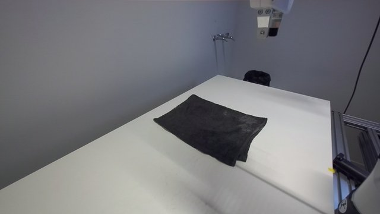
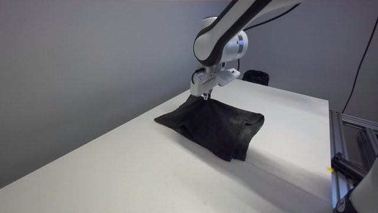
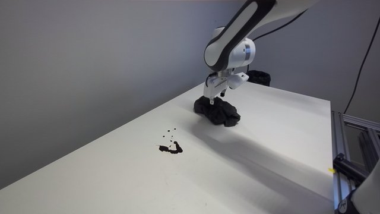
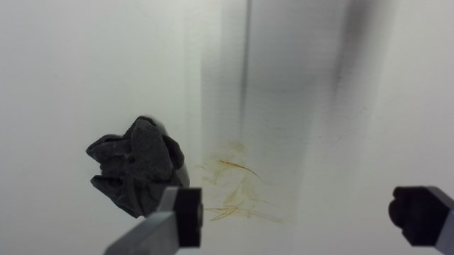

Trial 6 (start after the pour, end after one pass):
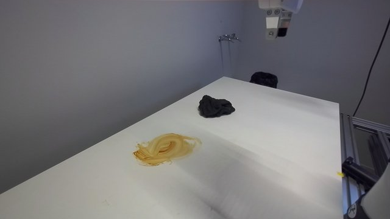
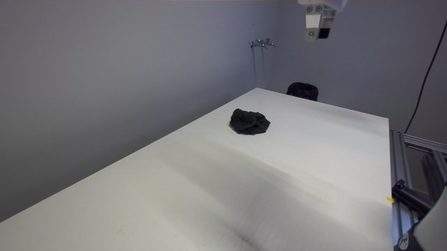

Trial 7b:
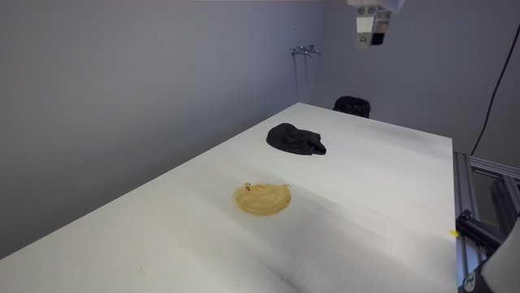
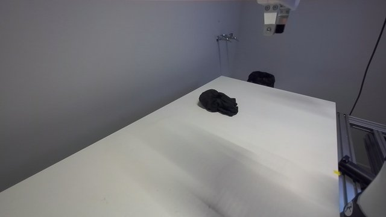

Trial 3 false clean and the 3b re-wipe (wrist camera), trial 5e corner by the left camera:
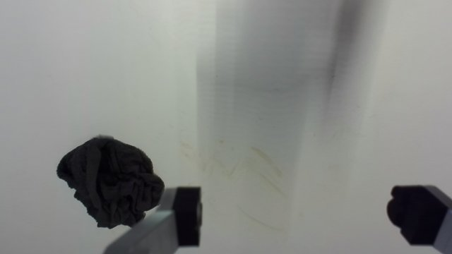
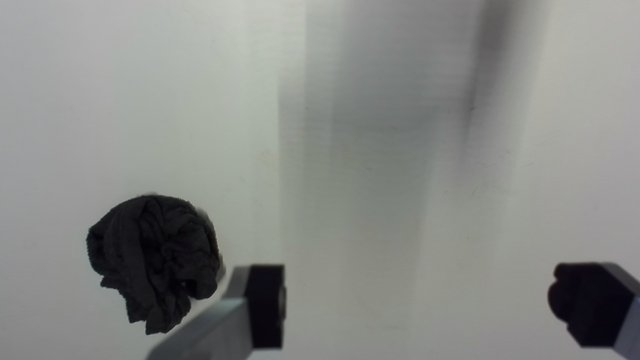
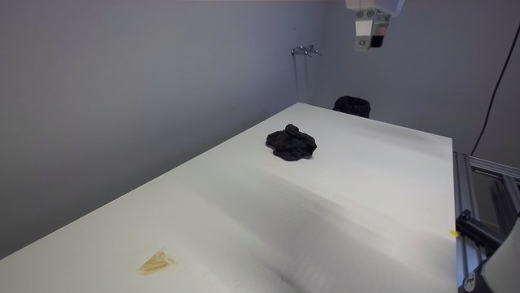
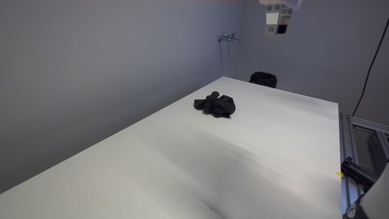
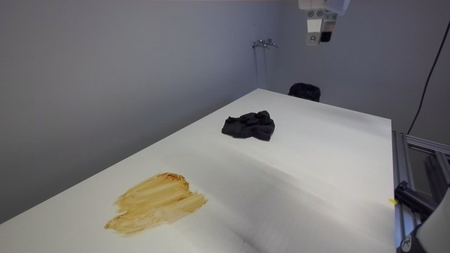

Paper variant (wet 2: start, pile, after the sweep with the missed scrap, final after supervised cleanup; wet 1 leftovers):
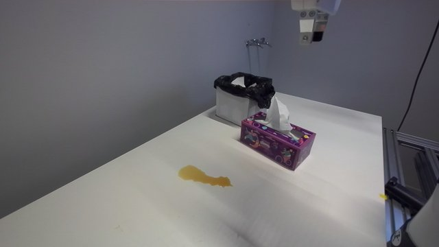
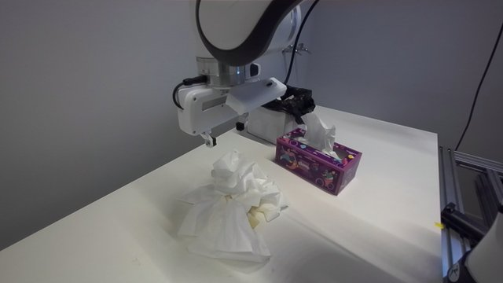
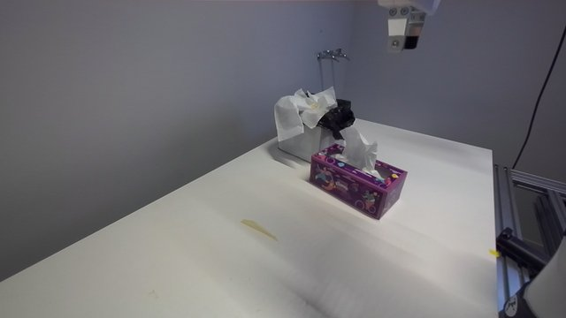
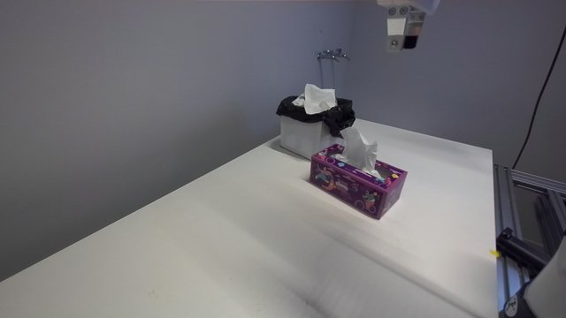
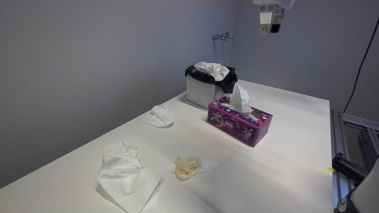
