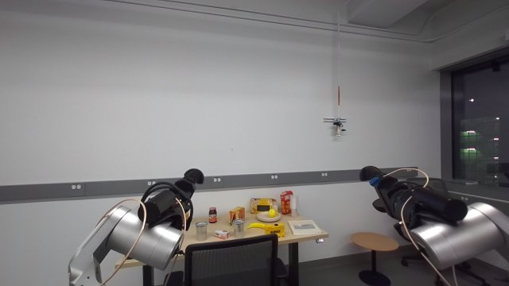
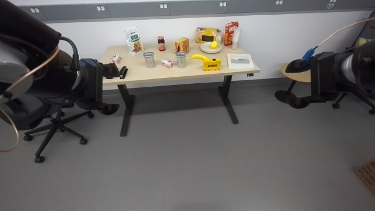
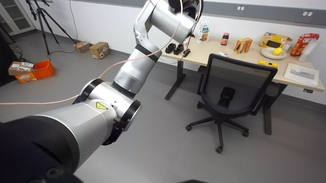
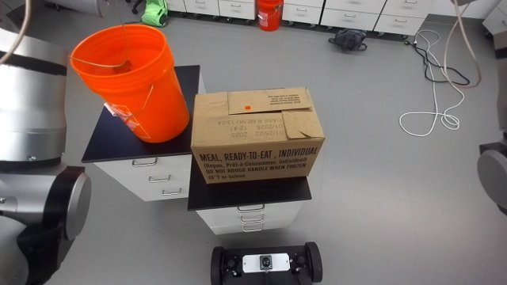
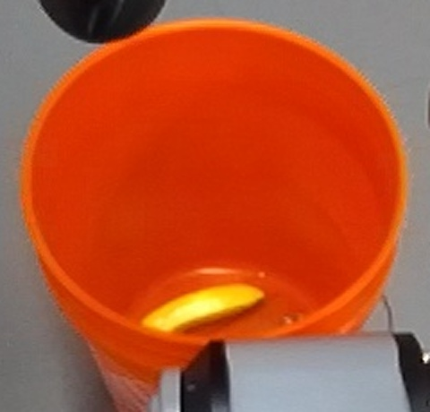
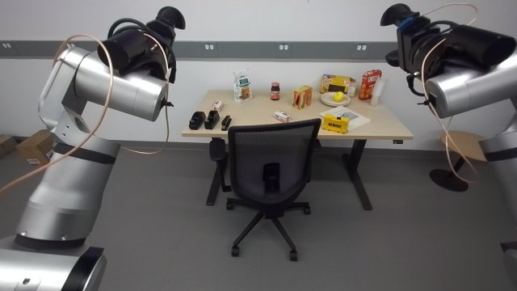
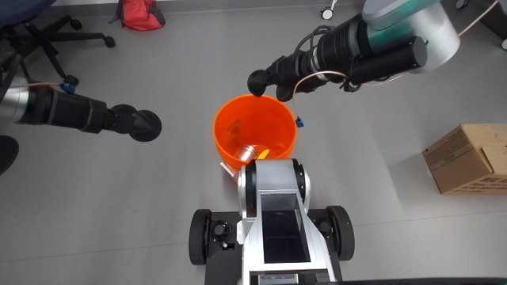
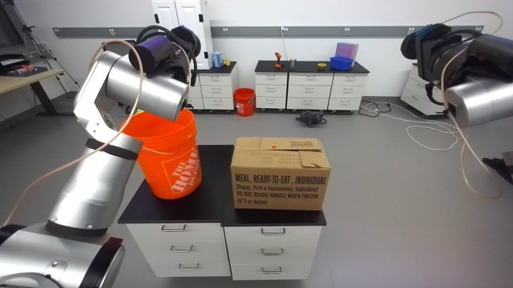
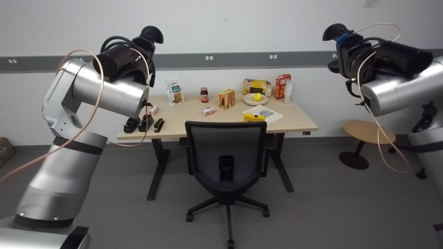

# Tidy: chair out, cups + banana into the basket, basket and box onto the cabinet, chair back

Session `20261010T011251Z_compositional_manipulation_aa1adf` (2026-10-09), task: "move the chair in front of you
out and park it to the left of the yellow table ... stack the two silver cups together and carry the stacked cups
and banana over to the orange basket to your right and place them in, and pick up the orange basket on to the
cabinet with dark top. Then ... move the chair back and tuck it to the table again. Finally ... pick up the box on
your right and put it also on the cabinet." All six conditions were met once, step by step with the agent at every
checkpoint (operator hints listed under Evidence). Operator rules for this composition: no brute-force searches
(the controller's optimal control instead), look at the images yourself instead of writing detection code, the
agent stays in the loop (no need for full automation).

## When to use

- A lab scene like the one in the evidence images: light-wood desk with an office chair tucked under it, two
  silver cups and a banana on the desk, an orange 5-gal bucket ("basket") and a ~0.4 m carton on the floor to the
  robot's right, a dark-top drawer cabinet (one or two units, top ~0.66-0.70 m) within a few metres, open floor.
- Start: robot ~2.5 m in front of the desk facing it, torso / arms `ready`.
- Not for: unattended runs (draft), cluttered floors (every base move needs a clear swept footprint), people in
  the work area.

## Preconditions

Each library skill checks its own (see their SKILL.md). Task level: armed, no fault; the round custom fingers
(open tips ~0.20 m); a fresh look at the whole scene before each subtask; before EVERY base move a swept-footprint
check (`run.py sweep_check`) against fresh depth and the furniture you identified in the image.

## Procedure

1. Chair out (office-chair-tuck): `find` -> `approach` -> `measure` -> `square` -> `grasp` (torso zero, both hands
   by optimal control, 4 cm deeper than the tips' middle) -> route with `run.py chair_route` (pull, relieved
   turns, drive; firm 0.4 A re-closes, grip-loss check) -> push to the wall left of the desk -> `release`.
2. Stack the cups (stack-cups): scan, pick one cup, align over the other, insert, release (the head look_at
   fallback clamps the pan when the target is too far sideways).
3. Cups + banana into the basket: pick the stacked cups (pinch 4 cm deep: both walls), pick the banana
   (elongated grasp), approach the basket (bucket 0.62 m ahead), torso posture by a tested joint move, then
   `run.py drop` per hand (closed-form pose: fingers pitched -0.7 rad, yaw from the shoulder; the cups needed torso
   `lowest` + lean 0.15 with the left hand), check the image, release.
4. Basket onto the cabinet (bimanual-bucket-rim-pnp): rim pinch with both hands, LIFT AT ONCE when a pinch loads
   a wrist (operator: "stand up fast to relieve"), place on the cabinet near an edge, leaving room for the box.
5. Chair back (office-chair-tuck): find, approach, measure, square, grasp, route back, `tuck` (push to bar-to-edge
   0.42 m), release.
6. Box onto the cabinet (bimanual-box-pnp floor_to_table): find_box -> approach x2 -> grasp + lift as one chain
   (no pause while squatted) -> carry route planned and sweep-checked by the agent -> look at the cabinet yourself,
   pick the free top, measure its edge from pixel depth -> `approach_table` with `edge_x` -> `place` -> retreat.

### Trial-2 rules (R2, 2026-10-10)

- Wheel odometry drifts (~0.45 m and ~0.3 rad over 90 min of turns): never route by odometry outlines made long ago.
  Before each base move, take a fresh frame, measure the furniture you will pass with pixel depth (desk edge ends,
  cabinet corners, chair bar / casters), build the polygons in the CURRENT base frame and `sweep_check` them; plan
  turn-drive-turn moves about the axle in closed form from those numbers (straight final legs; turns >= 0.6 m from
  furniture). Split the check per leg to tell the held object's own depth points (~20) from real obstacles.
- Hands: banana left / cups right when the banana lies on the left (operator). Carry with the torso at `ready`
  ("why don't you stand up": the wrists come off their limits, objects clear the desk). Release over the bucket by
  joint moves to the drop pose (`drop.drop_pose` + one IK solve + FK-sampled path), torso `mid` for the right hand,
  `lowest` for the left.
- Joint-space arm moves near a desk: sample the path with FK (fingertip height) or rise first - rby1_check does not
  see desk objects (a sweep pushed a book, a tool case and the cups).
- Box onto the cabinet next to the bucket: put the bucket at one END of the top (approach a short edge) and the box
  at the other end from the OTHER short edge (box short side inward).
- Home: go back to the start view (desk ~1.5 m ahead, the original heading offset), measured from the desk, not by
  odometry.

### Trial-3 rules (R3, 2026-10-10)

- Offline rehearsal before the episode (code/compose/t3_offline_plan.py in the session workspace): survey the scene
  with chest yaw + head pan (the cabinet stood directly BEHIND the start), pixel-depth map in the start frame, every
  leg sweep-checked offline. It found the tight spots (bucket turn by the cabinet corner) before the run.
- Base moves: ONE call at a time - a refused drive (over the 1 m cap) sent in parallel with the next turn let the
  turn run in the wrong place. Re-measure furniture on the way (the cabinet outline from odometry was 0.1-0.25 m
  off); turns with a held object need the axle >= 0.67 m from furniture (bucket / box swing ~0.6 m).
- Reach first, then the posture: cups centred 0.33 m ahead -> torso ready + 0.10 m back; banana -> fingers tilted
  along it; drops into the bucket by the R2 method (drop_pose pitch -0.7 + IK joint moves, mid / lowest).
- Box next to the bucket on a 0.9 m top: from the long side onto the free half when the far short edge is awkward.
- Home: drive to the start odometry, then correct from the desk (front 1.6 m, 0.16 rad right of its normal):
  odometry was 0.33 m short after 100 min.

## Code

`code/run.py:main(ctx, step, **args)` -> `{ok, measured, why}`:
- `sweep_check`: `moves` [[turn rad | drive m]], `frames` (depth frames; `frame_odom` {frame: odometry} when taken
  elsewhere), `obstacles` [[name, odometry polygon]], `extra` held-object box (x0, y0, x1, y1) in the base frame
  (chair: `chair_route.CHAIR_EXTRA`), `margin` 0.06. Turns pivot about the wheel axle 0.228 m ahead; the base
  footprint is bimanual-box-pnp's. ok = no polygon hit and <= 25 depth points in the swept area (look at what the
  points are: the robot's own arm / held object shows up as self points).
- `chair_route`: `moves` [[pull | turn | drive, value]] with the chair held.
- `drop`: `side`, `target` (held point at release, base frame), `hold` 0.20, `pitch` -0.7, `release`.
Modules: `sweep_check.py`, `scene_map.py` (depth frames -> odometry obstacle points, top-down render),
`chair_route.py`, `drop.py`. CLI: `python3 skill-library/skills/tidy-chair-cups-basket-box/code/run.py <step>
'<json args>'`.

**Hyper-parameters** are in one list, `code/tidy_chair_cups_basket_box/params.py`; the modules import them from there. They moved there unchanged on 2026-10-15: every value was compared before and after with each module imported offline, and no behaviour changed. The steps' own hyper-parameters are in the skills it uses. The modules are the package `code/tidy_chair_cups_basket_box/` (moved there on 2026-10-15; only the imports changed: the modules import each other relatively): import it as `tidy_chair_cups_basket_box` with `code/` on `sys.path`, or run a module from the workspace root with `PYTHONPATH=<skill>/code python -m tidy_chair_cups_basket_box.<module>`. Its `__init__.py` puts the code of the skills it imports (office-chair-tuck, oc-hand-reach, bimanual-box-pnp) on `sys.path`, so modules import them as packages too.

## Checks

- Chair parked: image shows it against the wall left of the desk, not touching the desk; tucked: armrests at /
  under the desk edge, centred, square (office-chair-tuck verify).
- Cups nested: one inside the other (stack-cups depth + image).
- In the basket: the stream at the release shows each object falling inside the rim.
- Basket / box on the cabinet: upright, fully on a dark top, grippers clear (image + touchdown force).

### Perception checkpoints

| Step | Subagent model | Frames | Question | Expected answer | Pass if | On fail |
|---|---|---|---|---|---|---|
| before every base move | agent (you) | fresh head views along the swept area (torso yaw / head pan for the rear) | Is the floor clear where the base (rear r 0.63 m about the axle) and the held object sweep? Which furniture is near? | clear / what + where | clear and sweep_check ok | replan (smaller turn, reverse <= 0.3 m on the known path) |
| chair grasp | agent / haiku | grasp frame | Are both grippers closed around the whole top bar (widths 15-35 mm)? | yes / no | yes | open, back out, measure, retry |
| drop | agent | image before opening | Is the held object over the basket opening, below the rim height clearance, not touching the rim? | yes / no | yes | adjust the target by a few cm, re-check |
| cabinet top choice | agent (you) | view of the cabinet | Which dark top is free and large enough, from which side can the robot reach it without the arm passing over the basket? | top + side + pixel points | free top found | look from another side |
| box place | agent | frame after release | Box upright fully on the top, grippers clear? | yes / no | yes | re-grasp from the table (bimanual-box-pnp table grasp) |

## Failure modes

1. Chair lost in a turn with soft grips; fingers biting only the bar's edge; grasp at torso `ready`; seed-search
   IK flipping a shoulder: see office-chair-tuck v3 (all fixed there).
2. Base rear hit the cabinet during a hand-planned 151 deg turn (operator): the front-only check missed it ->
   `sweep_check` of the whole footprint before every base move. The cabinet units were pushed into an L; the box
   then went on the free unit, approached from its free side.
3. Interrupted cup alignment re-localized the held cup as the target: keep the pre-pick scan fix (stack-cups).
4. Bucket pinch overload: small corrective moves did not help; lifting at once did (bucket skill).
5. Cabinet perception by depth clustering / extra Gemini masks merged two units and wasted calls (operator: "just
   look at it yourself"): read the image, query a few pixels for depth, decide.
6. Box skill edge from the wrong (farther) cabinet when the held box hides the near top: pass `edge_x`.
7. R2: optimal-control moves from far-from-natural postures stopped on wrist torque / limits three times (cups
   pre-grasp, chair release, bucket drop) -> joint moves for big reorientations (oc-hand-reach failure mode 5).
8. R2: the right arm's joint move from its side pose to a cup pre-grasp swept desk objects (operator "stop", "lift
   first") -> stack-cups v3 rise-first + dip check; re-grasp by Cartesian moves only.
9. R2: curved banana: a grasp on the chord between its ends put a finger on its edge (60 N backend stop) -> grasp at
   the measured middle with the local tangent, descend in 1 cm steps with a 6 N stop.
10. R2: chair `find` picked another chair, `find_cabinet` could not see the cabinet behind: locate by eye + pixel
   depth and write the world entries / plan the route yourself.

## Evidence

| Run | Date | Session | Outcome | Unattended | Conditions |
|---|---|---|---|---|---|
| R1 | 2026-10-09 | compositional_manipulation | success (all 6 conditions) | no | step by step with the agent; operator hints: deeper grasp, firm grip, natural arms, stand up fast, base crash warning, "just grasp it", "look at it yourself" |
| D1 | 2026-10-09 | same | success (drop pose only, free air, no release) | yes | `run.py drop` right hand target (0.62, -0.12, 0.92): 3 calls, 23 s, 2.3 mm |
| R2 | 2026-10-10 | same | success (all 6 conditions) | no | trial 2 after an operator reset, step by step; operator: stop / lift first (desk sweep), banana left + cups right, stand up, ears fine, just try lift it, home |
| R3 | 2026-10-10 | same | success (all 6 conditions, 98 min) | no | trial 3 after an offline rehearsal; operator: check torso/height vs previous skills, align precisely, check previous approaches (drops), just move to the cabinet, do not cut into the cabinet, use the park pose; 2 MinorFaults (re-armed by the operator) |

